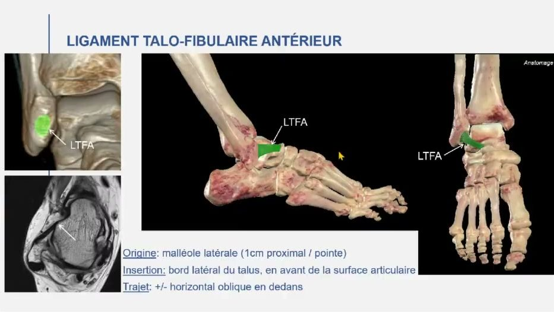
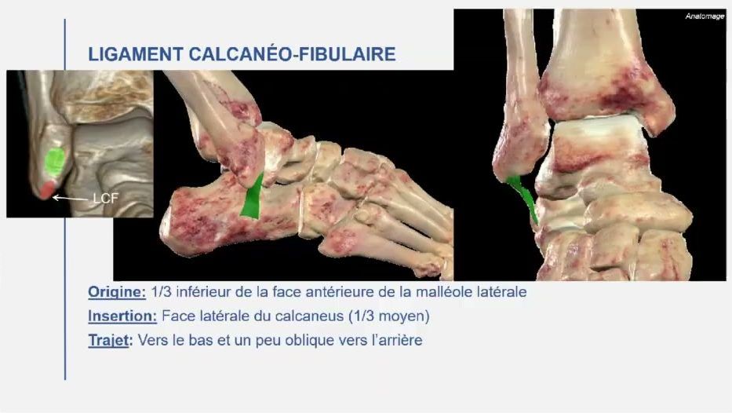
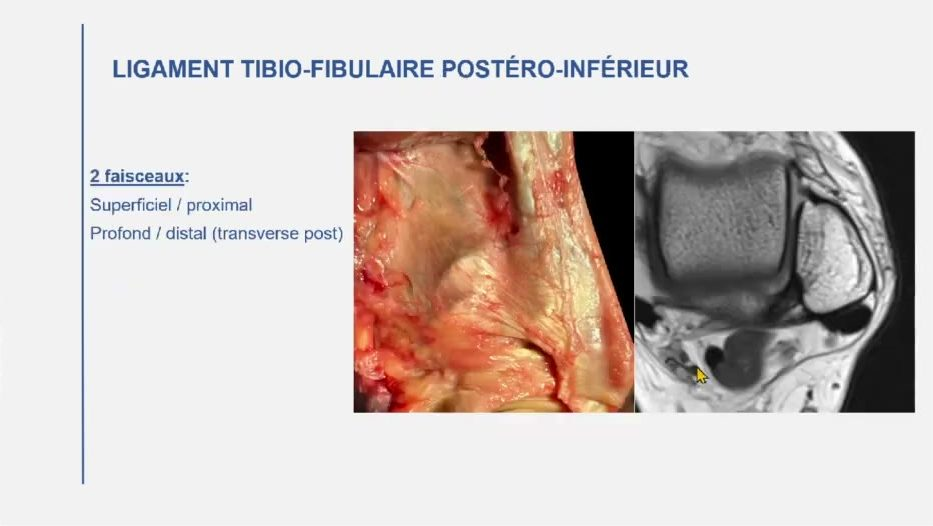

# Anatomie ligamentaire de la cheville

> [!abstract] L'essentiel
> **Connaître insertions et orientation de chaque faisceau pour localiser la lésion** : LTFA bande large horizontale, LCF vertical tendu en dorsiflexion, LCM profond tibio-talien postérieur puissant.

> [!success] À retenir
> 1. **LTFA** : malléole latérale **≈ 1 cm au-dessus de la pointe** → bord latéral du talus ; bande de **6-10 mm**, **1 à 3 faisceaux** (multifasciculaire ≠ lésion partielle).
> 2. **LCF** : tiers inférieur de la face antérieure de la malléole → face latérale du calcanéus, plancher de la gaine des fibulaires ; à analyser **en dorsiflexion** ; continuité avec le faisceau distal du LTFA.
> 3. Syndesmose : **LTFAI** oblique en bas et en dehors (faisceau de **Bassett** → conflit antérolatéral), **LTFPI** à 2 faisceaux (superficiel, profond = transverse postérieur).

## Images clés
 [▶ 3:12](https://www.youtube.com/watch?v=pLx7k99BAO4&t=192s)
 [▶ 5:04](https://www.youtube.com/watch?v=pLx7k99BAO4&t=304s)
 [▶ 9:44](https://www.youtube.com/watch?v=pLx7k99BAO4&t=584s)

## Points clés
- Terminologie : articulation talo-crurale (terminologie internationale) ou tibio-tarsienne (nomenclature française) ; un seul degré de liberté (flexion-extension), complété par la sous-talienne et la transverse du tarse (Chopart).
- Bras de levier antérieur bien supérieur au postérieur → lésions concentrées en avant.
- Stabilisation : osseuse (trochléenne : mortaise tibio-fibulaire concave / trochlée talienne convexe), ligamentaire (contrôle du varus-valgus), musculaire (triceps sural puissant limitant l'extension ; extenseurs faibles → stabilisation en flexion surtout ligamentaire).
- **LTFA** : du tiers moyen de la malléole latérale (~1 cm au-dessus de l'apex) au relief de la marge antérieure de la surface articulaire talienne ; horizontal de profil (axe du pied), oblique en dedans de face ; bande large de 6 à 10 mm, 1 à 3 faisceaux (proximal souvent plus volumineux), nombre non corrélé à la largeur ni à la biomécanique ; explique les lésions partielles.
- **LCF** : du tiers inférieur de la face antérieure de la malléole latérale (près de la pointe) vers le tiers moyen de la face latérale du calcanéus, vertical ou légèrement postérieur ; tendu en extension (dorsiflexion) ; épaississement en corde du plancher de la gouttière fibreuse des fibulaires ; continuité fibreuse/capsulaire avec le faisceau distal du LTFA (extension de signes lésionnels de l'un à l'autre).
- **LTFP** : de la fossette malléolaire postérieure au bord postérieur du talus, transversal ; rarement lésé.
- **Ligament collatéral médial** : origine malléolaire courte, insertion distale étendue ; plan superficiel en continuité (tibio-talien antérieur, tibio-naviculaire étendu au spring ligament, tibio-calcanéen vers le sustentaculum tali) ; plan profond tibio-talien postérieur très épais et puissant.
- **Syndesmose** : mobilité faible mais non nulle, l'élasticité ligamentaire augmentant la résistance mécanique. LTFAI du tiers latéral du bord antérieur du pilon tibial vers la malléole latérale, oblique en bas et en dehors ; faisceau accessoire distal (ligament de Bassett) pouvant entrer en conflit avec le dôme talien. LTFPI à deux plans (superficiel/proximal et profond), le profond rejoignant un épaississement méniscoïde complétant le rebord postérieur du pilon. Membrane interosseuse.

## Sémiologie et technique d'imagerie
- Explorer le LCF en dorsiflexion (mise en tension).
- Penser au LTFA comme une bande large, souvent bi-fasciculaire, et non une corde.

## Pièges et diagnostics différentiels
- Faisceaux multiples du LTFA ≠ lésion partielle.
- Anomalie du LCF associée à une lésion du LTFA par continuité anatomique.

> [!WARNING] À ne pas manquer
> Le ligament de Bassett peut être source de conflit antérolatéral avec le dôme talien.

> [!TIP] Pour le compte rendu
> Décrire chaque faisceau avec sa terminologie (LTFA proximal/distal, LCF, LTFP, plans superficiel et profond du LCM, LTFAI, LTFPI, membrane interosseuse).

## Liens
- Congrès : [[SIMS 2024 - Index]]
- Voir aussi : [[Imagerie des ligaments de la cheville]], [[Entorses latérales de cheville - traitement médical et chirurgical]]
