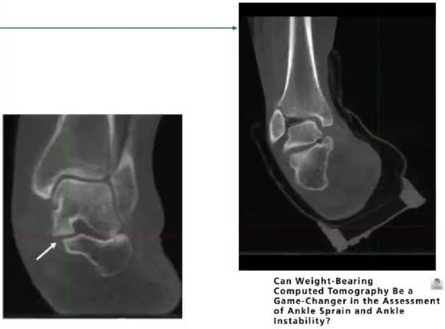
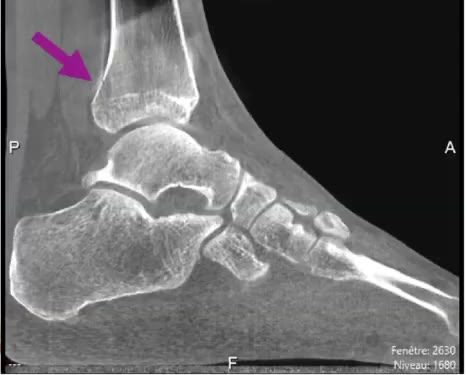

# Apports du cone beam en charge dans le pied et la cheville

> [!abstract] L'essentiel
> **Le cone beam en charge est une radiographie 3D isotrope à dose de radio standard** : il a vocation à remplacer la radio 2D en première ligne, y compris aux urgences.

> [!success] À retenir
> 1. Résolution **0,25-0,37 mm**, acquisition **≈ 30 s**, dose ≈ bilan radiographique ; os oui, parties molles non (IRM/écho restent nécessaires).
> 2. **Pied plat** : seule imagerie montrant la **subluxation péritalienne** (facette médiale sous-talienne) et les conflits sinusien/sous-fibulaire en charge → à écrire dans le CR.
> 3. Traumatologie : CBCT d'emblée = **−25 % de temps** aux urgences et **−50 % d'irradiation** vs radio puis scanner ; seuils 3D ≠ seuils 2D.

## Images clés
 [▶ 4:52](https://www.youtube.com/watch?v=-TzkhSZEkxc&t=292s)
 [▶ 8:09](https://www.youtube.com/watch?v=-TzkhSZEkxc&t=489s)

## Points clés
- Évolution comparable au dentaire (CBCT fin des années 1990, essor dans les années 2000).
- **Principe** : imagerie volumétrique isotrope (pas une tomographie), « clone digital fonctionnel » du pied en charge ; acquisition de ~30 s, toutes les incidences générées en une passe.
- **Dose** : équivalente à un bilan radiographique standard (environ deux radiographies et demie selon l'orateur).
- Premier appareil dédié au pied en 2012 ; champ jusqu'à 40 cm (deux pieds en une passe) ; **résolution spatiale 0,25 à 0,37 mm** ; résolution en densité inférieure au scanner (indications osseuses, pas parties molles).
- Contraintes : plombage, coût 150 000 à 500 000 € selon l'extension (hanches, bientôt rachis), réseau, stockage, PACS nécessaire mais insuffisant (accès direct en consultation).
- **Modèle économique** : rester sur des indications de niche ne fonctionne pas ; usage en **premier recours**, en remplacement de la radiographie 2D.
- **Applications** :
  - **Pied plat** : la conférence de consensus internationale place le CBCT au cœur de la décision ; seule imagerie montrant la **subluxation péritalienne** (signe de subluxation de la facette médiale).
  - **Hallux valgus** : pronation/torsion du premier rayon, subluxation sésamoïdienne ; le cliché de Guntz n'est pas un vrai cliché en charge fonctionnel.
  - Post-traumatique : cal vicieux du col du talus mesuré en comparatif, détection du plan de fracture, *matching* controlatéral, calcul du greffon.
  - Acquisition statique ou en stress (varus) pour l'instabilité ; cartilage visible en jouant sur le contraste.
- **Post-traitement** : algorithmes de réduction des artefacts métalliques et de mouvement (tibia) ; mesures manuelles = retour à la 2D ; biométrie 3D semi-automatique (*Foot and Ankle Offset*) ; segmentation désormais **automatique par IA** (Martinus Richter : mesures validées sur ~2500 mesures et > 500 patients, en 1/45e du temps manuel) ; *distance mapping*, couvertures articulaires, syndesmose.
- Applications chirurgicales : guides de coupe sur mesure (prothèse de cheville), robotique, semelles, éléments finis ; perspectives : hanche, poignet, rachis, densitométrie, suivi du descellement prothétique.
- **Traumatologie** : étude citée d'Anne Cotten : 25 % de temps en moins aux urgences et 50 % d'irradiation en moins avec une séquence CBCT d'emblée plutôt que radiographie puis scanner.

## Sémiologie et technique d'imagerie
- Les mesures en charge 3D diffèrent des mesures 2D : ne pas transposer les seuils sans validation.

## Pièges et diagnostics différentiels
- Faible contraste des parties molles : ne remplace pas IRM ou échographie.

> [!WARNING] À ne pas manquer
> Message politique de l'orateur : les industriels investissent le CBCT comme « matière première » de la planification des implants ; les radiologues doivent en garder la maîtrise. Lettre commune FNMR, SOFCOT et urgentistes mentionnée.

> [!TIP] Pour le compte rendu
> Dans le pied plat, mentionner explicitement la présence ou l'absence de subluxation péritalienne et de conflit sinusien ou sous-fibulaire en charge.

## Liens
- Congrès : [[SIMS 2024 - Index]]
- Voir aussi : [[Les mesures 2D, comment et pourquoi, leurs limites]], [[Pied plat - éléments cliniques et paracliniques orientant le geste chirurgical]]
