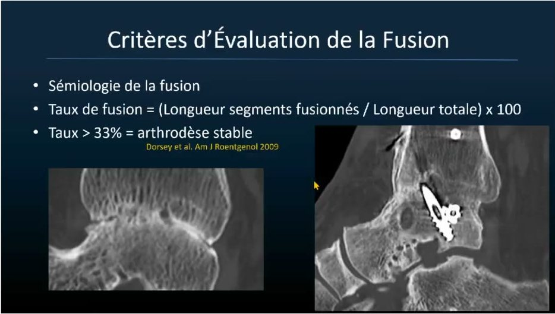
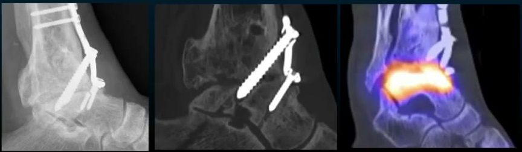

# Arthrodèses de la cheville et de l'arrière-pied

> [!abstract] L'essentiel
> **Arthrodèse de cheville / arrière-pied : la fusion se juge au scanner, stable si > 1/3 de l'interligne est ponté** ; le matériel ne compte jamais.

> [!success] À retenir
> 1. **Taux de fusion** = longueur fusionnée / longueur totale de l'interligne ; **> 33 % = arthrodèse stable** (Dorsey, AJR 2009) ; en pratique estimation subjective dans les **3 plans**.
> 2. Défaut de fusion : **tabac (> 2 paquets/j), âge > 60 ans**, arthrodèses étendues ; chercher liserés autour des vis, fracture/débricolage de matériel (TDM, fenêtres larges **1000/9000 UH**, réduction d'artefacts).
> 3. Arthrose adjacente : faible corrélation radio-clinique → ne retenir que les signes d'**évolutivité** (œdème IRM, hyperfixation SPECT-CT, aggravation de la déformation).

## Images clés
 [▶ 5:33](https://www.youtube.com/watch?v=zH8f2QSBW04&t=333s)
 [▶ 8:30](https://www.youtube.com/watch?v=zH8f2QSBW04&t=510s)

## Points clés
- **Cas d'ouverture** : patient diabétique dont la déformation du pied s'aggrave sur plusieurs années (perte de l'arche plantaire, mal perforant plantaire, ostéite) jusqu'à l'amputation ; l'arthrodèse vise à interrompre cette cascade en corrigeant la déformation.
- Objectif : restaurer l'alignement ; taux de fusion élevé, procédure réalisable chez des patients fragiles.
- **Conséquences biomécaniques** : perte de mobilité, redistribution des forces avec migration de l'appui vers l'avant-pied et mise en contrainte des articulations adjacentes et des parties molles, d'autant plus que le nombre d'articulations fusionnées est élevé.
- **Bilan préopératoire** : radiographies en charge (axes, arche plantaire ; cliché de Méary ou *long axial view*) ; scanner ou CBCT pour les déformations complexes ; IRM ou échographie pour les tendons et ligaments (ex. rupture du tibial postérieur, atteinte du spring ligament).
- **Gestes associés possibles** : par exemple transfert antérieur du tendon tibial postérieur (gouttière rétromalléolaire vide).
- **Défaut de fusion** : facteurs de risque = tabagisme (> 2 paquets/jour), âge > 60 ans, arthrodèses étendues ; mécanismes = micromobilité et troubles de perfusion. Le matériel seul ne maintient pas l'articulation.

## Sémiologie et technique d'imagerie
- **Scanner** : mieux corrélé à la clinique que la radiographie pour le taux de fusion ; utiliser les techniques de **réduction des artefacts métalliques** ; la haute résolution montre mieux les ponts osseux.
- **Critères de fusion** : ponts osseux traversant l'interligne et ossification de l'interligne.
- **Évaluation quantitative** (littérature) : longueur fusionnée / longueur totale de l'interligne ; arthrodèse stable si **> 33 %** (Dorsey, AJR 2009), bien corrélée à la clinique. Le matériel ne compte pas dans la mesure. Méthode très chronophage (plus de 30 images par cheville, 50-60 en haute résolution).
- En pratique, l'orateur recommande une **analyse subjective dans les trois plans** en visant un tiers de surface fusionnée.
- **Démontage / fracture de matériel** : bombement de plaque, fracture de vis à la radiographie ; liserés de décollement autour des vis au scanner (fenêtres larges, 1000/9000 UH) ; scintigraphie : hyperfixation de l'interligne non consolidé.
- Échographie, IRM, scintigraphie : œdème, remodelage, parties molles.

## Pièges et diagnostics différentiels
- Interligne natif difficile à identifier en cas de distorsion anatomique, greffe, ostéonécrose, ciment : calcul quantitatif peu réalisable.
- **Arthropathie dégénérative adjacente** : faible corrélation radioclinique, ne pas la considérer systématiquement comme cause d'échec ; rechercher des signes d'évolutivité (œdème IRM, hyperfixation, aggravation de la déformation), mieux corrélés aux symptômes.

> [!WARNING] À ne pas manquer
> Un matériel en place ne garantit pas la fusion : ne jamais compter le matériel dans l'évaluation du taux de fusion.

> [!TIP] Pour le compte rendu
> Préciser, par articulation, la présence de ponts osseux et une estimation de la surface fusionnée (cible : ≥ 1/3), l'état du matériel, les signes d'évolutivité des articulations adjacentes.

## Liens
- Congrès : [[SIMS 2024 - Index]]
- Voir aussi : [[Arthrodèses et prothèses de cheville - indications, techniques chirurgicales]], [[Ostéoarthropathie neurogène du pied diabétique]]
