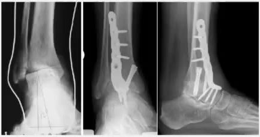
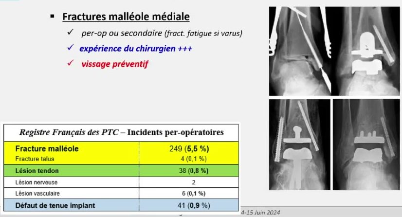

# Arthrodèses et prothèses de cheville - indications, techniques chirurgicales

> [!abstract] L'essentiel
> **Arthrodèse ou prothèse de cheville : le choix dépend des déformations, de la perte de substance et des articulations voisines** ; c'est ce que le CR doit décrire.

> [!success] À retenir
> 1. Arthrodèse : **in situ** (cheville axée, arthroscopie), **de réaxation** (tilt, déformation) ou **de reconstruction** (perte de substance) ; position cible **pied à 90°**, **léger valgus** (équin et varus très mal tolérés).
> 2. Prothèse : classer l'arthrose (**COFAS 1 à 4**), gestes associés dans **> 50 %** ; planification sur **scanner en charge jusqu'au genou** ; CI absolues : **infection**, **neuro-arthropathie**.
> 3. Complication n°1 : **fracture de la malléole médiale** (**5,5 %** au registre français), per-op ou de fatigue si varus ; survie à 10 ans **75-85 %**.

## Images clés
 [▶ 3:13](https://www.youtube.com/watch?v=Koj61vlf9v0&t=193s)
 [▶ 10:28](https://www.youtube.com/watch?v=Koj61vlf9v0&t=628s)

## Points clés
- Distinguer, dans l'arthrose « post-traumatique », les formes **post-fracturaires** et celles **sur instabilité** (de plus en plus fréquentes, présentation différente).
- **Traitement conservateur d'abord** : infiltrations de corticoïdes pour les poussées ; pas de preuve pour l'acide hyaluronique ni le PRP ; peu de place pour le débridement arthroscopique ; ostéotomies correctrices chez le jeune avec déformation ; distraction ou allogreffes massives discutées.
- **Activité de niche** en France : < 2000 arthrodèses/an, ~600 prothèses/an (vs 175 000 PTH, 130 000 PTG, 21 000 prothèses d'épaule).
- Revues : meilleurs PROMs à court terme pour la prothèse, mais moins de complications et de révisions pour l'arthrodèse. Seul essai randomisé (multicentrique, Royaume-Uni) : équivalence fonctionnelle à 1 an, légère supériorité des prothèses à **patin fixe**.
- **Arthrodèse** : historiquement à ciel ouvert, arthroscopique depuis les années 1980 (taux de fusion ~90 %, moins de complications). Mobilité compensatrice du médiopied ; dégradation constante de la subtalaire à 10 ans, mal corrélée à la clinique.
- Trois types : **in situ** (cheville axée, idéal sous arthroscopie, en concurrence avec la prothèse), **de réaxation** (déformations extra- ou intra-articulaires, tilt, décompensation de pied plat/creux ; gestes associés), **de reconstruction** (pertes de substance : reprises de prothèse, nécrose post-traumatique du talus ; autogreffe, allogreffe, cages, implants sur mesure en titane).
- **Position** : pied à 90° de profil (équin très mal toléré), talus centré en léger **valgus** (varus très mal toléré).
- **Ostéosynthèse** : vis (3 en général, indispensables sous arthroscopie) ; plaques verrouillées + vis (plus rigides, appui plus précoce, moins de pseudarthroses) ; clou rétrograde réservé à l'arthrodèse **tibiotalocalcanéenne** ; montages clou + plaque dans le pied de Charcot diabétique.
- **Prothèse** : 1re génération en France dans les années 1970 ; échecs des 2es générations cimentées à deux composants ; renouveau avec patin mobile non cimenté ; depuis 2010 retour au **patin fixe** (deux composants). Survie dans les registres passée de ~75 % à ~85 %, révisions encore élevées.
- **Contre-indications absolues** : infection aiguë, ostéoarthropathie neurogène, nécroses étendues, pathologie neurologique avec déficit moteur.
- **Facteurs pronostiques** : âge (> 50 ans meilleur), surtout **expérience du chirurgien** (> 10, voire > 20 poses/an recommandées).
- **Classification COFAS** : type 1 arthrose isolée ; 2 varus/valgus avec tilt intra-articulaire ; 3 déformations sus- ou sous-jacentes ; 4 arthroses multiples (cheville, arrière-pied, médiopied).
- Voie antérieure (antéromédiale ± latérale) ; mini-abord postéromédial pour protéger le pédicule tibial postérieur. Guides de coupe sur mesure planifiés sur **scanner en charge** remontant au genou. Gestes associés dans **plus de la moitié** des cas.
- Complication peropératoire n°1 : **fracture de la malléole médiale** (6 à 8 % selon l'orateur, 5,5 % dans le registre français des PTC), peropératoire ou secondaire (fracture de fatigue si varus) ; vissage préventif si ostéoporose. Cimenter en l'absence de stabilité primaire.

## Sémiologie et technique d'imagerie
- Bilan de planification : scanner/CBCT en charge incluant le genou pour les guides sur mesure.

## Pièges et diagnostics différentiels
- Arthrodèse : positionnement en équin ou varus, pseudarthrose (risque élevé en reconstruction).

> [!WARNING] À ne pas manquer
> Contre-indication absolue à la prothèse en cas d'ostéoarthropathie neurogène ou d'infection aiguë. L'orateur alerte sur l'avenir de la prothèse en France (tarif le plus bas d'Europe, implants de révision et guides non remboursés, une seule prothèse remboursée fin 2024).

> [!TIP] Pour le compte rendu
> Classer l'arthrose (type COFAS), décrire déformations sus- et sous-jacentes, perte de substance osseuse et état des articulations adjacentes : ils orientent vers arthrodèse in situ, de réaxation ou de reconstruction, ou vers une prothèse avec gestes associés.

## Liens
- Congrès : [[SIMS 2024 - Index]]
- Voir aussi : [[Prothèse de cheville - imagerie normale et des complications]], [[Arthrodèses de la cheville et de l'arrière-pied]], [[Arthropathies mécaniques de la cheville - étiologie et imagerie]]
