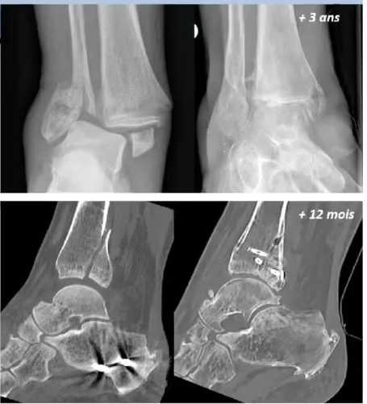
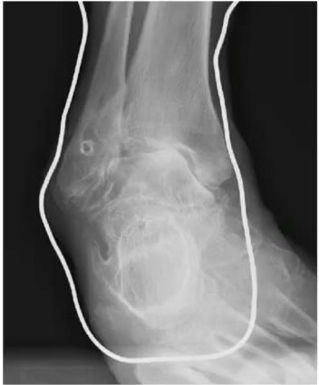
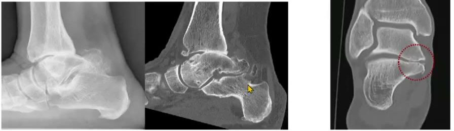

# Arthropathies mécaniques de la cheville - étiologie et imagerie

> [!abstract] L'essentiel
> **L'arthrose de cheville est post-traumatique dans 80 à 90 % des cas** : radiographies en charge en première intention, IRM pour l'infraradiologique et les ligaments, scanner pour la subtalaire et la planification.

> [!success] À retenir
> 1. Arthrose primitive = **10 %** des arthroses talocrurales (vs 70 % genou, 60 % hanche) : chercher un **trouble statique** du pied ; les **fractures du pilon tibial** fournissent **1/3** des arthrodèses talocrurales.
> 2. Sur la face en charge : **cerclage de Méary** (axe de l'arrière-pied) et **talar tilt**, normal **< 2°** ; son apparition signe l'évolution.
> 3. **Scanner** = référence pour la **subtalaire** (pas de superposition) et la planification ; CBCT en charge prometteur mais non validé et **non coté en France**.

## Images clés
 [▶ 3:25](https://www.youtube.com/watch?v=7fKqRwyc2OE&t=205s)
 [▶ 5:35](https://www.youtube.com/watch?v=7fKqRwyc2OE&t=335s)
 [▶ 7:24](https://www.youtube.com/watch?v=7fKqRwyc2OE&t=444s)

## Points clés
- **Biomécanique** : talus solidement ancré dans la mortaise tibiofibulaire, surfaces très congruentes, stabilité osseuse renforcée par les stabilisateurs tendineux et ligamentaires ; talocrurale = flexion dorsale/plantaire. La subtalaire (complexe talocalcanéonaviculaire), en deux parties (antéromédiale et postérieure) séparées par le sinus du tarse, assure inversion/éversion.
- **Épidémiologie** : arthrose de cheville **10 fois moins fréquente** que celle du genou. Arthrose primitive : **10 %** des arthroses talocrurales (vs 70 % au genou, 60 % à la hanche), encore moins en subtalaire.
- Explications : congruence, amplitudes limitées, peu de cisaillement, répartition favorable de la charge en appui unipodal, cartilage plus résistant à la compression. Les formes primitives sont favorisées par des **troubles statiques du pied**.
- **Post-traumatique : 80 à 90 %** des arthroses talocrurales, davantage en subtalaire. Mécanismes : lésion cartilagineuse initiale irréversible, perte de congruence, cal vicieux, instabilité chronique, synovite/inflammation post-traumatique persistante.
- **Traumatismes en cause** : talocrurale → fractures malléolaires (surtout avec atteinte de la syndesmose), **fractures du pilon tibial** (1/3 des arthrodèses talocrurales), fractures et luxations du talus, instabilité chronique post-entorse (microtraumatique). Subtalaire → fractures articulaires du talus et du calcanéus, luxations péritaliennes, instabilité.
- **Secondaires non traumatiques** (rares) : polyarthrite rhumatoïde vieillie, hémophilie, séquelles d'arthrite septique.

## Sémiologie et technique d'imagerie
- **Radiographies en charge** (face, profil, face en rotation interne pour dégager l'interligne talofibulaire) : examen de première intention et de suivi ; signes cardinaux d'arthrose.
- Cliché de **Méary** (cerclage) : recherche d'un trouble statique de l'arrière-pied à prendre en charge.
- **Talar tilt** (bascule du talus entre plafond du dôme et plafond de la mortaise) : normalement **< 2°** ; son apparition marque une évolution de la maladie.
- **IRM** (2e intention) : arthrose infraradiologique (amincissements chondraux), stabilisateurs tendinoligamentaires, œdème, conflits ; tenir compte du matériel d'ostéosynthèse.
- **Scanner** : analyse 3D des surfaces et du pincement, idéal pour la subtalaire et la planification.
- **Arthroscanner** : si contre-indication à l'IRM, doute sur le cartilage en IRM, recherche de corps étrangers ; invasif.
- **CBCT en charge** : couple scanner et charge ; limites : mesures à valider, mauvais contraste des parties molles, champ limité, absence de cotation en France (selon l'orateur).

## Pièges et diagnostics différentiels
- Superpositions radiographiques gênantes pour la subtalaire (incidences spécifiques possibles, mais l'imagerie en coupe est préférée).

> [!WARNING] À ne pas manquer
> Rechercher et décrire tout trouble statique de l'arrière-pied et tout talar tilt : ils conditionnent le traitement (ostéotomie, arthrodèse, prothèse).

> [!TIP] Pour le compte rendu
> Préciser l'étiologie probable (séquelle de fracture, instabilité), l'atteinte talocrurale et/ou subtalaire, l'axe de l'arrière-pied et le talar tilt.

## Liens
- Congrès : [[SIMS 2024 - Index]]
- Voir aussi : [[Arthrodèses et prothèses de cheville - indications, techniques chirurgicales]], [[Le complexe talocalcanéonaviculaire, le sinus du tarse et le ligament frondiforme]]
