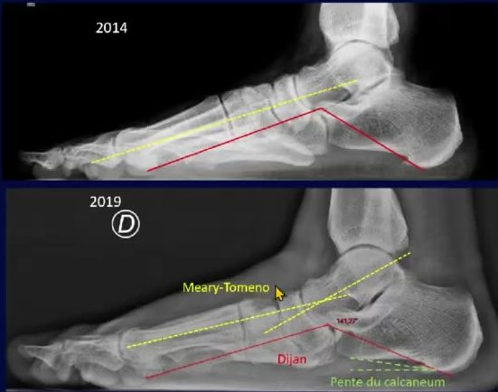
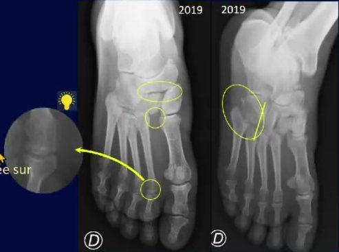
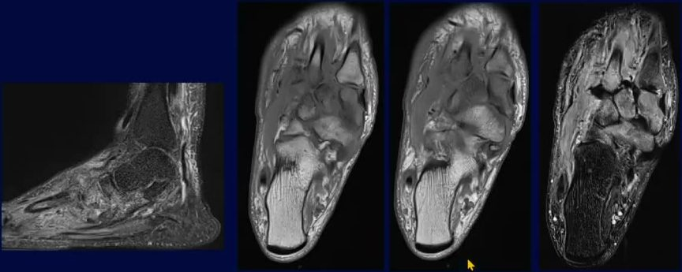

# Cas clinique 1 - Ostéoarthropathie nerveuse diabétique révélatrice d'un diabète

> [!abstract] L'essentiel
> **Arthropathie destructrice peu douloureuse du médiopied + pied plat acquis + Lisfranc = pied de Charcot jusqu'à preuve du contraire** → doser glycémie/HbA1c, même sans diabète connu.

> [!success] À retenir
> 1. Radio en charge : **destruction, fragmentation, désaxation** avec interlignes longtemps conservés ; comparer aux clichés antérieurs (cassure de **Méary**, angle de **Djian** ↑ = pied plat **acquis**).
> 2. Chercher **diastasis M1-M2** (luxation de Lisfranc) et **fracture sous-chondrale de la tête de M2** ; médiacalcose artérielle en écho = indice.
> 3. IRM : œdème polyostotique **périarticulaire**, sans hyposignal T1 franc, collection, sinus ni *ghost sign* → **pas d'ostéomyélite** ; ici HbA1c **11,8 %**.

## Images clés
 [▶ 2:06](https://www.youtube.com/watch?v=89FkFUyPcfc&t=126s)
 [▶ 3:02](https://www.youtube.com/watch?v=89FkFUyPcfc&t=182s)
 [▶ 3:53](https://www.youtube.com/watch?v=89FkFUyPcfc&t=233s)

## Points clés
- **Cas** : homme de 53 ans adressé en échographie pour caractérisation d'une masse du dos du pied droit, apparue après une marche rapide ; simple inconfort, pas de douleur. Œdème prenant le godet, kératose plantaire, chaleur symétrique, surpoids. Seul antécédent : chirurgie d'un canal carpien.
- **Échographie** : pas de masse mais infiltration œdémateuse des parties molles ; atteinte polyarticulaire tarsométatarsienne avec synovites (tuméfaction synoviale, hyperhémie Doppler, épanchement hyperéchogène), surfaces osseuses anfractueuses, interlignes mal individualisés, corps étrangers (arrachements, fragments, calcifications ?). Tendons normaux. **Médiacalcose** artérielle notée.
- **Radiographies en charge** : pied plat (cassure de la ligne de Méary, angle de Djian-Annonier augmenté), **acquis** (profil normal sur des radiographies antérieures retrouvées au PACS). Fragmentation et débris, perte de substance de part et d'autre des surfaces articulaires, légère déminéralisation, interlignes conservés, pas d'érosion.
- Diastasis M1-M2 et perte d'alignement C2-M2 : **luxation cunéométatarsienne (Lisfranc)** ; atteinte de la colonne latérale, cunéonaviculaire ; **fracture sous-chondrale de la tête de M2**.
- **IRM** : œdème des parties molles, épanchements, synovite, arthropathie congestive, disparition du ligament de Lisfranc ; œdème intraspongieux à point de départ articulaire, polyostotique. **Pas** de collection, de sinus de drainage, d'hyposignal T1 franc ni de *ghost sign* : pas d'argument pour une ostéomyélite.
- **Diagnostic** : HbA1c à 11,8 % → ostéoarthropathie nerveuse diabétique (pied de Charcot) révélatrice d'un diabète, forme aiguë. Évolution : fusions osseuses, pied plat stable.

## Sémiologie et technique d'imagerie
- Signes cardinaux du Charcot : destruction, fragmentation, désaxation, avec reconstruction en parallèle ; interlignes longtemps préservés ; médiopied le plus souvent atteint.
- Radiographies en charge : diagnostic, stadification et suivi.
- IRM : diagnostic précoce de la forme aiguë et recherche d'ostéomyélite associée.

## Pièges et diagnostics différentiels
- Traumatisme (absent), arthrite septique (pas de signe clinique ni IRM), arthropathie microcristalline (topographie peu classique), polyarthrite rhumatoïde (ni érosion ni pincement).
- Charcot révélateur d'un diabète : exceptionnel ; survient classiquement entre 50 et 60 ans sur diabète ancien mal équilibré. Le Charcot n'est pas exclusivement diabétique.

> [!WARNING] À ne pas manquer
> Ostéoarthropathie destructrice peu douloureuse, pied plat d'apparition récente, subluxation de Lisfranc ou atteinte isolée du tarse : évoquer une neuroarthropathie et demander une glycémie / HbA1c.

> [!TIP] Pour le compte rendu
> Décrire topographie (médiopied, polyarticulaire), déformation (pied plat acquis, Lisfranc), fractures sous-chondrales ; préciser l'absence de signe d'ostéomyélite (T1, collection, sinus). Traitement : mise en décharge et traitement orthopédique.

## Liens
- Congrès : [[SIMS 2024 - Index]]
- Voir aussi : [[Ostéoarthropathie neurogène du pied diabétique]], [[Pied plat - éléments cliniques et paracliniques orientant le geste chirurgical]]
