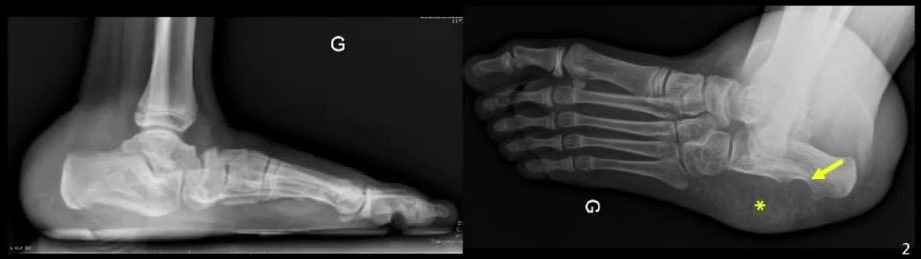
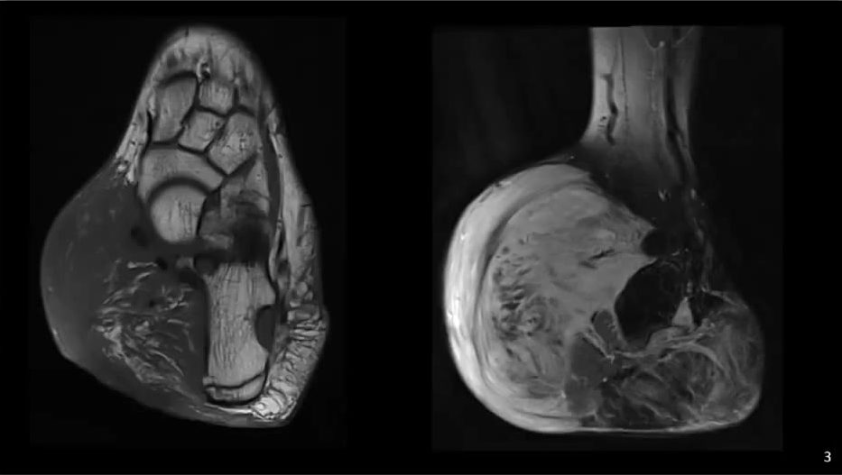
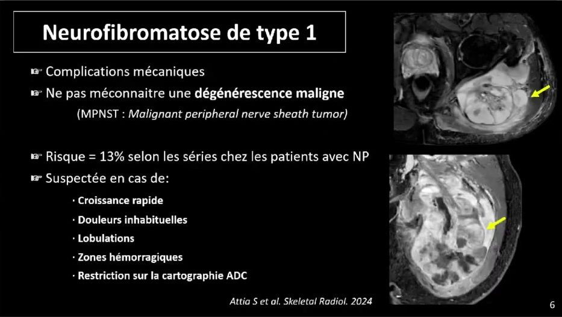

# Cas clinique 2 - Neurofibrome plexiforme du pied dans une neurofibromatose de type 1

> [!abstract] L'essentiel
> **Pied plat déformé de l'adolescent sans coalition + encoche calcanéenne à liseré scléreux = chercher une masse des parties molles** : ici neurofibrome plexiforme (NF1).

> [!success] À retenir
> 1. Radio : **encoche bien limitée à liseré de sclérose** de la face inférieure du calcanéus + épaississement des parties molles = processus **lent et ancien**.
> 2. IRM : masse **infiltrante** avec **travées graisseuses**, épaississements nerveux « en cordes » ; neurofibrome plexiforme = **pathognomonique de la NF1**.
> 3. Dégénérescence en **MPNST** (≈ **13 %** des plexiformes) si croissance rapide, douleur inhabituelle, **lobulations**, zones **hémorragiques**, **restriction ADC**.

## Images clés
 [▶ 0:24](https://www.youtube.com/watch?v=6yh2ch3TvaU&t=24s)
 [▶ 1:03](https://www.youtube.com/watch?v=6yh2ch3TvaU&t=63s)
 [▶ 3:24](https://www.youtube.com/watch?v=6yh2ch3TvaU&t=204s)

## Points clés
- **Cas** : patiente de 15 ans adressée pour déformation chronique du pied. Radiographies (profil en charge, 3/4) : pied plat marqué avec effondrement de l'arche médiale, verticalisation du talus, subluxation péritalienne, épaississement des parties molles de l'arrière-pied avec **encoche osseuse du calcanéus** limitée par un liseré de condensation net (lésion chronique). Pas de signe de coalition.
- **IRM** (T1 axial, T1 FS gadolinium) : masse volumineuse, signal peu spécifique (hypo-T1), **caractère infiltrant** avec travées graisseuses intralésionnelles, évolution ancienne ; autres signes de NF1 chez la patiente.
- **Diagnostic** : neurofibrome plexiforme, pathognomonique de la NF1, responsable de la déformation du pied.
- **NF1** : phacomatose la plus fréquente, transmission autosomique dominante, phénotype très variable.
- Neurofibromes : nodulaires (cutanés, sous-cutanés, le long des nerfs), diffus, ou **plexiformes** (épaississements « en cordes » vermiculaires le long des trajets nerveux, parfois ramifiés) ; plexiformes chez ~30 % des patients NF1 selon les séries.
- Les plexiformes sont probablement congénitaux, évoluent pendant les 10 premières années puis se stabilisent ; complications mécaniques fréquentes.

## Sémiologie et technique d'imagerie
- Érosion osseuse bien limitée à liseré condensé = processus lent, ancien.
- Travées graisseuses au sein de la masse = argument pour une lésion infiltrante.
- Diffusion : la restriction sur la cartographie ADC est utile au diagnostic de dégénérescence (une des indications de la diffusion en imagerie musculosquelettique). Imagerie nucléaire non détaillée.

## Pièges et diagnostics différentiels
- Risque de dégénérescence : très faible pour les neurofibromes nodulaires (d'autant plus qu'ils sont profonds) ; **~13 %** pour les plexiformes selon les séries → **MPNST** (*malignant peripheral nerve sheath tumor*, sarcome des gaines nerveuses).
- Critères de suspicion : **croissance rapide** (anormale à l'âge adulte), **douleur inhabituelle**, apparition de **lobulations intralésionnelles**, remaniements **hémorragiques**, restriction de diffusion.

> [!WARNING] À ne pas manquer
> Chez un patient NF1, tout neurofibrome plexiforme qui grossit, devient douloureux ou se lobule doit faire suspecter un MPNST.

> [!TIP] Pour le compte rendu
> Devant une déformation du pied sans coalition, chercher une cause des parties molles. Décrire l'extension, le caractère infiltrant, l'érosion osseuse, et l'absence ou la présence de critères de dégénérescence (lobulation, hémorragie, ADC).

## Liens
- Congrès : [[SIMS 2024 - Index]]
- Voir aussi : [[Tumeurs et pseudotumeurs des parties molles du pied]], [[Les neuropathies du pied]]
