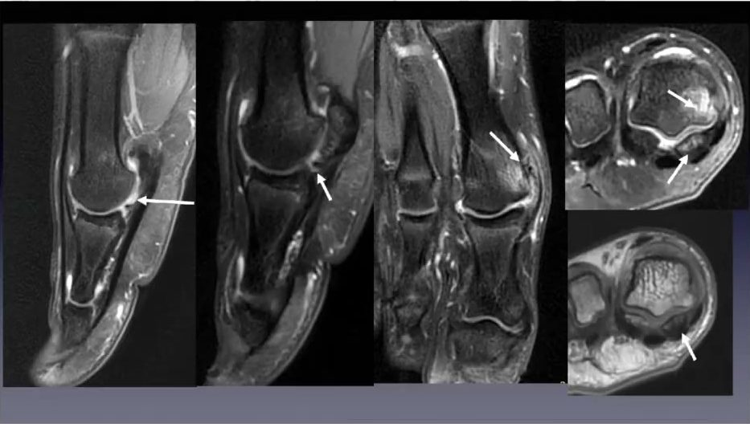
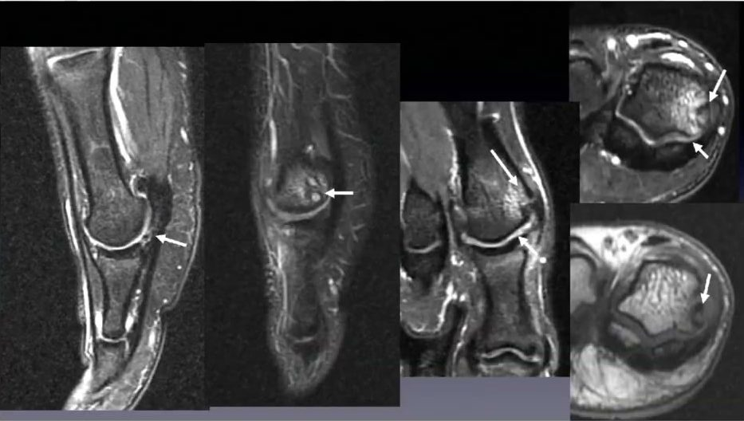
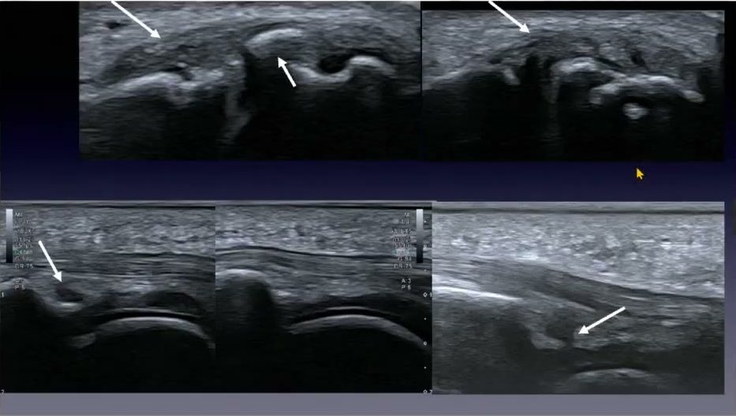

# Cas clinique 3 - Turf toe et instabilité métatarsophalangienne du premier rayon chez un adolescent

> [!abstract] L'essentiel
> **Turf toe + rupture du collatéral médial sous-traités = instabilité chronique de la 1re MTP et arthropathie précoce** : le bilan lésionnel initial doit dicter l'immobilisation.

> [!success] À retenir
> 1. IRM après hyperextension de la 1re MTP : analyser **séparément** plaque plantaire, ligaments **sésamoïdo-phalangiens**, sésamoïdo-métatarsiens, **collatéraux** et œdème sésamoïdien/céphalique → grader le turf toe.
> 2. Un ligament cicatrisé **épais et hypertrophique ≠ ligament compétent** ; lésion plantaire moins visible ≠ guérie.
> 3. Contrôle : **échographie dynamique comparative** pour démasquer la **laxité** ; chercher géodes et amincissement cartilagineux de la tête de M1.

## Images clés
 [▶ 1:10](https://www.youtube.com/watch?v=lUchloH6tck&t=70s)
 [▶ 2:45](https://www.youtube.com/watch?v=lUchloH6tck&t=165s)
 [▶ 3:23](https://www.youtube.com/watch?v=lUchloH6tck&t=203s)

## Points clés
- **Cas** : adolescent de 14 ans, judoka de haut niveau, sans antécédent. Douleur de la base de l'hallux après propulsion sur le pied en **hyperextension de la 1re métatarsophalangienne** lors d'un combat. Adressé pour IRM par les médecins du sport.
- **IRM initiale** (sagittal T2 FS, axial, coronal, T1) :
  - lésion du **complexe plantaire** (plaque fibrocartilagineuse) ;
  - solution de continuité en hypersignal du **ligament sésamoïdophalangien médial** ;
  - discontinuité du **ligament collatéral médial** à son insertion sur la tête de M1 ;
  - œdème du **sésamoïde médial** et du versant médial de la tête de M1, atteinte probable du ligament sésamoïdométatarsien médial.
- **Diagnostic retenu** : turf toe de grade 2 avec rupture du ligament collatéral médial.
- **Prise en charge** : traitement conservateur (repos, glaçage, strapping), durée d'immobilisation non précisée ; reprise des combats.
- **À un an** : douleurs chroniques du premier rayon.
  - IRM : lésion plantaire moins visible ; **géodes** de la tête de M1, amincissement cartilagineux débutant du versant médial, collatéral médial cicatrisé de façon **hypertrophique** avec hypersignal persistant à l'insertion.
  - Échographie : collatéral médial très épais, hétérogène, séquelle d'arrachement de la tête de M1 ; persistance d'une solution de continuité hypoéchogène du fibrocartilage plantaire ; **manœuvres dynamiques : laxité franche** de la MTP.
- **Diagnostic final** : instabilité chronique de la 1re MTP par cicatrisation incompétente du collatéral médial et du complexe plantaire.

## Sémiologie et technique d'imagerie
- IRM : analyser séparément plaque plantaire, ligaments sésamoïdophalangiens et sésamoïdométatarsiens, collatéraux, œdème sésamoïdien et céphalique.
- Échographie comparative et **dynamique** : met en évidence la laxité que l'IRM statique ne montre pas.

## Pièges et diagnostics différentiels
- Une diminution de visibilité de la lésion plantaire en IRM ne signifie pas cicatrisation fonctionnelle.
- Cicatrice ligamentaire épaisse ≠ ligament compétent.

> [!WARNING] À ne pas manquer
> Chez un sujet de 14 ans, géodes et laxité chronique exposent à une arthropathie précoce de la 1re MTP. Reprise trop précoce et immobilisation insuffisante sont en cause.

> [!TIP] Pour le compte rendu
> Faire un bilan lésionnel exhaustif du complexe capsuloligamentaire de la 1re MTP (plaque plantaire, sésamoïdes, collatéraux) pour permettre une immobilisation adaptée. Au contrôle, compléter par une échographie dynamique comparative.

## Liens
- Congrès : [[SIMS 2024 - Index]]
- Voir aussi : [[Spécificités de la cheville et du pied traumatiques de l'enfant et de l'adolescent]], [[Les lésions ligamentaires de la cheville - échographie versus IRM]]
