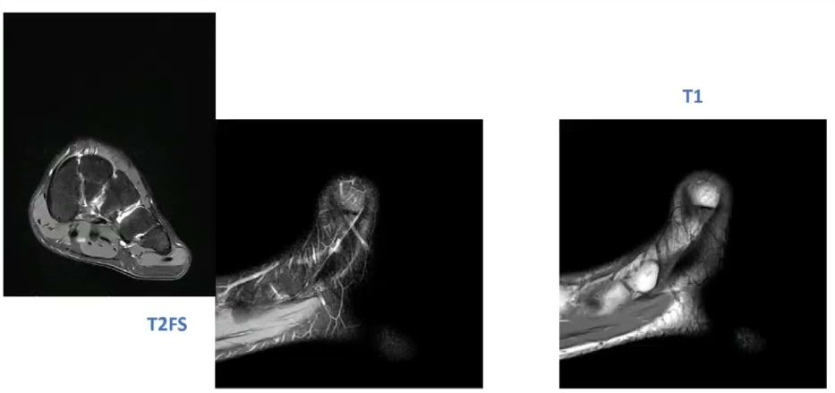
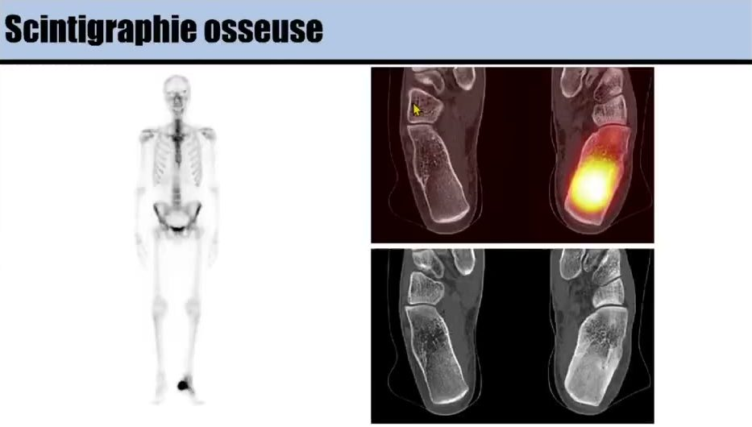
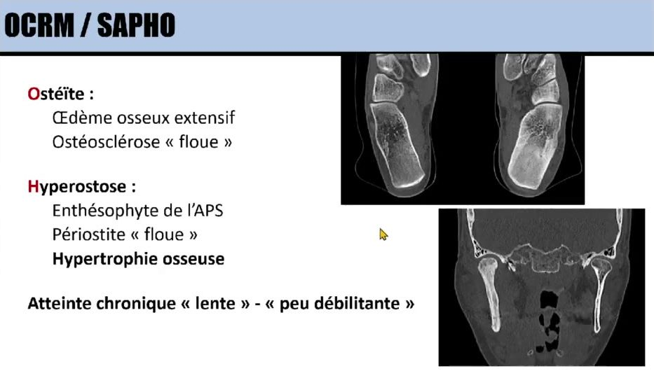

# Cas clinique 4 - Ostéomyélite chronique récurrente multifocale du calcanéus d'expression tardive

> [!abstract] L'essentiel
> **Œdème calcanéen extensif + ostéosclérose floue + hyperostose + hypertrophie osseuse d'évolution lente : penser OCRM/SAPHO**, même chez l'adulte jeune.

> [!success] À retenir
> 1. Triade : **ostéite** (œdème extensif, sclérose « floue »), **hyperostose** (enthésophyte de l'aponévrose plantaire, périostite floue), **hypertrophie osseuse** vs controlatéral.
> 2. Pas de **nidus**, pas d'**abcès** ni de collection → éliminer ostéome ostéoïde et ostéomyélite ; **scintigraphie corps entier** pour d'autres foyers.
> 3. Rechercher acné sévère / pustulose palmoplantaire ; site unique → **biopsie** (ostéite aseptique) avant de conclure.

## Images clés
 [▶ 0:24](https://www.youtube.com/watch?v=yFnclpcsqaM&t=24s)
 [▶ 2:19](https://www.youtube.com/watch?v=yFnclpcsqaM&t=139s)
 [▶ 4:52](https://www.youtube.com/watch?v=yFnclpcsqaM&t=292s)

## Points clés
- **Cas** : homme de 27 ans, talalgie d'horaire mixte depuis 6 mois. Antécédents : entorse de cheville un an plus tôt, traitement pour acné sévère.
- **IRM** : pas de lésion ligamentaire ou tendineuse significative ; **œdème osseux étendu du calcanéus** ; pas d'abcès, parties molles peu infiltrées, pas de collection.
- **Scanner** : condensation floue « en verre dépoli » de la tubérosité calcanéenne, irrégularités des contours (périostite floue), structures vasculaires serpigineuses au sein de la condensation ; constructions enthésophytiques de l'aponévrose plantaire.
- **Scintigraphie** : hyperfixation isolée du calcanéus et **hypertrophie osseuse** par rapport au côté controlatéral. Pas de nidus, pas d'argument infectieux, pas d'atteinte axiale retrouvée.
- **Biopsie osseuse** (site unique) : ostéite aseptique (absence de germe), infiltrat inflammatoire subaigu avec zones encore actives → lésion du spectre OCRM/SAPHO.
- **OCRM et SAPHO** : expressions différentes d'une même maladie ; ensemble hétérogène de manifestations cutanées et ostéoarticulaires secondaires à un processus inflammatoire aseptique, rattaché au spectre des spondyloarthropathies.

## Sémiologie et technique d'imagerie
- **Ostéite** (le « O » de SAPHO, commun à l'OCRM) : œdème osseux extensif, **ostéosclérose inflammatoire floue**.
- **Hyperostose** : constructions enthésophytiques, périostite floue (aspect comparable aux atteintes sternales du SAPHO).
- **Hypertrophie osseuse** : peu de lésions la donnent ; exemple d'OCRM mandibulaire ; la réaction périostée peut faire craindre une tumeur.
- Évolution lente, plus de 6 mois, peu invalidante.

## Pièges et diagnostics différentiels
- OCRM vs SAPHO : l'OCRM a des atteintes plus périphériques (tarse, calcanéus classiques) ; le SAPHO prédomine en axial (paroi sternocostoclaviculaire, rachis).
- L'âge (27 ans) était inhabituel : l'OCRM est dite forme pédiatrique du SAPHO, mais des formes tardives existent.
- L'acné du SAPHO est sévère (fulminante, conglobata, nécrosante, cicatricielle) ; le « P » correspond à la pustulose palmoplantaire, absente ici.
- Diagnostics à écarter : ostéome ostéoïde (pas de nidus), ostéomyélite infectieuse, tumeur.

> [!WARNING] À ne pas manquer
> Sclérose floue + hyperostose + hypertrophie osseuse d'évolution lente : penser OCRM/SAPHO avant de conclure à une tumeur ; en cas de site unique, la biopsie reste nécessaire pour éliminer infection et tumeur.

> [!TIP] Pour le compte rendu
> Décrire œdème, sclérose, hyperostose, hypertrophie, absence de nidus et d'abcès ; rechercher d'autres localisations (squelette axial, scintigraphie corps entier) et évoquer le spectre OCRM/SAPHO.

## Liens
- Congrès : [[SIMS 2024 - Index]]
- Voir aussi : [[Tumeurs et pseudotumeurs des parties molles du pied]], [[Cas clinique 1 - Ostéoarthropathie nerveuse diabétique révélatrice d'un diabète]]
