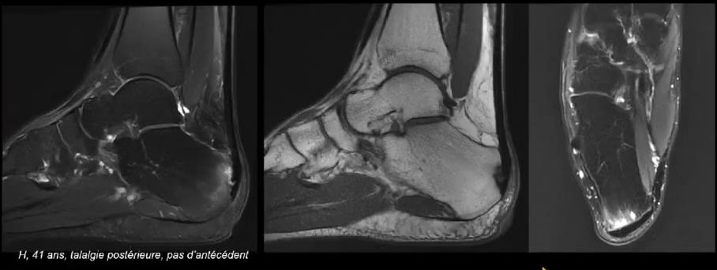
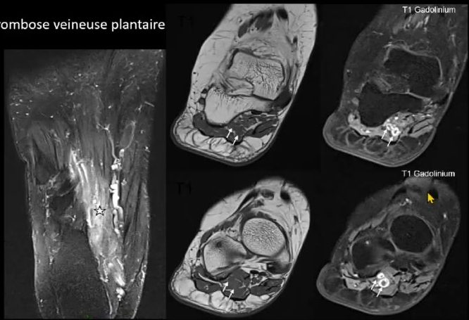
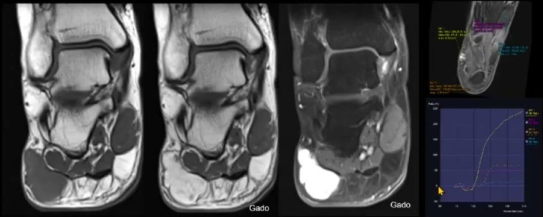

# Ceci n'est pas un pied mécanique

> [!abstract] L'essentiel
> **Quand la sémiologie d'un « pied mécanique » est discordante, l'écrire** : enthésite, microcristaux, ostéomalacie, Charcot, infection, thrombose, tumeur ou cause médicamenteuse.

> [!success] À retenir
> 1. Talalgie du jeune avec **érosion/œdème à l'enthèse fibrocartilagineuse** et tendon relativement respecté → **spondyloarthrite** ; **bursite intermétatarsienne** / ténosynovite = PR débutante.
> 2. Plantalgie brutale → chercher une **thrombose veineuse plantaire** (IRM/écho de la zone douloureuse) ; masse d'allure liquidienne en T2 → **injection obligatoire** (sarcome myxoïde/synovial).
> 3. Anomalies de signal du médio-pied chez un neuropathe/diabétique → **décharge immédiate** ; fracture « de fragilité » sous méthotrexate ou trait large condensé = ostéomalacie.

## Images clés
 [▶ 2:11](https://www.youtube.com/watch?v=gzOrjl2T5Mg&t=131s)
 [▶ 10:37](https://www.youtube.com/watch?v=gzOrjl2T5Mg&t=637s)
 [▶ 11:44](https://www.youtube.com/watch?v=gzOrjl2T5Mg&t=704s)

## Points clés
- **Pied rhumatismal (spondyloarthrite)** : cible = enthèse fibrocartilagineuse (insertion calcanéenne du tendon calcanéen, fascia plantaire, base du 5e métatarsien) ; formes enthésitiques souvent inaugurales chez le jeune. Indices : tendon relativement respecté, anomalies de signal osseuses et des parties molles profondes, érosion. L'œdème osseux peut être marqué dans le mécanique et discret dans la SpA.
- **Dactylite** (rhumatisme psoriasique) : pas toujours « chaude », parfois déclenchée par un traumatisme ; atteinte os + parties molles + articulation proche de la matrice unguéale ; radiographies : efflorescences (appositions) osseuses, tuméfaction des parties molles, acro-ostéolyse.
- **Polyarthrite rhumatoïde** : atteinte du pied classique et souvent inaugurale ; ténosynovites et bursites intermétatarsiennes assez spécifiques, surtout dans la PR précoce ; bursopathies de contrainte des 5e et 2e rayons.
- **Pied microcristallin** : goutte souvent diagnostiquée tardivement, hors phase aiguë ; MTP1 érosive et constructrice, érosions parfois à distance de l'articulation (tophus, visibles en échographie). Résorption d'apatite (ou goutte) dans un sésamoïde : grand classique (sésamoïde plus pâle à la radiographie).
- **Fractures sans traumatisme notable** : rechercher une fragilité osseuse (calcanéus) ; reconnaître la fracture ostéomalacique (trait large, berges condensées), y compris ostéomalacie oncogénique.
- **Pied diabétique** non étiqueté : rôle du radiologue pour mettre en décharge avant effondrement du médio-pied (douleur atténuée par la neuropathie).
- **Infection** à bas bruit, ex. tuberculose : ostéite plus qu'arthrite (naviculaire, calcanéus), paucibacillaire avec biopsies souvent négatives.
- **Pied vasculaire** : thrombose veineuse plantaire (plantalgie de début plus ou moins brutal), diagnostic en IRM/échographie si on explore la zone symptomatique.
- **SDRC de type 1** : phase chaude souvent passée inaperçue.
- **Pied tumoral** : liposarcome myxoïde et synovialosarcome peuvent paraître liquidiens en T2.
- **Maladies osseuses constitutionnelles** : dysplasie épiphysaire multiple révélée tardivement devant un pied plat ancien, évidente sur radiographies en charge.
- **Pied médicamenteux** : ostéopathie au méthotrexate (fractures pseudo-ostéoporotiques chez des patients PR).

## Sémiologie et technique d'imagerie
- Radiographies bilatérales et symétriques dans toute exploration non traumatique des extrémités.
- IRM et scanner adaptés pour la résorption d'apatite ; échographie pour tophus et thrombose veineuse plantaire.

## Pièges et diagnostics différentiels
- Masse d'aspect liquidien en T2 avec rehaussement faible puis plus marqué : penser sarcome (myxoïde, synovial).
- Fracture de « fragilité » chez un patient sous méthotrexate.

> [!WARNING] À ne pas manquer
> Anomalies de signal du médio-pied chez un diabétique non connu ou neuropathique : recommander la décharge immédiate pour prévenir l'effondrement du médio-pied.

> [!TIP] Pour le compte rendu
> Évoquer explicitement une cause non mécanique (enthésite inflammatoire, microcristaux, ostéomalacie, neuro-arthropathie, infection, tumeur) quand la sémiologie est discordante, et suggérer le bilan complémentaire au clinicien.

## Liens
- Congrès : [[SIMS 2024 - Index]]
- Voir aussi : [[Fascia plantaire]], [[Démembrement des atteintes distales du tendon calcanéen]], [[Les autres pathologies de l'hallux]]
