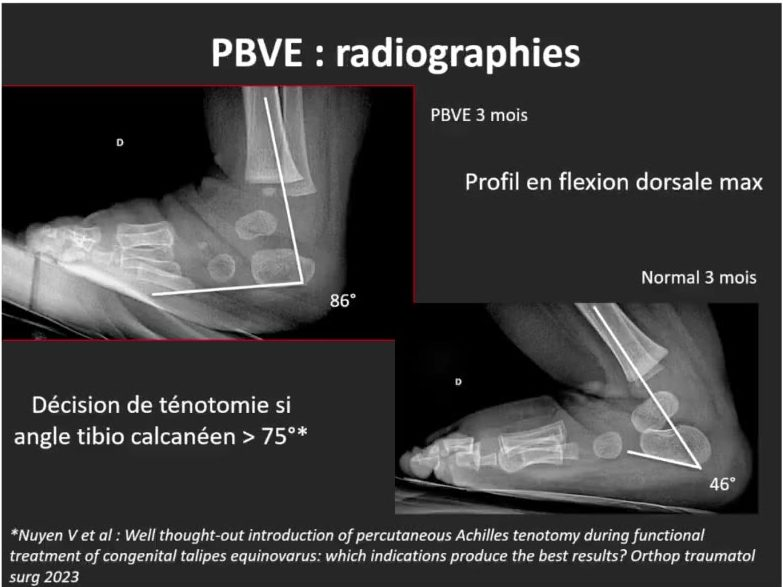
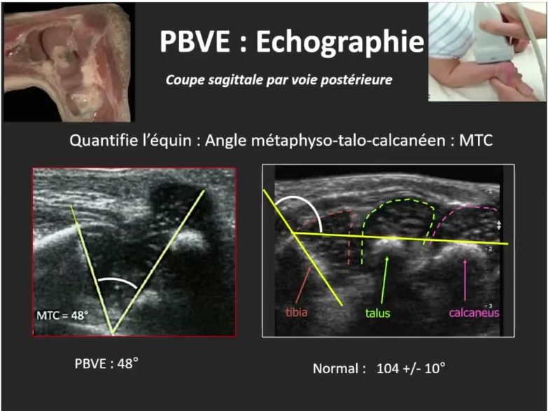
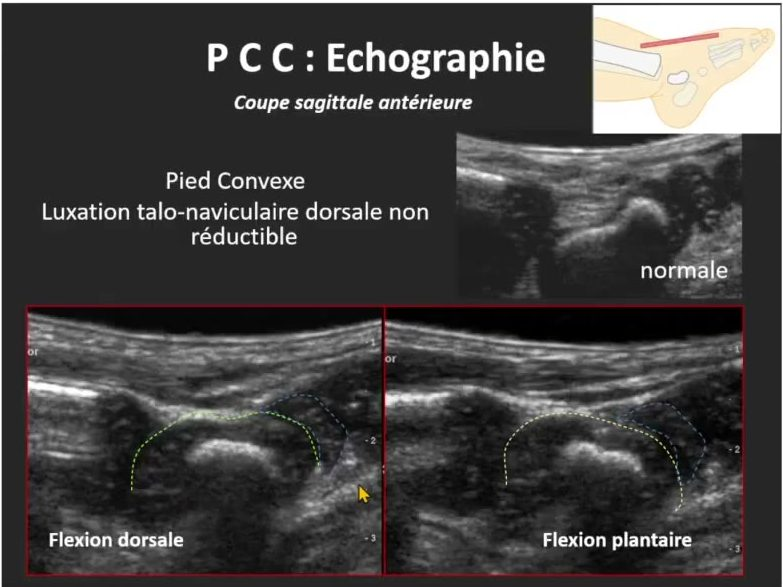

# Déformations congénitales du pied de l'enfant - qu'attend l'orthopédiste de l'imagerie ?

> [!abstract] L'essentiel
> **Pied bot et pied convexe : diagnostic clinique, l'imagerie grade la sévérité et guide le traitement** : radio de profil en flexion dorsale forcée, échographie avant 1 an.

> [!success] À retenir
> 1. **PBVE** : profil en flexion dorsale max à **3 mois** → **ténotomie si angle tibio-calcanéen > 75°** ; radio en charge à l'âge de la marche (**15-18 mois**).
> 2. Écho du PBVE (correction maximale) : divergence talo-calcanéenne **18 ± 10° vs 47 ± 5°** ; angle métaphyso-talo-calcanéen (équin) **normal 104 ± 10°**.
> 3. **Pied convexe congénital** (**1/10 000**, arthrogrypose/spina bifida 50 %) : **luxation talo-naviculaire dorsale irréductible**, vue directement en écho sagittale antérieure ; au suivi d'un PBVE, traquer la **convexité plantaire**.

## Images clés
 [▶ 2:53](https://www.youtube.com/watch?v=GfPLONW8fAM&t=173s)
 [▶ 6:09](https://www.youtube.com/watch?v=GfPLONW8fAM&t=369s)
 [▶ 8:18](https://www.youtube.com/watch?v=GfPLONW8fAM&t=498s)

## Points clés
- Déformations constituées après la 8e semaine de vie fœtale, à distinguer des malpositions (disproportion fœto-maternelle) ; prise en charge orthopédique.
- Pied de l'enfant majoritairement cartilagineux à la naissance ; maturation à l'adolescence (plus tôt chez la fille).
- **Pied bot varus équin** : 1 à 2/1000 naissances en France, bilatéral dans la moitié des cas, forte prédominance masculine, le plus souvent idiopathique (bilan pour éliminer une cause générale). Déformation tridimensionnelle : équin sagittal, adduction transversale, supination-varus frontal ; proximité (« intimité ») naviculo-malléolaire. Traitement : kiné, attelles, plâtres, chirurgie ; ténotomie vers 3 mois.
- **Pied convexe congénital** : très rare (1/10 000), associé dans la moitié des cas à une arthrogrypose ou un spina bifida ; défini par une luxation talo-naviculaire irréductible. Différentiel : pied talus (flexion dorsale dans la cheville) vs pied convexe (flexion dorsale dans la médio-tarsienne).

## Sémiologie et technique d'imagerie
- Radiographie du pied bot : avant ténotomie (3 mois, couché), puis à l'âge de la marche en charge (15-18 mois), puis à la demande.
- Profil en flexion dorsale forcée (plaquette) : équin = angle tibio-calcanéen augmenté (ténotomie si > 75°, Nguyen et al. 2023 ; normal à 3 mois ≈ 46°), parallélisme talo-calcanéen, alignement calcanéus-cuboïde-métatarsiens ; une luxation cuboïdo-métatarsienne signe une flexion au mauvais endroit (tarso-métatarsienne).
- Face : adduction par l'angle calcanéus-5e métatarsien augmenté, diminution de la divergence talo-calcanéenne.
- Échographie (travaux de l'équipe de C. Tréguier, Rennes), en correction maximale, idéalement avec l'orthopédiste : 2 coupes axiales médiales (rapprochement naviculaire-malléole médiale, naviculaire non ossifié avant ~3 ans ; divergence talo-calcanéenne 18 ± 10° dans le PBVE vs 47 ± 5° normalement) et 1 coupe sagittale postérieure (équin : angle métaphyso-talo-calcanéen, normal 104 ± 10°).
- Pied convexe : radiographies de profil en flexion dorsale et plantaire maximales (signes indirects : talus verticalisé, angle tibio-talien ouvert, axe métatarsien toujours au-dessus de l'axe du talus) ; l'échographie montre directement la luxation dorsale et latérale du naviculaire sur la tête du talus.

## Pièges et diagnostics différentiels
- Sensibilité/spécificité du diagnostic anténatal imparfaites.
- Pied talus vs pied convexe congénital.

> [!WARNING] À ne pas manquer
> Lors du suivi d'un pied bot, rechercher une convexité plantaire : correction au mauvais endroit, transition vers un aspect de pied convexe.

> [!TIP] Pour le compte rendu
> Donner angle tibio-calcanéen (équin), divergence talo-calcanéenne, alignement calcanéo-cuboïdo-métatarsien et rapport naviculaire/malléole ou tête du talus pour grader la sévérité et guider le traitement.

## Liens
- Congrès : [[SIMS 2024 - Index]]
- Voir aussi : [[L'examen clinique du pied]], [[50 ans d'imagerie du pied]]
