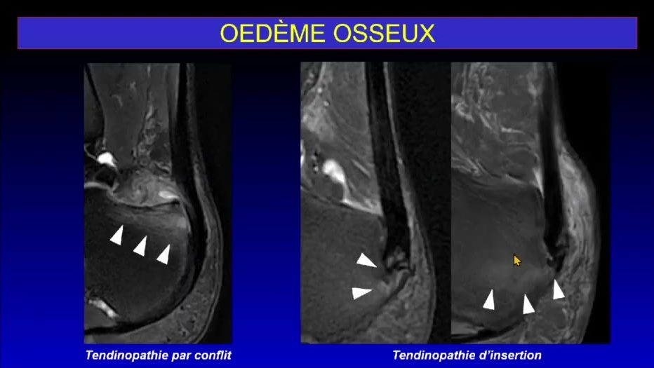
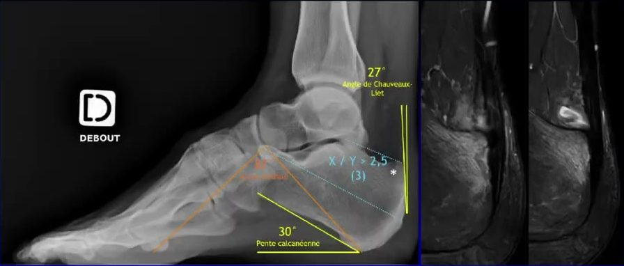

# Démembrement des atteintes distales du tendon calcanéen

> [!abstract] L'essentiel
> **Tendon calcanéen distal : situer l'atteinte, antérieure et proximale = conflit (Haglund), postérieure et distale = insertion** ; souvent associées, la bursite n'est qu'un symptôme.

> [!success] À retenir
> 1. **Œdème osseux** : coin **postéro-supérieur** de la tubérosité = conflit ; **enthésophyte / calcanéus distal** = insertion (pas l'apanage des enthésites rhumatismales).
> 2. Radios **en charge** : **pente calcanéenne > 30°**, angle de **Chauveaux-Liet**, rapport **X/Y > 2,5** (calcanéus long) = facteurs favorisants, pas un diagnostic.
> 3. Bursite rétrocalcanéenne « isolée » en IRM → **échographie** (plus sensible pour les fissurations antérieures débutantes) ; préciser le degré d'atteinte **< ou > 50 %** de l'épaisseur.

## Images clés
 [▶ 5:00](https://www.youtube.com/watch?v=WSZQutxlKQY&t=300s)
 [▶ 7:34](https://www.youtube.com/watch?v=WSZQutxlKQY&t=454s)

## Points clés
- Trois entités : tendinopathie par conflit (« maladie de Haglund »), tendinopathie d'insertion distale (sous-estimée par les radiologues), enthésite rhumatismale (non traitée ici).
- **Bursite** = bourse à parois épaisses avec inflammation des parties molles (pas un simple épanchement d'une bourse physiologique) ; rétrocalcanéenne ou calcanéenne sous-cutanée ; préférer « prétendineuse » / « rétrotendineuse » ; toujours rechercher une cause (conflit, insertion, AJI…).
- Clinique : douleur distale médiane postérieure → insertion ; plus haute, postéro-latérale (parfois postéro-médiale) → conflit ; palpation bidigitale du coin postéro-supérieur → bursite rétrocalcanéenne.
- **Conflit** : fissuration/cratérisation de la face antérieure et proximale du tendon ; œdème de la partie postéro-supérieure de la tubérosité.
- **Insertion** : atteinte postérieure et distale, enthésophyte (se développe là où l'insertion n'est pas fibrocartilagineuse, portion la plus distale et postérieure), œdème de l'enthésophyte ou du calcanéus distal ; diagnostic jamais uniquement radiographique (enthésophytes banals).
- L'œdème osseux n'est pas l'apanage des enthésites rhumatismales.
- **Morphologie** : coin postéro-supérieur proéminent/pointu = facteur de risque subjectif ; angles classiques peu reproductibles ; rapport longueur calcanéenne totale / longueur de la partie supérieure > 2,5 = calcanéus long, facteur de risque d'atteinte distale globale.
- **Morphostatique** : pied creux et calcanéus verticalisé font « pousser » l'os contre le tendon ; pente calcanéenne pathologique au-delà de 30° ; angle de Chauveaux-Liet (pente calcanéenne moins angle postérieur du calcanéus).
- Les anomalies morphostatiques sont des facteurs favorisants, pas un diagnostic : un patient avec pied creux peut n'avoir qu'une tendinopathie d'insertion.

## Sémiologie et technique d'imagerie
- Échographie plus sensible que l'IRM pour les fissurations antérieures débutantes : à ajouter devant une bursite rétrocalcanéenne apparemment isolée en IRM.
- Échographie : fissurations, hyperhémie Doppler signant le caractère symptomatique d'une tendinopathie d'insertion.
- IRM : œdème osseux (proximal = conflit, distal/enthésophyte = insertion), enthésophyte visible en T1.
- Radiographies en charge indispensables.

## Pièges et diagnostics différentiels
- Enthésophyte volumineux pouvant en imposer pour un conflit.
- Bursite « isolée » : chercher la cause.

> [!WARNING] À ne pas manquer
> Les deux tendinopathies sont fréquemment associées : le chirurgien veut savoir si l'atteinte est plutôt proximale/corporéale ou distale.

> [!TIP] Pour le compte rendu
> Bilan en charge (déformation calcanéenne, trouble morphostatique) ; topographie de l'atteinte (antérieure-proximale vs postérieure-distale) ; degré d'atteinte (< ou > 50 % de l'épaisseur) ; présence et topographie des bursites ; enthésophyte/ossifications ; œdème osseux.

## Liens
- Congrès : [[SIMS 2024 - Index]]
- Voir aussi : [[Ceci n'est pas un pied mécanique]], [[Fascia plantaire]], [[Tendons de la cheville - à quoi ça sert, comment ça marche]]
