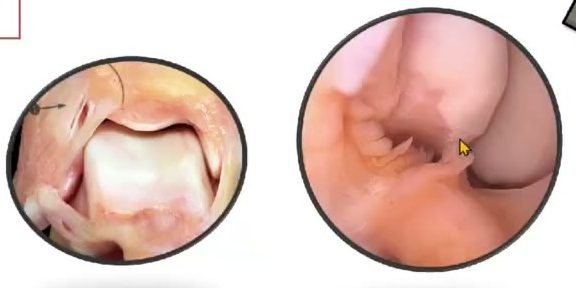
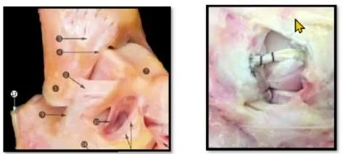

# Entorses latérales de cheville - traitement médical et chirurgical

> [!abstract] L'essentiel
> **Premier épisode d'entorse latérale grave = traitement médical avec immobilisation jour et nuit, même si LTFA et LCF sont rompus** : il conditionne le pronostic ; chirurgie réservée à l'instabilité chronique.

> [!success] À retenir
> 1. Rupture **LTFA ± LCF** au 1er épisode = **pas d'indication chirurgicale** ; protocole **POLICE**, reprise course à **8 semaines**, guérison à **3 mois**.
> 2. Échographie la plus large possible si signes de gravité : préciser faisceaux lésés, siège (**malléolaire** le plus souvent) et lésions associées (**syndesmose**, fibulaires).
> 3. Instabilité chronique : réparation arthroscopique ± renfort rétinaculaire (jeune) ou **reconstruction anatomique LTFA + LCF** par greffe ; ne jamais conclure « ligaments normaux » face à une laxité clinique récidivante.

## Images clés
 [▶ 7:07](https://www.youtube.com/watch?v=yi1ZW7WYNIs&t=427s)
 [▶ 8:20](https://www.youtube.com/watch?v=yi1ZW7WYNIs&t=500s)

## Points clés
- Préciser : stade lésionnel, délai du traumatisme, premier épisode ou récidive ; ne pas méconnaître une lésion de la syndesmose (fréquente lors des traumatismes directs latéraux).
- Aucune classification (clinique ou d'imagerie) ne corrèle parfaitement degré lésionnel et pronostic.
- Biomécanique : une force exercée sur le LTFA est transmise au LCF → notion de complexe ligamentaire latéral, connecté au talo-fibulaire postérieur par le bord médial de la malléole latérale.
- Les avulsions se font sur le versant malléolaire ; lésion progressive : faisceau supérieur du LTFA, puis faisceau inférieur, puis LCF.
- La rupture des faisceaux antérieur et/ou moyen n'est pas une indication chirurgicale : le traitement de 1re intention est médical.
- Protocole « POLICE » (après RICE/PRICE) : immobilisation jour **et** nuit, appui guidé par la douleur, cryothérapie, antalgiques, kinésithérapie individualisée (articulaire, force, proprioception, puis fonctionnel).
- Reprise : 4-6 semaines pour activités en décharge (vélo, natation), 8 semaines course, 2,5 mois entraînement, guérison à 3 mois.
- Mieux vaut immobiliser par excès (effets réversibles par rééducation) qu'un traitement fonctionnel trop rapide : une cicatrisation en distension est irréversible ; l'instabilité latérale mène à l'arthrose.

## Sémiologie et technique d'imagerie
- Radiographies et échographie (la plus large possible si signes d'entorse grave) pour éliminer une urgence chirurgicale et choisir immobilisation, durée et décharge.
- En arthroscopie, un moignon du LTFA peut être avancé dans la gouttière latérale par une translation antérieure du talus et simuler une rupture corporéale.

## Pièges et diagnostics différentiels
- Fractures, lésions de la syndesmose, instabilité des tendons fibulaires, rupture du tendon calcanéen.
- Facteurs favorisants à rechercher en cas de récidive : varus d'arrière-pied, rétraction de la chaîne postérieure (flexion plantaire), réalité de la laxité clinique.

> [!WARNING] À ne pas manquer
> Un CR concluant à des « ligaments normaux » chez un patient à son 10e épisode d'entorse avec laxité clinique pose problème : attention aux termes employés.

> [!TIP] Pour le compte rendu
> Décrire précisément faisceau(x) lésé(s), siège (malléolaire le plus souvent), lésions associées (syndesmose, fibulaires). En chronique, la chirurgie est anatomique et arthroscopique : réparation par ancre ± renforcement par le rétinaculum (type Gould) chez le jeune ; en révision ou tissu de mauvaise qualité, reconstruction LTFA + LCF par greffe de gracilis (tunnels talus, malléole, calcanéus) — plus de place pour les plasties aux fibulaires.

## Liens
- Congrès : [[SIMS 2024 - Index]]
- Voir aussi : [[Anatomie ligamentaire de la cheville]], [[Imagerie des ligaments de la cheville]], [[Tendons fibulaires et leurs retinacula]]
