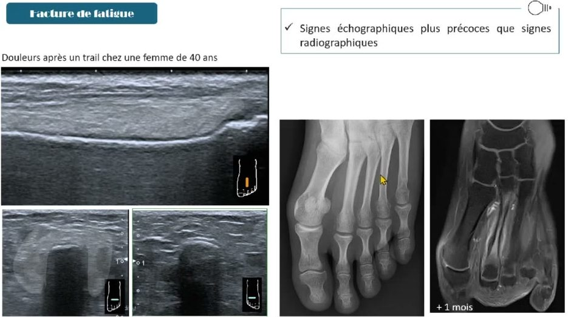
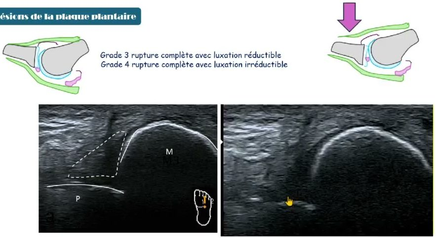
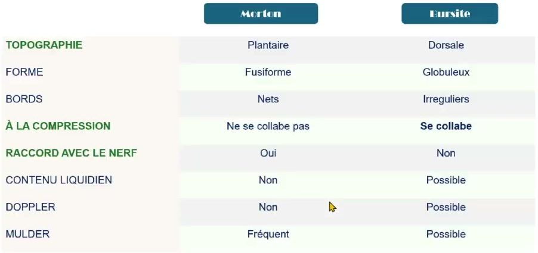

# Faire une écho de l'avant-pied

> [!abstract] L'essentiel
> **Écho de l'avant-pied systématique et dynamique** (MTP dorsales puis plantaires, diaphyses, espaces intercapitaux, 1er rayon), toujours confrontée aux radios en charge ; IRM si discordance.

> [!success] À retenir
> 1. **Fracture de fatigue** : **gangue hyperéchogène péri-diaphysaire** = signe le plus précoce, avant la radio ; gangue + épanchement MTP → fracture de la tête → **IRM**.
> 2. **Plaque plantaire** (syndrome du 2e rayon) : défect, subluxation dorsale de P1 testée en dynamique (**grade 3 réductible / grade 4 irréductible**), cartilage « trop bien vu ».
> 3. **Morton vs bursite** : névrome plantaire, fusiforme, incompressible, en continuité avec le nerf ; bursite dorsale, globuleuse, **collabable** ; vérifier la plaque avant d'infiltrer.

## Images clés
 [▶ 9:19](https://www.youtube.com/watch?v=2TC1bjiAok4&t=559s)
 [▶ 10:22](https://www.youtube.com/watch?v=2TC1bjiAok4&t=622s)
 [▶ 19:09](https://www.youtube.com/watch?v=2TC1bjiAok4&t=1149s)

## Points clés
- Quatre prérequis : radiographies en charge vues avant ; examen des pieds debout (trouble statique, hyperkératoses) ; examen systématique (pathologies associées) ; corrélation radio-clinique.
- **MTP par voie dorsale** (méthode G. Morvan) : os, cartilage, récessus synovial (jusqu'à la jonction épiphyso-métaphysaire), extenseur, Doppler ; une synovite/un épanchement peut être mécanique (sujet asymptomatique, hallux valgus) → ne pas conclure à tort à une pathologie inflammatoire.
- **Diaphyses** en sagittal puis axial : corticale, périoste, graisse péri-diaphysaire (doit être peu échogène et mobile). Fracture de fatigue : décollement périosté, hématome sous-périosté, cal hyperéchogène, déformation, et surtout **gangue hyperéchogène** de la graisse péri-diaphysaire, souvent seul signe précoce (avant la radiographie) ; comparer au côté opposé.
- Gangue péri-diaphysaire + épanchement articulaire → suspecter une fracture de la tête (inaccessible à l'échographie) → IRM.
- **Plaque plantaire** par voie plantaire (astuce : papier collé sur le gel), en sagittal et coronal, en balayant toute la plaque, sonde parallèle aux fibres (anisotropie, encoches physiologiques). Lésions rarement isolées, dans le syndrome du 2e rayon : partielles, transfixiantes, rupture complète avec luxation réductible (grade 3) ou irréductible (grade 4). Signes : subluxation dorsale de P1 (dynamique : réductibilité), défect focal, subluxation latérale de l'appareil fléchisseur, cartilage « trop bien vu » (amincissement de la plaque).
- **Espaces intercapitaux** : ligament transverse séparant compartiments dorsal (bourse, interosseux) et plantaire (nerf interdigital, pédicule, lombricaux). Voie dorsale préférée (peau fine) : nerf afférent, deux branches efférentes, ligament intermétatarsien profond, bourse ; manœuvre de Mulder échographique (« clac ») uniquement si la sonde est exactement sur le névrome.
- Névrome vs bursite : la bursite est plus dorsale et postérieure, collabable ; rechercher la continuité avec le nerf ; bursites pseudo-tumorales en contexte inflammatoire ; préciser le caractère douloureux.
- Infiltration du névrome par voie dorsale, pied à plat, en visant la bourse comme réservoir et en évitant les vaisseaux.
- **1er rayon** : pas d'indication d'échographie dans l'hallux valgus sauf bilan d'un syndrome du 2e rayon associé ; en traumatologie, tests dynamiques (fracture sésamoïdienne à fragments mobiles, ligaments collatéraux principal et accessoire, ligaments sésamoïdo-phalangiens du turf toe).

## Sémiologie et technique d'imagerie
- Ajuster les réglages à l'épaisseur cutanée plantaire ; analyser la souplesse de la graisse sous-cutanée.
- Hyperkératose symptomatique : épaississement cutané, infiltration hypoéchogène mal limitée avec lobules graisseux flottants.

## Pièges et diagnostics différentiels
- Ténosynovite des fléchisseurs ou synovite prises pour une bursite intercapitale → infiltration risquant de favoriser une rupture de plaque.
- Expansion synoviale épaissie de la MTP2 simulant une bursite.

> [!WARNING] À ne pas manquer
> Vérifier l'intégrité de la plaque plantaire avant d'infiltrer une « bursite » intercapitale : l'infiltration peut favoriser la rupture.

> [!TIP] Pour le compte rendu
> Rattacher chaque anomalie aux symptômes, préciser la stabilité dynamique (MTP, sésamoïdes), le caractère douloureux d'un névrome, et proposer une IRM si l'échographie est limitée.

## Liens
- Congrès : [[SIMS 2024 - Index]]
- Voir aussi : [[IRM d'une métatarsalgie centrale]], [[Rayons latéraux - pathologies et traitements]], [[Les autres pathologies de l'hallux]]
