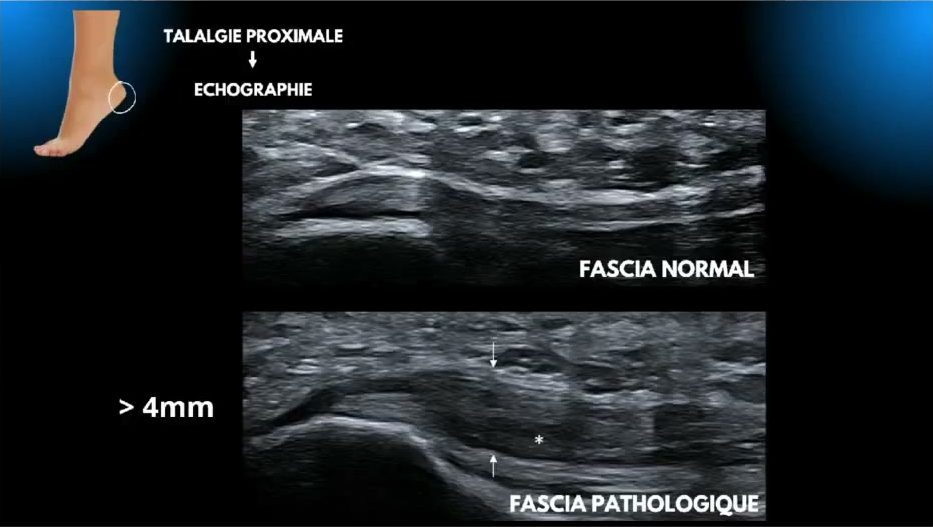
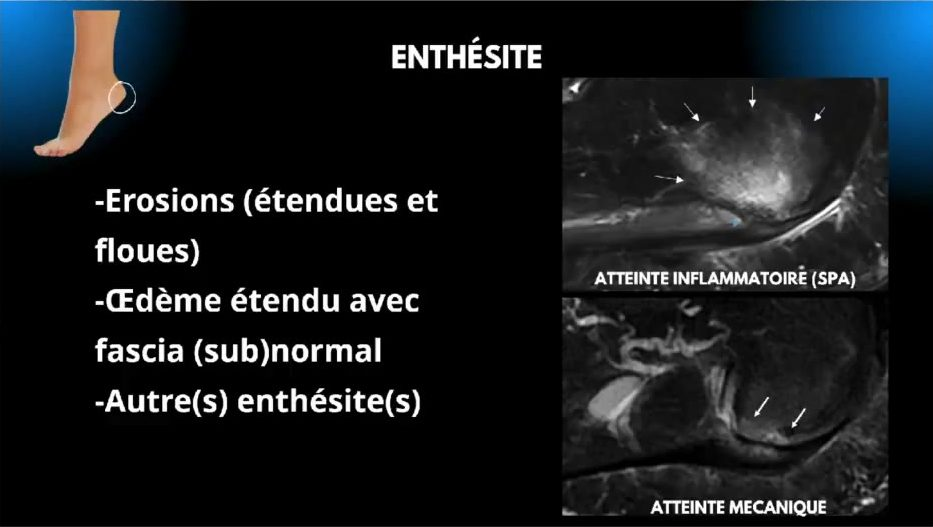
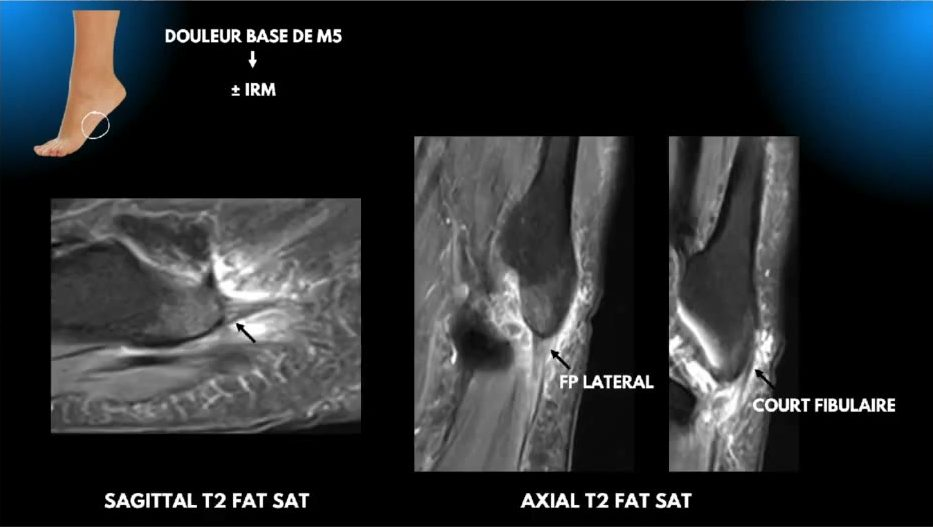

# Fascia plantaire

> [!abstract] L'essentiel
> **Talalgie mécanique = aponévropathie (pas « -ite ») : radio + échographie suffisent** (fascia **> 4 mm**) ; IRM si échec du traitement, doute de rupture ou diagnostic différentiel.

> [!success] À retenir
> 1. Échographie : épaississement fusiforme **> 4 mm**, perte fibrillaire, fissures ; l'**hyperhémie Doppler** est corrélée aux symptômes, pas l'épaisseur. L'épine calcanéenne n'a pas de valeur diagnostique.
> 2. **Enthésite inflammatoire** (SpA) : œdème étendu et érosions floues avec fascia (sub)normal → chercher d'autres enthèses.
> 3. Douleur plantaire **base de M5** (femme ≈ **54 ans**, obésité, varus) : **aponévropathie du faisceau latéral** (≈ 6 mm, **+ 4 mm** vs controlatéral), court fibulaire normal.

## Images clés
 [▶ 4:14](https://www.youtube.com/watch?v=JRVIQK4Q1tM&t=254s)
 [▶ 5:59](https://www.youtube.com/watch?v=JRVIQK4Q1tM&t=359s)
 [▶ 7:31](https://www.youtube.com/watch?v=JRVIQK4Q1tM&t=451s)

## Points clés
- Anatomie : lame fibreuse entre coussinet graisseux et muscles plantaires superficiels, du processus postéro-médial du calcanéus aux capsules plantaires des MTP ; trois faisceaux (médial, central, latéral, ce dernier recouvrant la base de M5).
- Complexe achilléo-calcanéo-plantaire ; mécanisme de treuil (dorsiflexion des MTP → tension → rigidité du pied).
- Faible élasticité → faible résistance aux hypersollicitations : surcharge intrinsèque (pied plat, pied creux) ou extrinsèque (chaussage, sport, obésité) ; diabète fragilisant (glycation du collagène).
- Histologie : fissures, néovascularisation, cellules de réparation, pas de cellules inflammatoires → terme « aponévropathie ».
- Clinique : talalgie mécanique proximale, maximale au premier pas du matin.
- **Épine calcanéenne** : peu utile au diagnostic ; 15 à 30 % des porteurs asymptomatiques ; os mature à travées perpendiculaires à l'appui (compression et traction), réaction au stress biomécanique comparable à un ostéophyte ; prévalence croissante avec l'âge, l'obésité, l'arthrose ; épines enchâssées dans le fascia associées à une atteinte plus sévère.
- **Ruptures** : microtraumatiques sur aponévropathie chronique fissuraire (facteurs : obésité, infiltration cortisonique) ou traumatiques pures (saut) ; imagerie similaire, la clinique tranche (ecchymose plantaire médiale, « pop »).
- **Aponévropathie distale du faisceau latéral** : douleur plantaire en regard de la base de M5, femme d'âge moyen d'environ 54 ans, facteurs obésité et varus ; pas de douleur à l'éversion contrariée ; épaisseur rapportée autour de 6 mm (soit 4 mm de plus que le côté controlatéral) ; court fibulaire indemne ; IRM : œdème du fascia, des parties molles, de l'enthèse, fissures, œdème de l'abducteur du 5e orteil.

## Sémiologie et technique d'imagerie
- Radiographie de profil en charge : calcifications (rares, 3 %), épaississement visible, comblement du triangle graisseux sous-enthésique, parfois érosions.
- Échographie (examen primordial) : épaississement fusiforme > 4 mm, perte de l'échostructure fibrillaire, calcifications, infiltration œdémateuse périphérique, plages anéchogènes de fissures (~12 %) ; l'hyperhémie Doppler est corrélée aux symptômes, contrairement à l'épaisseur.
- IRM : si échographie négative et résistance au traitement médical bien conduit.

## Pièges et diagnostics différentiels
- Enthésite inflammatoire : œdème très étendu contrastant avec un fascia normal ou subnormal ; rechercher d'autres enthésites (tendon calcanéen) ; érosions floues avec reconstruction possibles dans les deux cadres.
- Neuropathie de Baxter : diagnostic différentiel et parfois conséquence de l'aponévropathie.
- Tendinopathie distale du court fibulaire vs aponévropathie du faisceau latéral.

> [!WARNING] À ne pas manquer
> Infiltration cortisonique de proximité = facteur de risque de rupture du fascia.

> [!TIP] Pour le compte rendu
> Épaisseur mesurée, échostructure, fissure/rupture, hyperhémie, et discordance éventuelle évocatrice d'une enthésite inflammatoire.

## Liens
- Congrès : [[SIMS 2024 - Index]]
- Voir aussi : [[Ceci n'est pas un pied mécanique]], [[Radiologie interventionnelle pied et cheville]], [[Démembrement des atteintes distales du tendon calcanéen]]
