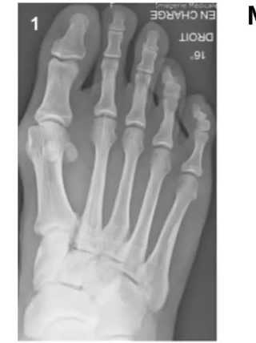
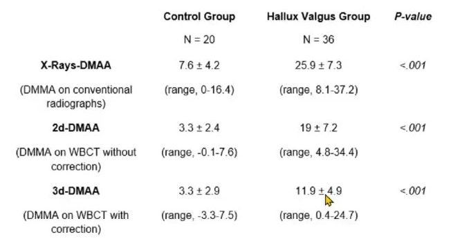
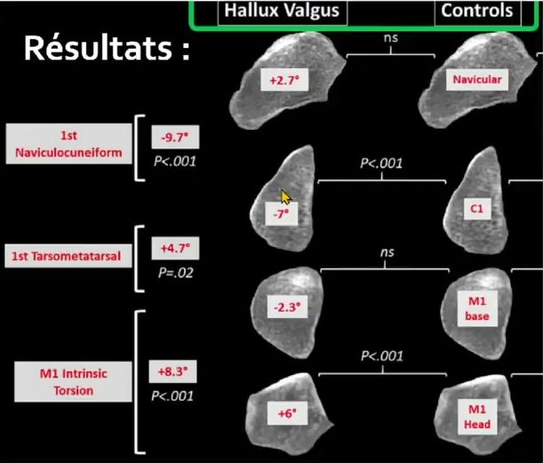

# Hallux valgus

> [!abstract] L'essentiel
> **La pronation de M1 fausse la radio dorso-plantaire : DMAA surestimé et fausse subluxation sésamoïdienne** ; elle vient d'une torsion intrinsèque de M1 et de la TMT1.

> [!success] À retenir
> 1. Récidive après chirurgie fréquente : **HVA > 15° dans 44 %** à plus de 5 ans, souvent asymptomatique.
> 2. **DMAA** : **25,9°** en radio vs **11,9°** en WBCT corrigé de la pronation (témoins **7,6° / 3,3°**) → rester prudent sur le DMAA radiographique.
> 3. **Bord latéral arrondi de la tête de M1** = marqueur de pronation (≈ **90 %** des HV) ; vérifier le centrage réel des sésamoïdes en **incidence coronale ou WBCT**.

## Images clés
 [▶ 4:27](https://www.youtube.com/watch?v=Ip9Feb3Xhrw&t=267s)
 [▶ 6:02](https://www.youtube.com/watch?v=Ip9Feb3Xhrw&t=362s)
 [▶ 7:13](https://www.youtube.com/watch?v=Ip9Feb3Xhrw&t=433s)

## Points clés
- Plus d'une centaine de techniques chirurgicales ; revue de la littérature à plus de 5 ans de recul : HVA moyen à 15,6° (seuil de définition 15°), récidive de 44 % avec ce seuil, sans différence entre techniques — récidives fréquentes mais souvent asymptomatiques.
- Dysmorphies/dysplasies du 1er rayon comme facteur pathogénique (revue de M. Stephens, JBJS Am).
- **DMAA** (angle articulaire distal de M1) : peu reproductible. Okuda : plus le bord latéral de la tête est rond, plus la déformation est avancée et plus la récidive est fréquente ; la tête « ronde » correspond à la superposition du condyle plantaire-latéral due à la pronation (artefact).
- **Pronation de M1** : Kim (2015) la retrouve dans ~90 % des hallux valgus ; la subluxation sésamoïdienne (score de Hardy et Clapham) apparaît sévère en dorso-plantaire alors que, sur une incidence coronale, les sésamoïdes restent centrés sur la crête → l'incidence dorso-plantaire est biaisée. Selon Saltzman, le DMAA pourrait ne pas exister.
- Étude en WBCT (cone beam en charge) avec correction virtuelle de la pronation : la bascule en valgus de la surface articulaire distale existe mais est surestimée (DMAA 25,9° vs 7,6° chez les témoins en radiographie, 11,9° vs 3,3° en WBCT corrigé de la pronation).
- Mesures de rotation de la colonne médiale (validées sur cadavre) : la pronation de la tête de M1 par rapport au sol provient d'une torsion intrinsèque en pronation de M1 et d'une malposition en pronation de la TMT1.
- Étude biomécanique cadavérique (pieds normaux, charge + tensions tendineuses) : une ostéotomie de pronation de M1 seule ne crée pas d'hallux valgus ; sous charge et traction du long fléchisseur de l'hallux, la tête s'éjecte latéralement des sésamoïdes (restés en place) → HVA de 45°.
- Analogie inversée avec le J-sign fémoro-patellaire : ce sont les sésamoïdes qui restent fixes (rôle du fémur) et la tête qui se centre ou s'éjecte.

## Sémiologie et technique d'imagerie
- Radiographie dorso-plantaire : DMAA et position sésamoïdienne à interpréter avec prudence en cas de pronation.
- Incidence coronale sésamoïdienne et WBCT : évaluer pronation de M1, rotation de la colonne médiale et centrage réel des sésamoïdes.

## Pièges et diagnostics différentiels
- Tête de M1 « ronde » = marqueur de pronation, pas forcément dysplasie articulaire.
- Fausse subluxation sésamoïdienne sur cliché dorso-plantaire en cas de pronation.

> [!WARNING] À ne pas manquer
> La récidive après chirurgie d'hallux valgus est fréquente (44 % à plus de 5 ans selon la revue présentée) : la pronation de M1 est un facteur à rechercher.

> [!TIP] Pour le compte rendu
> Mentionner l'aspect arrondi du bord latéral de la tête de M1 et, si un WBCT est disponible, la pronation de M1 et de la TMT1 ; rester prudent sur le DMAA mesuré en dorso-plantaire.

## Liens
- Congrès : [[SIMS 2024 - Index]]
- Voir aussi : [[Imagerie de l'avant-pied opéré]], [[Les autres pathologies de l'hallux]], [[Interactions entre le pied et les articulations du membre inférieur - place des nouvelles modalités]]
