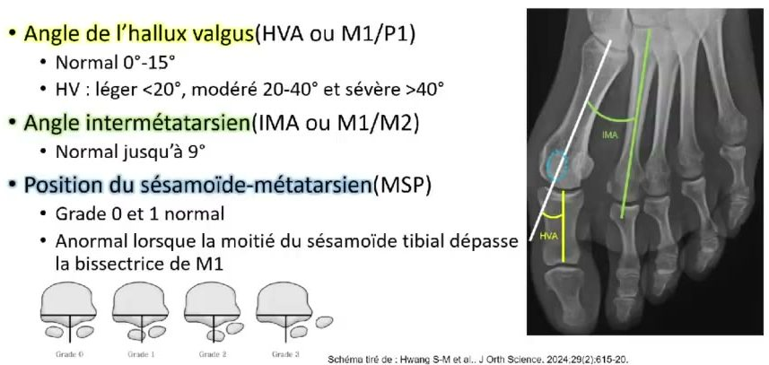
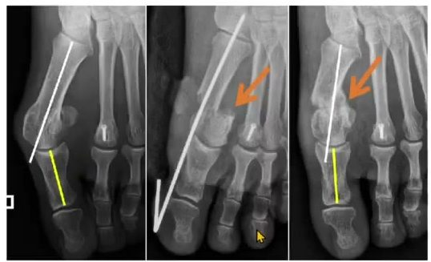
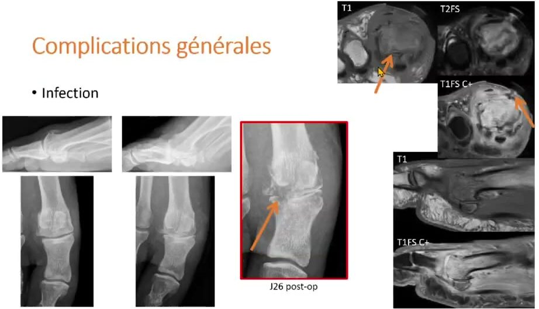

# Imagerie de l'avant-pied opéré

> [!abstract] L'essentiel
> **Radiographie en charge comparative = examen clé de l'avant-pied opéré** : 3 mesures (HVA, IMA, sésamoïdes), matériel, consolidation/fusion ; écho, TDM, IRM en 2e intention.

> [!success] À retenir
> 1. Mesures : **HVA** normal **0-15°** (objectif postop **< 20°**), **IMA** normal **≤ 9°** (objectif **< 12°**), **MSP grade 0-1** ; HVA et MSP postop sont pronostiques.
> 2. Ostéotomie **percutanée (MIS)** : pas d'ostéosynthèse, **déplacement marqué et cal hypertrophique attendus**, consolidation lente → ne pas parler de complication.
> 3. Complications : récidive **3-16 %**, pseudarthrose d'arthrodèse **≈ 7 %**, descellement (MTP1) ; **érosions + déminéralisation précoces = arthrite septique** → IRM injectée.

## Images clés
 [▶ 0:23](https://www.youtube.com/watch?v=DwIO0-p_k-w&t=23s)
 [▶ 2:52](https://www.youtube.com/watch?v=DwIO0-p_k-w&t=172s)
 [▶ 6:06](https://www.youtube.com/watch?v=DwIO0-p_k-w&t=366s)

## Points clés
- Mesures : angle d'hallux valgus (HVA, M1/P1), angle intermétatarsien (IMA, M1/M2), position des sésamoïdes (MSP) — normale si la tête reste dans les 50 % du sésamoïde tibial. En postopératoire, HVA mesuré depuis le centre de la nouvelle position de la tête ; HVA et MSP sont pronostiques.
- Objectifs postopératoires de l'hallux valgus : HVA < 20°, IMA < 12°, MSP normal (grade 0 ou 1).
- **Ostéotomies M1** : chevron distal (hallux valgus léger, translation ± rotation, vis) ; scarf (double chevron, IMA augmenté) ; vérifier le débord des vis vers l'articulation ou les sésamoïdes (profil utile). **Percutanées (MIS)** : pas d'ostéosynthèse, translation d'environ 75 % de la tête, cals hypertrophiques, consolidation lente jusqu'à 18 mois.
- Gestes adjuvants : bunionectomie (exostosectomie médiale), chéilectomie (ostéophyte dorsal + tiers dorsal de la tête) pour hallux rigidus, ostéotomie phalangienne varisante (Akin) ou de dorsiflexion (Moberg).
- Rayons latéraux : ostéotomie de Weil (raccourcissement, réduction de la luxation dorsale MTP), vis ou broche retirée.
- **Arthrodèses** : Lapidus (TMT1) pour hallux valgus sévère/IMA augmenté ; MTP1 = référence de l'hallux rigidus et de l'hallux valgus arthrosique ; IPP/IPD pour griffes.
- **Arthroplasties** : résection (polyarthrite rhumatoïde), implant de cartilage synthétique (Cartiva) ; à la MTP1, l'axe prothétique perpendiculaire à la charge explique une mauvaise tolérance à long terme, conversion en arthrodèse possible.
- **Complications** : infection (arthrite septique après chéilectomie : érosions, déminéralisation, puis IRM — remplacement T1 confluent, rehaussement, pertuis) ; atteinte du nerf cutané dorso-médial de l'hallux ; métatarsalgies de transfert (syndrome du 2e rayon, sésamoïdite, fractures de contrainte) ; récidive du malalignement (la plus fréquente après ostéotomie) ; pseudarthrose d'arthrodèse (interligne visible à 2 ans, liseré, pas toujours symptomatique) ; descellement (MTP1) ; rupture de matériel (vis, plaque), pas toujours synonyme de pseudarthrose.

## Sémiologie et technique d'imagerie
- Radiographie en charge et comparaison avec l'examen antérieur systématiques.
- Échographie : conflit, parties molles autour d'une vis qui recule.
- Scanner : position exacte du matériel, liseré, fusion osseuse, érosions péri-matériel.
- IRM (injectée) : ostéomyélite, infection médullaire, parties molles.

## Pièges et diagnostics différentiels
- Déplacement marqué et retard de consolidation sont attendus après chirurgie percutanée.
- Vis cassée avec fusion acquise ≠ pseudarthrose.

> [!WARNING] À ne pas manquer
> Érosions et déminéralisation périarticulaires précoces après chirurgie = arthrite septique jusqu'à preuve du contraire.

> [!TIP] Pour le compte rendu
> HVA, IMA, MSP ; type de chirurgie ; position et intégrité du matériel ; consolidation/fusion ; signes de transfert ou d'infection.

## Liens
- Congrès : [[SIMS 2024 - Index]]
- Voir aussi : [[Hallux valgus]], [[Rayons latéraux - pathologies et traitements]], [[Les autres pathologies de l'hallux]]
