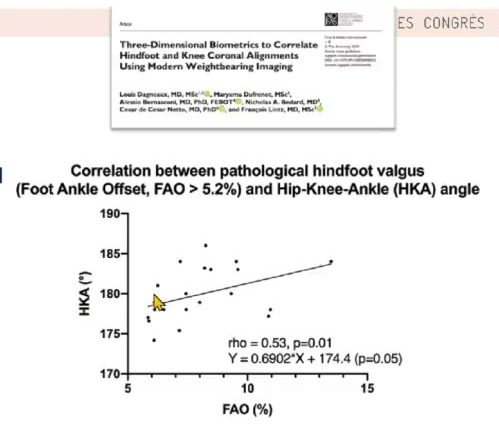
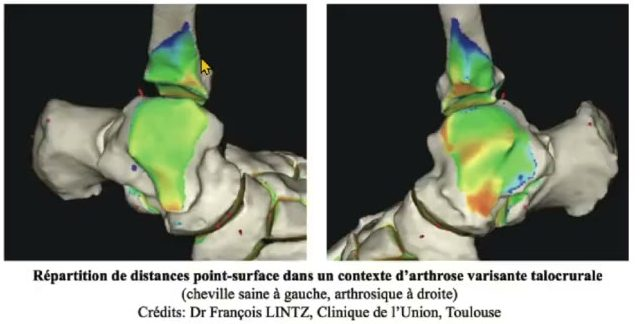

# Interactions entre le pied et les articulations du membre inférieur - place des nouvelles modalités

> [!abstract] L'essentiel
> **Genou et arrière-pied s'alignent ensemble : EOS + scanner en charge révèlent des phénotypes « valgus dominants » et « varus dominants »** ; à signaler avant chirurgie.

> [!success] À retenir
> 1. **HKA valgus** corrélé au **valgus d'arrière-pied** (FAO pathologique **> 5,2 %**, rho = 0,53) ; HKA neutre → arrière-pied plutôt neutre.
> 2. **Valgus dominant** (femme, faillite LCM et tibial postérieur) contre **varus dominant** (homme, tibia vara + varus d'arrière-pied, arthrose rapide).
> 3. **Varus d'arrière-pied** non corrigé spontanément après PTG : mesurer l'arrière-pied **en charge (WBCT, foot and ankle offset)** avant arthroplastie ; relations **non linéaires**.

## Images clés
 [▶ 6:31](https://www.youtube.com/watch?v=qujtzeMBpGk&t=391s)
 [▶ 7:55](https://www.youtube.com/watch?v=qujtzeMBpGk&t=475s)

## Points clés
- Historique : Scarpa (1803) décrit l'analogie entre l'articulation talo-naviculo-calcanéenne (« acetabulum pedis ») et la coxo-fémorale ; concept repris plus de 100 ans après (« coxa pedis »).
- Analogies de développement post-natal (détorsion coxo-fémorale et orientation talo-naviculaire passant d'environ 45° à 10° quasi simultanément), malformatives (protrusion/extrusion vs pied bot/pied plat congénital) et cinématiques (ouverture/fermeture de la chaîne lors du cycle de marche).
- Compensations connues : la rotation externe corrige le pied plat via le tibial postérieur ; un cal vicieux du segment jambier modifie la position du pied.
- Après prothèse de genou corrigeant la déformation arthrosique, l'arrière-pied se modifie entre 3 semaines et 1 an, sauf en cas de varus de l'arrière-pied : les interactions ne sont pas toujours possibles.
- La littérature est surtout 2D et sur des patients arthrosiques (capacité d'adaptation altérée) ; l'enjeu est de retrouver l'alignement constitutionnel pour prévenir la pathologie.
- Étude public-privé (avec F. Lintz, clinique de l'Union, Toulouse) combinant EOS (HKA 3D) et WBCT (foot and ankle offset), en excluant opérés, hyperlaxes et arthrosiques : HKA neutre associé à un arrière-pied plutôt neutre ; HKA valgus fortement corrélé au valgus d'arrière-pied ; dans le plan rotatoire (157 patients), corrélation rotation latérale / varus d'arrière-pied sans influence de la torsion fémorale.
- Nouveaux phénotypes : **valgus dominants** (valgus genou + arrière-pied, moment valgisant fort, souvent femmes, distension du LCM et faillite du tibial postérieur, « faillite des parties molles ») et **varus dominants** (plutôt hommes, tibia vara + varus d'arrière-pied, sujets rigides, arthrose rapide).
- Jusqu'à 35 phénotypes d'alignement du genou décrits dans la population générale grâce à la biométrie 3D.

## Sémiologie et technique d'imagerie
- EOS : mesures angulaires reproductibles et reconstruction 3D (modèle générique + analyse biplanaire) ; application à la planification de l'avant-pied (reconstruction de la courbure des têtes métatarsiennes).
- WBCT : nouvelles données biométriques 3D (foot and ankle offset), « distance mapping » (analyse surfacique et volumétrique).
- Facteurs intrinsèques modulateurs : IMC, densité osseuse, propriétés des parties molles (explorables en élastographie).
- Compensation sous-talienne altérée par l'arthrose ou l'âge (moins efficace après 65 ans) ; orientation de la talo-crurale à analyser selon la déformation sus-jacente.

## Pièges et diagnostics différentiels
- Les interactions sont non linéaires : pas de règle simple « varus au-dessus = varus en dessous ».
- Les études 2D et les cohortes arthrosiques ne reflètent pas l'alignement constitutionnel.

> [!WARNING] À ne pas manquer
> Un varus d'arrière-pied ne se corrige pas spontanément après correction de l'axe du genou par prothèse : l'arrière-pied doit être évalué avant arthroplastie.

> [!TIP] Pour le compte rendu
> En bilan d'alignement, associer si possible mesures globales (HKA, EOS) et mesures d'arrière-pied en charge (WBCT, foot and ankle offset) et signaler le phénotype (valgus/varus dominant) au chirurgien.

## Liens
- Congrès : [[SIMS 2024 - Index]]
- Voir aussi : [[Ceci n'est pas un pied mécanique]], [[Le tibial postérieur]], [[50 ans d'imagerie du pied]]
