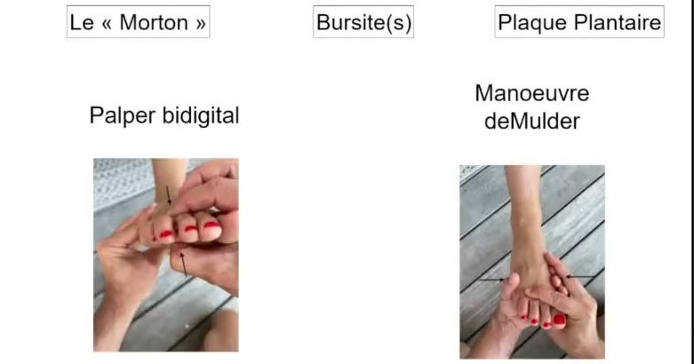
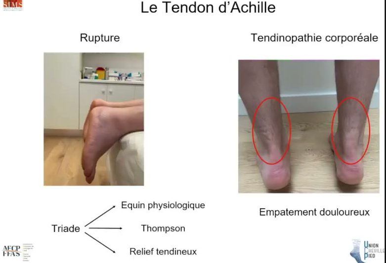

# L'examen clinique du pied

> [!abstract] L'essentiel
> **Une anomalie indolore n'est qu'un particularisme, seule l'anomalie douloureuse est pathologique** : l'imagerie doit répondre à la question clinique, pas décrire des angles.

> [!success] À retenir
> 1. **Morton = 3e espace** (99 %) : palper bidigital + manœuvre de **Mulder** ; douleur de MTP2 avec hallux valgus = **bursite ou plaque plantaire**, pas un Morton.
> 2. Rupture du tendon calcanéen = **triade** (perte de l'équin physiologique, **Thompson**, perte du relief) ; les ruptures partielles « n'existent pas » pour l'orateur.
> 3. Toute arthropathie **sous-talienne** fait mal au **sinus du tarse** : sinus indolore → douter du diagnostic ; exception à la règle : pied neurologique (**Charcot**).

## Images clés
 [▶ 4:34](https://www.youtube.com/watch?v=YHP7cY3INbQ&t=274s)
 [▶ 7:56](https://www.youtube.com/watch?v=YHP7cY3INbQ&t=476s)

## Points clés
- L'examen clinique fait économiser du temps et des examens inutiles (piles d'IRM, scintigraphies, échographies parfois nuisibles).
- Approche mixte topographique (avant-pied, médio-pied, arrière-pied, cheville) et fonctionnelle (articulation, tendons, ligaments, neurovasculaire).
- **1er rayon** : hallux valgus (ce qui compte est la réductibilité et l'atteinte arthrosique, plus que la valeur exacte du métatarsus varus), hallux rigidus (couronne ostéophytique douloureuse), hallux varus.
- **Rayons latéraux** : Morton dans 99 % des cas au 3e espace (palper bidigital, manœuvre de Mulder) ; Morton des 1er/2e espaces quasi inexistant pour l'orateur ; douleur centrée sur MTP2 avec hallux valgus = bursite ou lésion de plaque plantaire (insuffisance d'appui du 1er rayon), diagnostiquée par palpation bidigitale de la MTP2.
- 5e rayon : quintus varus avec inflammation MTP5 ; griffes visibles.
- **Médio-pied** : arthropathie de Lisfranc (cunéo-métatarsienne), tarse bossu douloureux ; rechercher une composante arthrosique.
- **Arrière-pied** : enthésopathie calcanéenne à distinguer de la tendinopathie corporéale (douleur à la propulsion sur la pointe des pieds) ; syndrome de Haglund = traduction douloureuse d'un trouble morphologique (pente calcanéenne).
- Tibial postérieur : douleur de l'enthèse si os naviculaire accessoire ; tendinopathie = douleur traçante rétro-malléolaire médiale, montée sur pointe des pieds ; pas toujours associée à un pied plat valgus.
- Fibulaires : douleur rétro-malléolaire latérale et à l'éversion contrariée ; varus d'arrière-pied fréquent mais inconstant.
- Rupture du tendon calcanéen : triade disparition de l'équin physiologique, signe de Thompson, perte du relief tendineux (« coup de hache ») ; les ruptures partielles « n'existent pas » pour l'orateur.
- Tibio-talienne : douleur en fer à cheval sur l'interligne, ostéophytes palpables. Sous-talienne : toute arthropathie sous-talienne fait mal au sinus du tarse.

## Sémiologie et technique d'imagerie
- Pas de technique d'imagerie détaillée : l'orateur attend du radiologue qu'il confronte l'imagerie à la question posée par une prescription détaillée.

## Pièges et diagnostics différentiels
- « Morton du 2e espace » = souvent bursite / plaque plantaire.
- Sinus du tarse indolore → se méfier du diagnostic d'arthropathie sous-talienne.
- Exception à la règle « indolore = particularisme » : pathologies neurologiques (pied de Charcot).

> [!WARNING] À ne pas manquer
> Des angles hors normes mais indolores ne sont pas une pathologie ; des angles normaux mais douloureux le sont.

> [!TIP] Pour le compte rendu
> Établir la concordance entre la question clinique et l'imagerie, éviter les comptes rendus longs non ciblés.

## Liens
- Congrès : [[SIMS 2024 - Index]]
- Voir aussi : [[Rayons latéraux - pathologies et traitements]], [[Le tibial postérieur]], [[Démembrement des atteintes distales du tendon calcanéen]]
