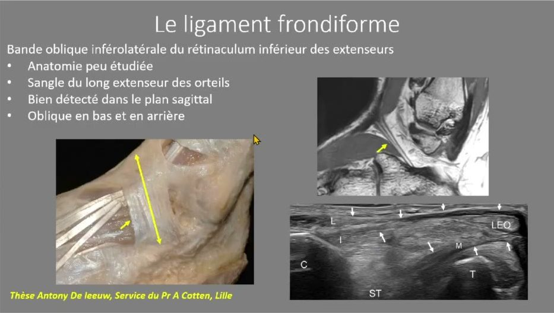
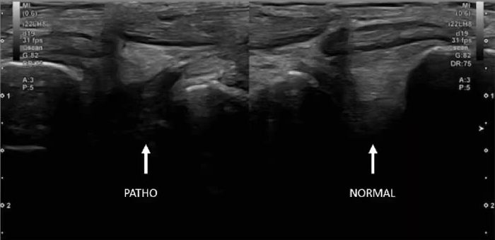
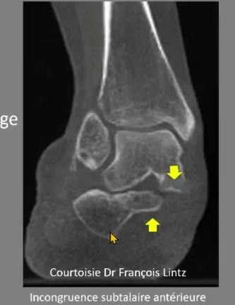

# Le complexe talocalcanéonaviculaire, le sinus du tarse et le ligament frondiforme

> [!abstract] L'essentiel
> **Sinus du tarse et coxa pedis : ligament interosseux accessible en écho par voie médiale, frondiforme = sangle du long extenseur des orteils** ; l'instabilité subtalaire exige une imagerie multimodale.

> [!success] À retenir
> 1. Écho du **ligament interosseux talocalcanéen** par voie médiale : **infiltration de la graisse** (comparative) et ouverture anormale en **valgus dynamique** = pathologique.
> 2. **Ligament frondiforme** : bande oblique en bas et en arrière du rétinaculum inférieur des extenseurs, **4 racines**, au mieux en **IRM sagittale 3D DP/T2**.
> 3. Instabilité subtalaire : **CBCT en charge** (incongruence subtalaire antérieure), scanner 4D, **écho dynamique en varus** de la subtalaire postérieure si rupture du calcanéofibulaire.

## Images clés
 [▶ 3:28](https://www.youtube.com/watch?v=45AMU1WuhmQ&t=208s)
 [▶ 5:31](https://www.youtube.com/watch?v=45AMU1WuhmQ&t=331s)
 [▶ 6:29](https://www.youtube.com/watch?v=45AMU1WuhmQ&t=389s)

## Points clés
- **Anatomie** : compartiment subtalaire postérieur et complexe talocalcanéonaviculaire, séparés par le **sinus du tarse** (grand orifice antérolatéral, petit orifice postéromédial).
- Surfaces subtalaires à courbure inversée : postérieure convexe vers le haut, antérieure concave ; **interligne intermédiaire** dans 50 % des cas. Facettes antérieure et intermédiaire + tête du talus + naviculaire + spring ligament = **coxa pedis** (analogie avec la hanche).
- Talocrurale : mobilité quasi exclusivement sagittale ; subtalaire et coxa pedis : mobilité axiale et frontale (roulement, rotation/pronosupination, glissement).
- **Stabilité passive** : ligament interosseux talocalcanéen (versant médial du sinus), **ligament cervical** (versant latéral, « sentinelle du sinus »), ligament frondiforme (ferme l'orifice antérolatéral), **ligament capsulaire antérieur** de la subtalaire postérieure (élément clé de stabilité, ~2 mm à l'état normal, peut être aminci ou épaissi) ; en périphérie : calcanéofibulaire, tibiospring, tibiocalcanéen ; spring ligament (support de la tête du talus : faisceau supéromédial, faisceaux inféroplantaire et médioplantaire oblique).
- **Stabilité active** : fléchisseurs en dedans, fibulaires en dehors.
- **Ligament frondiforme** (travaux de l'équipe d'Anne Cotten, Lille) : correspond à la **sangle du long extenseur des orteils**, trajet oblique en bas et en arrière, bien vu en IRM sagittale et en **IRM 3D DP ou T2**. Composantes superficielle et profonde ; **quatre racines** : latérale (calcanéus), intermédiaires latérale et médiale (souvent réunies, calcanéus), médiale (talus dans 50 % des cas, et surtout ligament interosseux talocalcanéen).
- **Pathologie** : syndrome du sinus du tarse (lésions post-traumatiques, fibrose, dégénérescence mucoïde, kystes des ligaments intrasinusiens), arthropathies mécaniques ou rhumatismales, synostoses, **instabilité subtalaire** (diagnostic clinique et en imagerie difficile).

## Sémiologie et technique d'imagerie
- **Échographie du ligament interosseux talocalcanéen par voie médiale** : sonde coronale sur la face médiale, de la subtalaire postérieure vers l'avant ; élargissement = orifice postéromédial du sinus ; puis interligne subtalaire antérieur. Le ligament est profond, sous la graisse, le faisceau supéromédial du spring et le tendon tibial postérieur.
- Rechercher une **infiltration de la graisse** (examen comparatif) et faire du **dynamique en valgus** : ouverture anormale du sinus avec ligament interosseux infiltré/désorganisé = pathologique.
- **Instabilité subtalaire** :
  - **CBCT en charge** : incongruences subtalaires antérieures démasquées par la charge ;
  - **scanner 4D** : instabilité talonaviculaire visible, mais difficile à mettre en œuvre en pratique ;
  - **échographie dynamique en varus** : ouverture pathologique du compartiment subtalaire postérieur en cas de rupture du calcanéofibulaire (comparer au côté sain).

## Pièges et diagnostics différentiels
- Instabilité subtalaire et syndrome du sinus du tarse : tableaux peu spécifiques, souvent associés à l'instabilité latérale.

> [!WARNING] À ne pas manquer
> Rupture du calcanéofibulaire : tester aussi la subtalaire postérieure en varus, pas seulement la talocrurale.

> [!TIP] Pour le compte rendu
> Décrire les ligaments du sinus (interosseux, cervical, frondiforme), l'infiltration graisseuse, le spring et le calcanéofibulaire, et le comportement dynamique ; évoquer une instabilité subtalaire et proposer CBCT en charge si besoin.

## Liens
- Congrès : [[SIMS 2024 - Index]]
- Voir aussi : [[Les lésions ligamentaires de la cheville - échographie versus IRM]], [[Arthropathies mécaniques de la cheville - étiologie et imagerie]], [[Pied plat - éléments cliniques et paracliniques orientant le geste chirurgical]]
