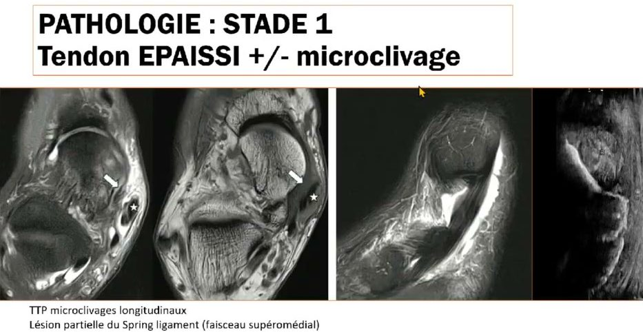
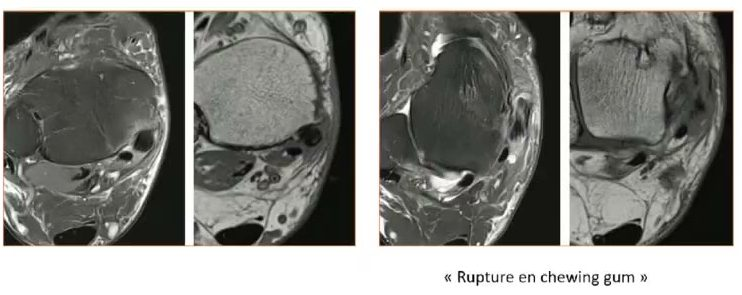
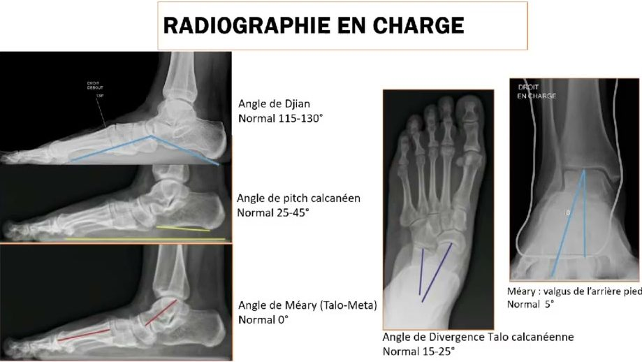

# Le tibial postérieur

> [!abstract] L'essentiel
> **Dysfonction du tibial postérieur = première cause de pied plat valgus acquis de l'adulte** : grader le tendon (épaissi → aminci → rompu) et toujours demander des **radios en charge bilatérales**.

> [!success] À retenir
> 1. Stades : **1** tendon épaissi ± microclivages (± spring ligament) ; **2** tendon **aminci** = rupture partielle « en chewing-gum » ; **3** rupture complète (gouttière vide).
> 2. En charge : angle de Djian **> 130°** (normal 115-130°), pitch calcanéen **< 25°**, cassure de Méary (normal **0°**), divergence talo-calcanéenne **> 25°**.
> 3. Pièges : enthèse naviculaire évasée et angle magique ≠ lésion ; **os naviculaire accessoire de type 2** (synchondrose) seul pathogène ; luxation aiguë du sportif prise pour une entorse.

## Images clés
 [▶ 5:24](https://www.youtube.com/watch?v=7fcWfl1Hxsk&t=324s)
 [▶ 6:04](https://www.youtube.com/watch?v=7fcWfl1Hxsk&t=364s)
 [▶ 7:18](https://www.youtube.com/watch?v=7fcWfl1Hxsk&t=438s)

## Points clés
- Rôle : flexion plantaire, inversion et surtout stabilisation de l'arche médiale → raisonner en statique du pied.
- Origine tibia, fibula, membrane interosseuse ; trajet vertical rétro-malléolaire puis horizontal sous la malléole ; insertion complexe : faisceau antérieur principal (~90 %) sur le versant plantaire du naviculaire et la capsule cunéo-naviculaire, faisceaux moyen et postérieur accessoires (métatarsiens, cuboïde, cunéiformes).
- Enthèse distale évasée avec noyau fibrocartilagineux (sésamoïde) au contact du spring ligament → calibre augmenté, replis graisseux, hypersignal focal, angle magique (réduit par flexion plantaire en procubitus).
- Fréquence : ~3 % des femmes après 45 ans, près de 10 % de la population après 65 ans.
- Classification chirurgicale de Johnson et Strom modifiée par Myerson (stade 4) ; à ne pas confondre avec les stades d'imagerie 1-2-3 du tendon.
- Stades d'imagerie : ténosynovite abondante (± infiltration sous-cutanée, œdème osseux, spicule à l'insertion du rétinaculum des fléchisseurs) → stade 1 tendon épaissi avec clivages (± lésion du faisceau supéro-médial du spring ligament) → aspect « chewing-gum » : amincissement = rupture partielle avancée → rupture complète (gouttière vide).
- **Luxation aiguë** (rare, sportif, flexion plantaire-inversion) : désinsertion du rétinaculum ou décollement périosté type « Bankart » ; souvent prise pour une entorse ; au stade chronique tendon aplati méconnu.
- **Os naviculaire accessoire** : types 1 (sésamoïde), 2 (aspect de pseudarthrose, seul pathogène), 3 (naviculaire cornu) ; asymétrie fréquente ; syndrome douloureux = œdème de l'os, de l'enthèse ou de la synchondrose.

## Sémiologie et technique d'imagerie
- Échographie, trois coupes de référence : axiale rétro-malléolaire (tendon deux fois plus gros que les fléchisseurs, plus antérieur et médial), longitudinale (jonction myotendineuse), axiale distale (enthèse, interface spring ligament, os accessoire).
- IRM : hyposignal T1/T2 sauf portion distale ; une fine lame liquidienne est normale.
- Bilan en charge bilatéral : angle de Djian-Annonier (« diamant ») > 130-135°, horizontalisation de la pente calcanéenne, cassure de la ligne de Méary ; face et cliché de Méary avec cerclage : valgus majoré, divergence talo-calcanéenne augmentée, découverture de la tête du talus.
- Injection de gadolinium non indiquée en bilan initial (sauf suspicion de rhumatisme inflammatoire : ténosynovite épaisse rehaussée).

## Pièges et diagnostics différentiels
- Particularités de l'enthèse et angle magique ≠ lésion.
- Un tendon d'emblée fin en coupe axiale n'est pas normal.
- Rupture complète rarement visible comme solution de continuité nette (comblement hétérogène).

> [!WARNING] À ne pas manquer
> La rupture chronique est souvent silencieuse et méconnue dans les CR : rechercher l'affaissement de l'arche et vérifier les trois tendons médiaux dans la gouttière (luxation).

> [!TIP] Pour le compte rendu
> Stade lésionnel du tendon, état du spring ligament, os accessoire, et mesures en charge (signes de gravité intégrés à la stadification thérapeutique).

## Liens
- Congrès : [[SIMS 2024 - Index]]
- Voir aussi : [[Imagerie des ligaments de la cheville]], [[Tendons de la cheville - à quoi ça sert, comment ça marche]], [[Interactions entre le pied et les articulations du membre inférieur - place des nouvelles modalités]]
