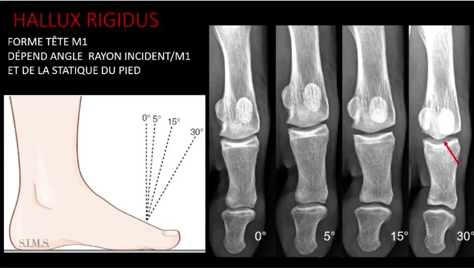
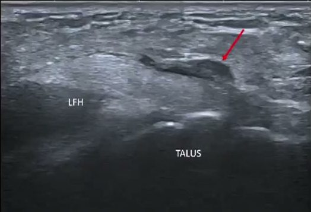
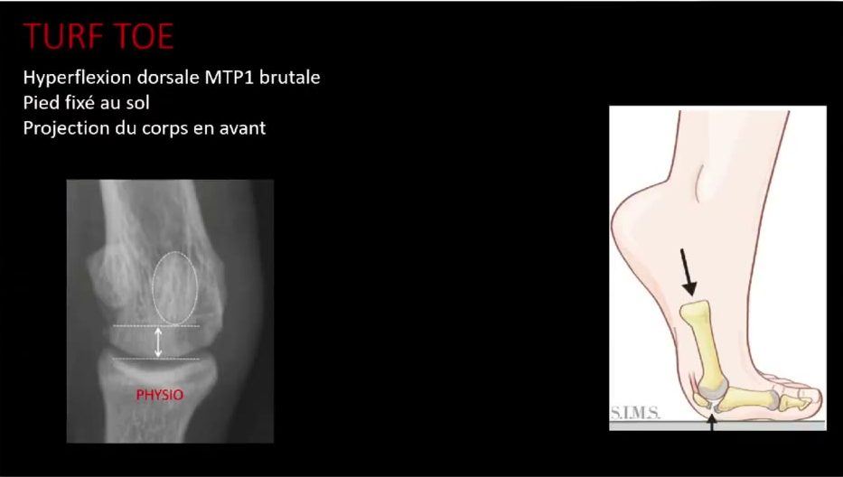

# Les autres pathologies de l'hallux

> [!abstract] L'essentiel
> **Hallux douloureux sans hallux valgus : penser hallux limitus fonctionnel (LFH bloqué sous la poulie rétro-talienne), entorses MTP1 à stader et luxation MTP1 irréductible.**

> [!success] À retenir
> 1. **Hallux limitus fonctionnel** : flexion dorsale MTP1 **< 40° cheville en flexion dorsale** (stretch test), MTP1 radiologiquement normale → écho dynamique du **LFH et de la poulie rétro-talienne**.
> 2. **Turf toe** : **recul du sésamoïde tibial** (normalement plus distal que le fibulaire) = lésion grave de la plaque plantaire → IRM ; grades 1–2 explorables en écho.
> 3. Luxation MTP1 dorsale **type 2A** (bloc sésamoïdo-phalangien sans diastasis inter-sésamoïdien) = **irréductible → chirurgie** ; tête de M1 « plate/pointue » dépend de l'incidence du rayon.

## Images clés
 [▶ 0:44](https://www.youtube.com/watch?v=DOHv0iSWXkQ&t=44s)
 [▶ 3:21](https://www.youtube.com/watch?v=DOHv0iSWXkQ&t=201s)
 [▶ 4:45](https://www.youtube.com/watch?v=DOHv0iSWXkQ&t=285s)

## Points clés
- **Hallux rigidus** : la tête « plate ou pointue » décrite comme facteur de risque dépend en fait de l'incidence du rayon (sphérique à 0°, aplatie à 5-15°, pointue à 30° par projection de la crête intersésamoïdienne) → critère discutable. L'échographie détecte, dans les formes douloureuses à radiographie normale, ostéophytes débutants et lésions chondrales dorsales.
- **Hallux limitus fonctionnel** : flexion dorsale MTP1 < 40° en fin de pas, par effet ténodèse du long fléchisseur de l'hallux (LFH) sous la poulie rétro-talienne ; favorisé par des microtraumatismes sportifs. Conséquences : douleur du LFH, supination de l'avant-pied, métatarsalgies latérales, peut-être Morton, contraintes talonnières (fasciopathie), instabilité de cheville.
- Poulie rétro-talienne : sangle tendue entre les deux tubercules postérieurs du talus, histologie identique à la poulie A2 des doigts, visible en échographie (bande hypoéchogène).
- **Stretch test** : MTP1 libre en flexion plantaire de cheville, limitée (< 40°) en flexion dorsale de cheville, sans arthropathie MTP1.
- Formes : LFH épaissi nodulaire en amont d'une poulie épaissie avec épanchement ; ou jonction myotendineuse basse du LFH butant contre une poulie normale. Variante : **hallux saltans** (ressaut audible du LFH sous la poulie). Traitement chirurgical si échec médical : résection de poulie, ténosynovectomie arthroscopique (équipes suisses).
- **Turf toe** : hyperflexion dorsale brutale MTP1, pied fixé au sol. Signe radiographique : le sésamoïde tibial (médial), normalement plus distal que le fibulaire, recule → lésion grave. Grades bénins analysables en échographie (épaississement du ligament sésamoïdo-phalangien/métatarsien médial, petite avulsion) ; grade 3 → IRM pour bilan ligamentaire précis. Le stadage conditionne immobilisation et rééducation.
- **Sand toe** (beach-volley) : hyperflexion plantaire MTP1, lésion de la capsule dorsale épaissie, rehaussée en IRM ; immobilisation et rééducation spécifiques.
- **Skimboarder toe** : hyperflexion dorsale + contraction violente du long extenseur → lésions des expansions extenseurs (bandes rétinaculaires millimétriques anisotropes), cicatrisation hypertrophique douloureuse, possible instabilité/ressaut des extenseurs.
- **Luxations MTP1** : réduire rapidement ; presque toutes réductibles orthopédiquement sauf le **type 2A** (luxation dorsale du complexe sésamoïdo-phalangien en bloc sans diastasis intersésamoïdien) → chirurgie à ciel ouvert.

## Sémiologie et technique d'imagerie
- Échographie dynamique (flexion-extension de l'hallux) pour la poulie et le LFH ; IRM avec gadolinium pour capsule dorsale et expansions extenseurs.

## Pièges et diagnostics différentiels
- Fracture sésamoïdienne vs sésamoïde bipartite : imagerie en coupes (scanner/IRM) en cas de doute.
- Solution de continuité unique de la corticale plantaire d'un sésamoïde = artère sésamoïdienne (issue de la 1re artère métatarsienne plantaire), pas une fracture.

> [!WARNING] À ne pas manquer
> Luxation MTP1 dorsale de type 2A : irréductible, appeler le chirurgien. Recul du sésamoïde tibial : lésion grave de la plaque plantaire.

> [!TIP] Pour le compte rendu
> Stader l'entorse MTP1 (structures lésées, avulsion, position des sésamoïdes) et, devant une métatarsalgie latérale ou une douleur du LFH, rechercher un conflit LFH/poulie rétro-talienne.

## Liens
- Congrès : [[SIMS 2024 - Index]]
- Voir aussi : [[Hallux valgus]], [[Faire une écho de l'avant-pied]], [[Rayons latéraux - pathologies et traitements]]
