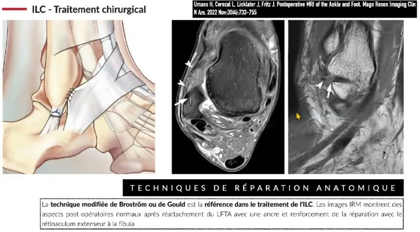
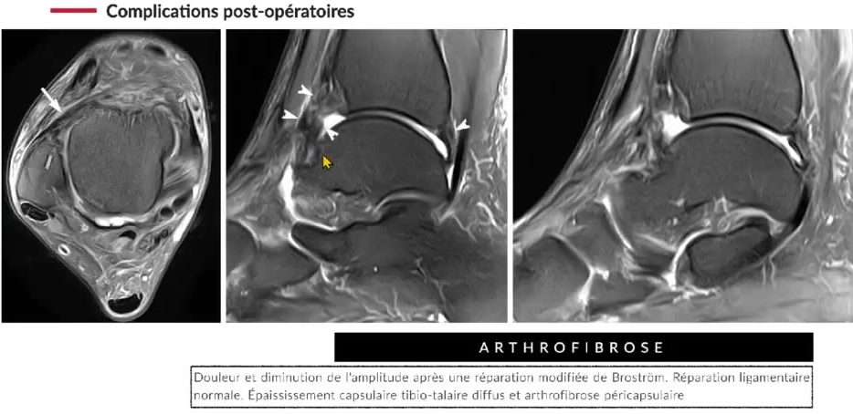
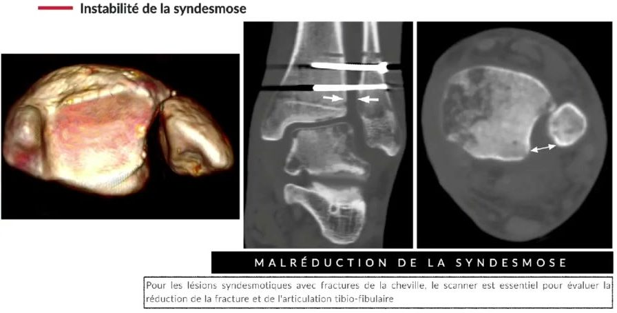

# Les ligaments de la cheville - imagerie postopératoire normale et pathologique

> [!abstract] L'essentiel
> **Après chirurgie ligamentaire de cheville : IRM pour les complications, scanner pour la réduction de la syndesmose** ; le Broström-Gould est la référence à reconnaître.

> [!success] À retenir
> 1. **Broström modifié (Gould)** normal : LTFA réinséré par ancre fibulaire, renforcé par le **rétinaculum des extenseurs**, continu en IRM à 3 mois ; une augmentation synthétique a un aspect quasi ligamentaire.
> 2. Raideur douloureuse avec réparation normale → **arthrofibrose** : épaississement capsulaire tibio-talien diffus, bandes fibreuses, récessus oblitérés.
> 3. Syndesmose opérée : **scanner** pour la **malréduction** tibio-fibulaire ; chercher aussi récidive d'instabilité, lésion ostéochondrale, fibulaires, névrome de portail (écho).

## Images clés
 [▶ 2:45](https://www.youtube.com/watch?v=X_OTwnPrbdo&t=165s)
 [▶ 7:01](https://www.youtube.com/watch?v=X_OTwnPrbdo&t=421s)
 [▶ 9:36](https://www.youtube.com/watch?v=X_OTwnPrbdo&t=576s)

## Points clés
- Chirurgie de l'instabilité en hausse grâce à une meilleure compréhension et à l'**arthroscopie**. Instabilité latérale chronique la plus fréquente ; environ **40 %** des entorses latérales gardent des douleurs chroniques.
- Nouveaux concepts : **microinstabilité** (rupture du faisceau supérieur du ligament talofibulaire antérieur) et **instabilité rotatoire** (entorse latérale + lésion de la partie antérieure, surtout superficielle, du deltoïde). Conséquences : conflits, lésions ostéochondrales, lésions du rétinaculum supérieur des fibulaires et des tendons fibulaires.
- **Réparation anatomique** de référence : **Broström modifié (Gould)** = suture ligamentaire renforcée par le rétinaculum inférieur des extenseurs, souvent entièrement arthroscopique.
- Tissus de mauvaise qualité : réparation anatomique **augmentée** par ligament synthétique, ou **reconstruction anatomique** par autogreffe (gracile, plantaire grêle).
- Reconstructions **non anatomiques** (ténodèses) quasi abandonnées mais encore rencontrées en suivi.
- **Médial** : réparation ou reconstruction anatomique du deltoïde, ± augmentation synthétique ou greffe.
- **Syndesmose** : nombreuses techniques ; l'essentiel est la réduction ; réparation anatomique avec renforcement ou fixation dynamique par bouton.

## Sémiologie et technique d'imagerie
- **Échographie** : cicatrisation ligamentaire, sutures, ancres, renfort rétinaculaire ; complications superficielles et **nerveuses** (névrome lié aux portails arthroscopiques).
- **IRM** : contrôle normal à 3 mois (ligament continu, renfort rétinaculaire visible), évaluation des ancres et de l'os ; augmentation synthétique d'aspect quasi ligamentaire à 3, 6, 9 mois.
- **Scanner** : indispensable pour juger la réduction de la syndesmose en postopératoire.

## Pièges et diagnostics différentiels
- **Complications précoces** : surtout de la plaie ; rarement nerveuses.
- **Tardives** : récidive ou persistance de l'instabilité (nouvelle entorse avec rupture complète de la réparation, même augmentée), rupture des reconstructions non anatomiques, lésion ostéochondrale du talus, **arthrofibrose** (réparation normale mais capsule et synoviale épaissies, bandes fibreuses, récessus oblitérés, raideur sévère), ténosynovite des fibulaires (technique non anatomique), infection, arthrose.
- Malréduction de la syndesmose → instabilité massive secondaire.

> [!WARNING] À ne pas manquer
> Raideur postopératoire avec ligament réparé normal : rechercher l'arthrofibrose (oblitération des récessus). Après chirurgie de la syndesmose, vérifier la réduction au scanner.

> [!TIP] Pour le compte rendu
> Préciser la technique (anatomique, augmentée, greffe, non anatomique), la continuité et l'épaisseur du néoligament, l'état des ancres et du matériel, les lésions associées (ostéochondrales, fibulaires, deltoïde) et toute complication nerveuse.

## Liens
- Congrès : [[SIMS 2024 - Index]]
- Voir aussi : [[Les lésions ligamentaires de la cheville - échographie versus IRM]], [[Les lésions ostéochondrales du dôme talien]]
