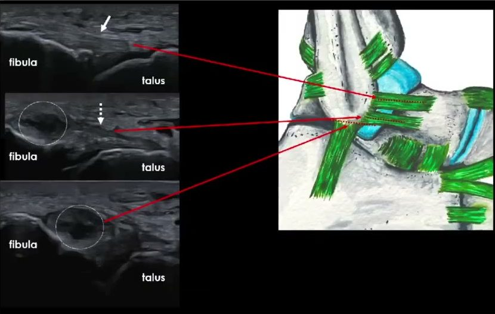
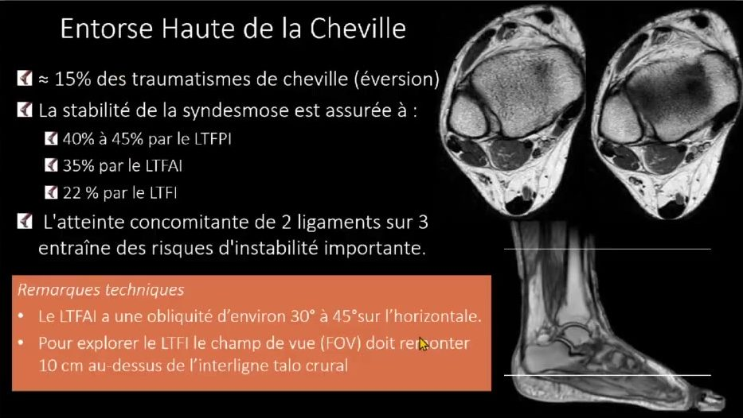

# Les lésions ligamentaires de la cheville - échographie versus IRM

> [!abstract] L'essentiel
> **Échographie dynamique et comparative en 1re intention de l'entorse ; IRM pour la syndesmose, le Chopart/spring, le sinus du tarse, l'os et avant chirurgie.**

> [!success] À retenir
> 1. LTFA souvent **bifide** : faisceau distal à **enthèse commune avec le LCF** ; manœuvres dynamiques (rotation médiale, varus) pour distinguer rupture, désinsertion et ligament continu distendu.
> 2. **Entorse haute ≈ 15 %** : stabilité par LTFPI (**40-45 %**), LTFAI (**35 %**), LTFI (**22 %**) ; **2 ligaments sur 3** atteints = instabilité → IRM avec FOV remontant **10 cm** au-dessus de l'interligne.
> 3. **Chopart** touché dans **73 %** des inversions, sinus du tarse **≈ 70 %**, avulsions/contusions osseuses **≈ 1/4** des entorses → domaine de l'IRM si discordance radioclinique.

## Images clés
 [▶ 3:30](https://www.youtube.com/watch?v=uZCwzeHdjlM&t=210s)
 [▶ 5:28](https://www.youtube.com/watch?v=uZCwzeHdjlM&t=328s)

## Points clés
- Objectifs : type d'entorse, ligaments atteints, gravité (élongation vs rupture), lésions associées (fractures, arrachements). Seules l'échographie et l'IRM démembrent l'ensemble des lésions.
- **Plan latéral** (80 % des lésions) : LTFA souvent **bifide** (faisceau proximal principal + faisceau distal accessoire), le faisceau distal ayant une **enthèse commune avec le ligament calcanéofibulaire**.
- **Manœuvre dynamique « double rotation »** (expérience lyonnaise, pied en bout de table) : tension en rotation médiale, détente en rotation latérale ; distingue rupture proximale, désinsertion distale et lésion bénigne.
- **Calcanéofibulaire** : test en varus (mise en tension) ; ligament infiltré mais continu et se tendant = fonctionnel ; moignon flottant sans mise en tension = rupture ; communication physiologique avec la gaine des fibulaires.
- Cas particulier : LTFA principal intact mais désinsertion du faisceau distal emportant l'enthèse commune avec le calcanéofibulaire.
- **IRM** : performances désormais proches de l'échographie (3D, reconstruction IA, séquences **ZTE** « silencieuses » pour les petites avulsions) ; gradation : épaississement avec perte fibrillaire (bénin), amincissement continu, rupture complète.
- **Entorse haute** (15 % des traumatismes, éversion) : stabilité assurée surtout par le ligament tibiofibulaire postéro-inférieur, puis antéro-inférieur, puis interosseux ; deux ligaments atteints = risque d'instabilité. Le ligament antéro-inférieur apparaît fragmenté en coupes 2D (ne pas conclure à une rupture). Explorer ~10 cm au-dessus de l'interligne pour le ligament interosseux.
- Désinsertion haute de l'interosseux + hypersignal hémicirconférentiel du tibia = « **anneau de feu rompu** » (décrit par Calder, nom transcrit), quasi pathognomonique d'une lésion syndesmotique instable.
- **Chopart** : atteint dans 73 % des traumatismes en inversion (isolé dans 5 à 33 % des cas). Ligaments talonaviculaire dorsal, bifurqué, calcanéocuboïdien : l'atteinte complète du Chopart est l'apanage de l'IRM.
- **Spring ligament** : faisceau supéromédial (visible en échographie) et deux faisceaux plantaires (médioplantaire oblique strié, inféroplantaire) visibles seulement en IRM (coupes axiales). Rupture du supéromédial possible en éversion ; en échographie, le tibiospring peut flotter dans la rupture.
- **Plan médial** (15 % des entorses, contre-coup en compression ou traction) : explorer en éventail avec variation de flexion ; faisceau tibiotalien postérieur (perte de l'interposition graisseuse hyperéchogène) ; avulsion du rétinaculum des fléchisseurs ; Doppler.
- **Sinus du tarse** (atteint dans 70 % des entorses) : ligament frondiforme, rétinaculum inférieur des extenseurs, ligament interosseux talocalcanéen, ligament cervical ; mieux vus en IRM coronale et sagittale ; en échographie, seul l'orifice latéral (ouverture en varus) : infiltration hypoéchogène profonde = suspicion de lésion.
- **Fractures et avulsions** : environ 1/4 des entorses ; échographie performante sur les reliefs superficiels (avulsion calcanéenne du ligament calcanéocuboïdien dorsal → chercher la fracture de la grande apophyse à l'enthèse du bifurqué ; avulsion de la pointe malléolaire).
- **Contusions osseuses** : ~1/4 des entorses, précisent le mécanisme, révèlent les fractures occultes, se normalisent en moins de 12 mois, bon pronostic.

## Sémiologie et technique d'imagerie
- Échographie : toujours **dynamique et comparative**.
- IRM : explorer haut pour la syndesmose, coupes axiales pour le spring.

## Pièges et diagnostics différentiels
- Radiographie « normale » avec impotence majeure : syndesmose + fracture de la malléole postérieure à l'IRM.

> [!WARNING] À ne pas manquer
> Toujours regarder la syndesmose (antérieure, interosseuse, postérieure) et le Chopart/spring : lésions fréquemment méconnues à l'échographie seule.

> [!TIP] Pour le compte rendu
> Pour chaque ligament : intact, lésion partielle, rupture (localisation proximale/distale), comportement dynamique ; lésions osseuses associées. IRM si discordance radioclinique, suspicion d'entorse haute ou sanction chirurgicale discutée.

## Liens
- Congrès : [[SIMS 2024 - Index]]
- Voir aussi : [[Les ligaments de la cheville - imagerie postopératoire normale et pathologique]], [[Le complexe talocalcanéonaviculaire, le sinus du tarse et le ligament frondiforme]]
