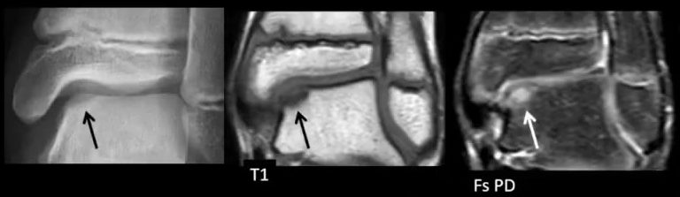
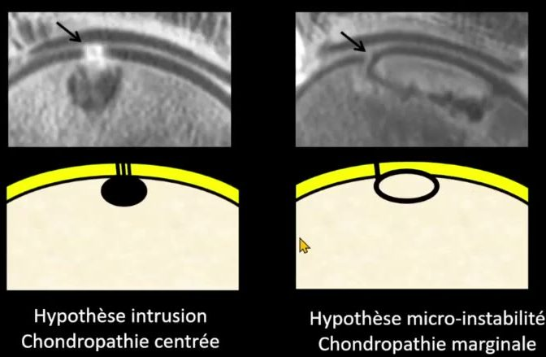
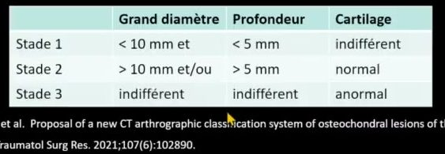

# Les lésions ostéochondrales du dôme talien

> [!abstract] L'essentiel
> **« Lésion ostéochondrale » du dôme talien = trois entités : ostéochondrose (médiale), fracture (latérale), conflit sur instabilité** : localiser, mesurer, juger la stabilité de la lésion **et de la cheville**.

> [!success] À retenir
> 1. Lésion **unique**, sans lésion en miroir, pincement ni ostéophyte (sinon arthrose) ; ostéochondrose **médiale dans 80 %**, fracture **latérale dans 80 %**.
> 2. Classification arthroscanner (Lopes 2021) : **stade 1 < 10 mm et < 5 mm** de profondeur ; **stade 2 > 10 mm et/ou > 5 mm**, cartilage normal ; **stade 3 = cartilage anormal**.
> 3. Géode : chondropathie **centrée** (intrusion) vs **marginale** (micro-instabilité) ; **délaminations** sous-diagnostiquées → reconstructions sagittales, IRM en traction.

## Images clés
 [▶ 2:23](https://www.youtube.com/watch?v=b_GSd4fMd7w&t=143s)
 [▶ 7:20](https://www.youtube.com/watch?v=b_GSd4fMd7w&t=440s)
 [▶ 5:11](https://www.youtube.com/watch?v=b_GSd4fMd7w&t=311s)

## Points clés
- **Définition** : lésion unique de l'os et du cartilage dans une articulation synoviale, sans autre anomalie : **pas de lésion en miroir** du pilon, **pas de pincement**, **pas d'ostéophyte** (ce n'est pas une arthrose).
- Deux profils : prédominance d'un ou plusieurs **nodules osseux**, ou prédominance de **remaniements géodiques** sous-chondraux.
- **Trois grands types** :
  1. **Trouble de croissance** (ostéochondrose) : nodule osseux enchâssé dans un défect, découvert parfois à l'âge adulte ; **médial dans 80 %** des cas (parfois latéral, central rare) ; émoussement régulier bien délimité du contour ; IRM hypo-T1, signal intermédiaire T2 ; pas d'épanchement, peu ou pas d'œdème.
  2. **Fracture** : **latérale dans 80 %** des cas ; interruption linéaire abrupte de l'os et du cartilage ; scanner/arthroscanner pour le cartilage ; IRM reine pour l'os ; ne pas oublier les **nodules ostéocartilagineux** libres.
  3. **Conflit sur instabilité** : contact du versant latéral du dôme avec la mortaise sur radiographie dynamique ; aspect proche du trouble de croissance mais avec **abrasion chondrale focale** en regard de la zone de contact.
- Ces catégories se chevauchent : une lésion de l'enfance peut s'exprimer à l'âge adulte, un traumatisme peut déstabiliser une ostéochondrose ; toutes peuvent, sans obligation, évoluer vers l'arthrose.
- **Cahier des charges** : détecter, localiser, mesurer, évaluer la stabilité de la lésion et **de la cheville**. Instabilité formelle si fragment déplacé ; improbable chez le sujet jeune, pour une petite lésion ou sans géodes de voisinage.
- Classifications multiples (une par équipe) ; classification arthroscanographique de Lopes et al. (2021) : stade 1 < 10 mm et < 5 mm de profondeur (cartilage indifférent), stade 2 > 10 mm et/ou > 5 mm avec cartilage normal, stade 3 cartilage anormal ; petite lésion : peu d'importance du cartilage, bonne évolution.

## Sémiologie et technique d'imagerie
- **Mécanismes des géodes sous-chondrales** :
  - micromobilité à l'interface d'une ostéochondrose non disséquée → remaniement lacunaire puis rupture (cartilage lésé **en périphérie** de la lésion) ;
  - **théorie de l'intrusion** : lésion chondrale première mettant en communication articulation et moelle → géode (cartilage lésé **centré** sur la géode) ;
  - contusion osseuse → nécrose, fibrose, résorption, géode ;
  - **décollement chondral / délamination** à l'interface cartilage-lame sous-chondrale, pouvant ensuite s'ouvrir en surface sous l'effet du cisaillement.
- Arthroscanner : l'iode et l'os ont la même densité → délamination difficile à voir en coronal, mieux sur les reconstructions sagittales ; en IRM, visible si du liquide s'interpose.
- IRM en traction : révèle des décollements chondraux invisibles sans traction.

## Pièges et diagnostics différentiels
- Ne pas qualifier de lésion ostéochondrale une arthrose (lésion en miroir, pincement, ostéophytes).
- Nous ne voyons qu'une partie des lésions chondrales : délaminations probablement plus fréquentes qu'on ne le pense.

> [!WARNING] À ne pas manquer
> Toujours évaluer la stabilité de la cheville : une lésion latérale de conflit traduit une instabilité à traiter.

> [!TIP] Pour le compte rendu
> Type probable, localisation (médiale/latérale/centrale), dimensions, état du cartilage, géodes, œdème, fragment ou nodule libre, signes d'instabilité de la lésion et de la cheville.

## Liens
- Congrès : [[SIMS 2024 - Index]]
- Voir aussi : [[Spécificités de la cheville et du pied traumatiques de l'enfant et de l'adolescent]], [[Les lésions ligamentaires de la cheville - échographie versus IRM]]
