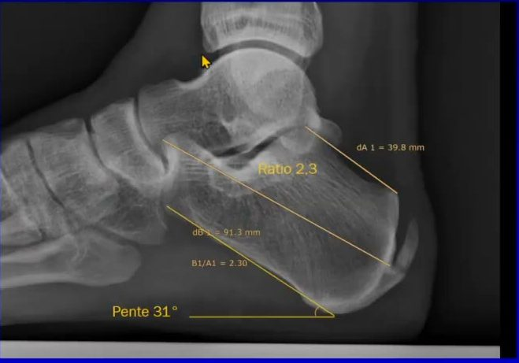
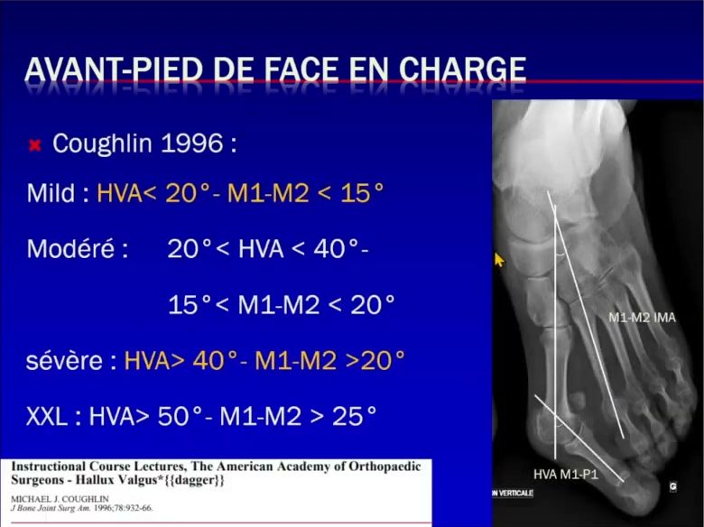

# Les mesures 2D, comment et pourquoi, leurs limites

> [!abstract] L'essentiel
> **Peu de mesures 2D changent la chirurgie, mais celles-ci doivent figurer au CR, sur clichés en charge** : forme du calcanéus, axe de l'arrière-pied, M1-M2 / M1-P1, DMAA, angle talonaviculaire.

> [!success] À retenir
> 1. Talalgie postérieure : **pente calcanéenne > 20°** et **rapport de Tourné < 2,5** (calcanéus long) → ostéotomie de fermeture dorsale (Zadek) plutôt que calcanéoplastie.
> 2. Hallux valgus (Coughlin) : **M1-P1** et **M1-M2** (modéré **20-40° / 15-20°**, sévère **> 40° / > 20°**) + **DMAA** (normal **< 10°**, pathologique **> 15°**, risque de récidive).
> 3. Avant-pied de face : **angle talonaviculaire > 7°** = pied plat ; axe de l'arrière-pied normal **≈ 6° de valgus** (Méary/Djian) : préciser la méthode, normes différentes de Saltzman / *long axial view*.

## Images clés
 [▶ 3:33](https://www.youtube.com/watch?v=MpYR4-2uDSA&t=213s)
 [▶ 6:15](https://www.youtube.com/watch?v=MpYR4-2uDSA&t=375s)

## Points clés
- Mesures uniquement sur **radiographies en charge**.
- **Profil** : l'angle de l'arche interne a peu d'intérêt. Plus utiles : la **ligne de Méary** (talus-M1, colonne médiale talus-naviculaire-cunéiforme médial-M1) pour localiser le point de cassure (talonaviculaire dans un pied plat postérieur, cunéo-M1 dans un pied plat antérieur, formes mixtes dans le pied creux).
- **Pente calcanéenne** (reflet de la colonne latérale) : pathologique au-delà de **20°** (verticalisation du calcanéus → conflit postérieur avec le tendon calcanéen).
- Angle de **Chauveaux-Liet** (pente calcanéenne moins angle de verticalisation) : normalement < 10°, jugé peu concordant avec la clinique par les chirurgiens.
- **Rapport de Tourné** (Yves Tourné, Grenoble, 2018) : longueur du calcanéus / longueur de la grosse tubérosité ; **< 2,5 = calcanéus long**. Rapport < 2,5 et pente > 20-25° orientent vers une ostéotomie de fermeture dorsale (type **Zadek**, décrite dans les années 1930).
- **Axe de l'arrière-pied selon Méary** (face, talon surélevé, cerclage métallique) : l'axe tibial passe normalement à l'union des deux tiers externes et du tiers interne de la partie rectiligne sous-talonnière du fil. L'orateur rappelle la définition originale des ouvrages de Chevrot. Mesure de Djian : axe entre la verticale au plan d'appui et le milieu du talus et du plan d'appui ; valeur normale ~**6° de valgus**.
- Ces techniques sont francophones ; les anglo-saxons utilisent l'incidence de **Saltzman** ou la ***long axial view*** (deux pieds en charge un peu écartés, rayon incliné à 45° centré sur les tibiotarsiennes, chevilles un peu fléchies) où axe tibial et axe calcanéen sont normalement alignés ; critères stricts de traçage de l'axe calcanéen. Les angles obtenus ne sont pas identiques.
- **Avant-pied de face en charge** : angles **M1-M2** et **M1-P1** à donner systématiquement (classification de Coughlin, 1996 : hallux valgus modéré, sévère, très sévère → type de chirurgie) ; éventuellement P1-P2.
- **DMAA** (orientation de la surface articulaire de la tête de M1 par rapport à l'axe de M1) : normalement **< 10°**, pathologique au-delà de **15°** (diapo) ; difficile à tracer, une description « DMAA semblant augmenté » suffit, mais à signaler (risque de récidive d'hallux valgus si non pris en compte).
- **Découverture médiale du talus** sur l'avant-pied de face : distance entre points les plus médiaux des surfaces talienne et naviculaire ; **angle talonaviculaire** pathologique au-delà de **7°** (pied plat selon Polichetti) → pied plat visible sur un simple cliché d'avant-pied.
- Observation personnelle (non encore démontrée) : sur les clichés de Guntz non trop rognés, les patients avec **triceps court** auraient souvent des pentes taliennes inclinées plutôt qu'horizontales.

## Sémiologie et technique d'imagerie
- Qualité des clichés (charge, repères métalliques, incidence) = condition de mesures fiables et reproductibles, avec ou sans IA.

## Pièges et diagnostics différentiels
- Ne pas mélanger méthodes Méary/Djian et Saltzman/*long axial view* : normes différentes.
- Habitudes régionales variables.

> [!WARNING] À ne pas manquer
> Un DMAA augmenté non signalé expose à une récidive après chirurgie d'hallux valgus.

> [!TIP] Pour le compte rendu
> Hallux valgus : M1-M2, M1-P1 (± P1-P2), DMAA. Talalgie postérieure : pente calcanéenne et rapport de Tourné. Pied plat : Méary, angle talonaviculaire, axe de l'arrière-pied en précisant la méthode.

## Liens
- Congrès : [[SIMS 2024 - Index]]
- Voir aussi : [[Pied plat - éléments cliniques et paracliniques orientant le geste chirurgical]], [[Apports du cone beam en charge dans le pied et la cheville]]
