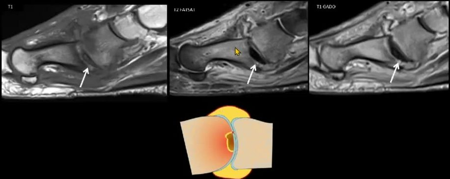
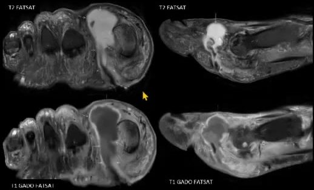
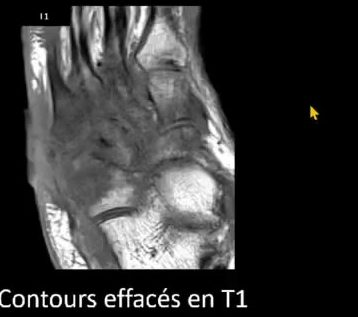

# Ostéoarthropathie neurogène du pied diabétique

> [!abstract] L'essentiel
> **Charcot = œdème osseux → fissure → fragmentation → effondrement** ; ostéite seulement si **ulcère + collection communicante + hyposignal T1 franc**.

> [!success] À retenir
> 1. Pied chaud et gonflé, radios normales : **IRM** → œdème péri-Lisfranc et fissures sous-chondrales = maintenir la **décharge** avant la déformation.
> 2. **Ghost sign** : contours osseux effacés en T1 (cuboïde, M5) = ostéoarthrite très probable ; **T1 respecté** + hypersignal T2 FS = « **œdème réactionnel non spécifique** ».
> 3. **Pied en piolet** : cuboïde en appui → ulcère plantaire = porte d'entrée ; zones de **nécrose** non rehaussées = risque de faux négatifs.

## Images clés
 [▶ 2:05](https://www.youtube.com/watch?v=tbr8QtdE6NY&t=125s)
 [▶ 5:35](https://www.youtube.com/watch?v=tbr8QtdE6NY&t=335s)
 [▶ 4:57](https://www.youtube.com/watch?v=tbr8QtdE6NY&t=297s)

## Points clés
- Association de lésions osseuses et articulaires secondaires à une atteinte du système nerveux central ou périphérique ; en Europe, au pied, essentiellement neuropathie diabétique (« pied de Charcot »).
- **Physiopathologie** : contraintes mécaniques sur une zone en souffrance → **œdème osseux** → fissure → fragment qui se nécrose ou se libère dans l'articulation → redistribution des contraintes → nouvelles fissures, fractures, destruction sous-chondrale → **effondrement articulaire**.
- **Phase aiguë** : pied chaud, gonflé, peu douloureux, chez un diabétique ancien mal équilibré avec neuropathie sensitive → mise en décharge immédiate par le diabétologue. Radiographie souvent normale ; IRM : œdème de part et d'autre du Lisfranc, fissures sous-chondrales débutantes.
- Stade suivant : fragments dévitalisés (base de M1), déformation sous-chondrale cunéométatarsienne → déformations débutantes à dépister sur **radiographies en charge**.
- **Pied en piolet** (*rocker-bottom*) : bascule antérieure du talus et du naviculaire, translation plantaire du médiopied, **cuboïde devenant surface d'appui** → hyperpression des parties molles → ulcération = porte d'entrée infectieuse.

## Sémiologie et technique d'imagerie
- **Infection** : porte d'entrée cutanée quasi indispensable, extension par contiguïté (collection, pertuis).
- Pied non déformé : **radiographies répétées** à quelques jours d'intervalle : ostéolyse marginale excentrée en regard de l'ulcère = ostéoarthrite. Sur Charcot préexistant : lyse corticale, perte de substance, apposition périostée en regard d'une ulcération.
- Médiopied : superpositions → **IRM**.
- **Signal T1 en contraste spontané** : hyposignal T1 profond dans l'infection, pouvant effacer les contours osseux (cuboïde, M5) visibles sur les autres séquences = ***ghost sign***, fortement suggestif d'ostéoarthrite.
- **Triade diagnostique IRM** : 1) ulcère, 2) collection communicante, 3) anomalies T1 prononcées avec petites érosions corticales.
- T1 respecté avec hypersignal T2 FS : parler d'**œdème réactionnel / non spécifique**, généralement non infectieux, d'évolution favorable.
- **Nécrose** (tissus plantaires, portion inférieure du cuboïde) : zone non rehaussée homogène à limite nette ; risque accru de **faux négatifs** (petites collections, ostéite) ; signal T1 ou Dixon graisse perturbé.

## Pièges et diagnostics différentiels
- Ne pas surdiagnostiquer une ostéite sur un hypersignal T2 isolé avec T1 normal.
- Zones nécrotiques masquant collection ou ostéite.

> [!WARNING] À ne pas manquer
> Un pied chaud et gonflé chez un diabétique neuropathe avec radiographies normales impose une IRM : l'œdème osseux précoce justifie le maintien de la décharge pour éviter la déformation.

> [!TIP] Pour le compte rendu
> Préciser le stade (œdème, fissures, fragmentation, déformation), la présence d'un ulcère, d'une collection communicante et d'un hyposignal T1 franc ; employer « œdème réactionnel non spécifique » si le T1 est préservé ; signaler les zones de nécrose.

## Liens
- Congrès : [[SIMS 2024 - Index]]
- Voir aussi : [[Cas clinique 1 - Ostéoarthropathie nerveuse diabétique révélatrice d'un diabète]], [[Arthrodèses de la cheville et de l'arrière-pied]], [[Les neuropathies du pied]]
