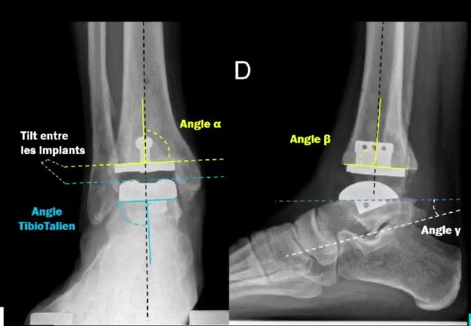
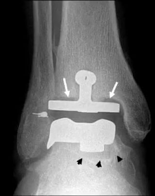
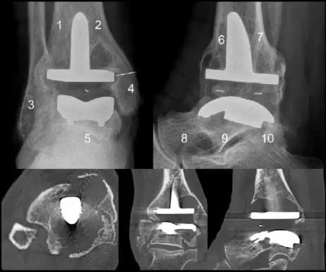

# Prothèse de cheville - imagerie normale et des complications

> [!abstract] L'essentiel
> **Suivre une prothèse de cheville = mesures angulaires reproductibles et comparaison systématique aux clichés antérieurs** : liserés et géodes sont les complications les plus fréquentes.

> [!success] À retenir
> 1. Mesures de suivi : **angle α** (implant tibial/axe tibial) et **tilt entre implants** de face, **angle β** (pente tibiale) et **γ** (implant talien) de profil → détecter une **migration** lente.
> 2. **Liseré ≥ 2 mm** = significatif ; convexe = **géode** → localiser en **10 zones** (radio + scanner/CBCT) ; géodes sous l'implant talien = risque d'**effondrement**.
> 3. Douleur aiguë : **fracture du polyéthylène** ; infection difficile à affirmer parmi les liserés → ponction, écho, scintigraphie aux leucocytes marqués.

## Images clés
 [▶ 7:17](https://www.youtube.com/watch?v=k4Q9c3z6Qb4&t=437s)
 [▶ 8:55](https://www.youtube.com/watch?v=k4Q9c3z6Qb4&t=535s)
 [▶ 9:10](https://www.youtube.com/watch?v=k4Q9c3z6Qb4&t=550s)

## Points clés
- **Implants actuels** : polyéthylène solidaire d'un implant (souvent tibial) = deux composants (majoritaires aujourd'hui en France), ou patin mobile intermédiaire = trois composants.
- **Bilan préopératoire** :
  - **Pangonométrie** : axe mécanique de tout le membre, et évaluation du tibia sur toute sa longueur (utile en cas de grosse déformation).
  - **Cheville** : classification de l'arthrose ; estimer l'**excentration du talus** par rapport à la charge tibiale (l'orateur propose une classification des arthroses varisantes dans un ouvrage).
  - **Face en charge avec repère talonnier** (fil métallique) : l'axe tibial doit passer entre le tiers médial et les deux tiers latéraux ; en cas de grosse déformation, utiliser la projection du centre du dôme par rapport au centre de l'appui talonnier (technique du quadrilatère).
  - **Trois angles** : angle médial distal du tibia ; tilt talien (tangente au plafond tibial / tangente au dôme) ; angulation du dôme par rapport à l'axe tibial.
  - **Profil** : angle de Djian-Annonier, axe/angle de Méary pour localiser les déformations associées.
  - **Clichés en stress** : réductibilité des déformations, laxité → ligamentoplastie ou résection de conflit associées.
  - Flexion/extension dynamiques : part de la talocrurale vs médiopied (axe de M1).
  - **Scanner** de planification (segmentaire ou tibia entier) ; **CBCT en charge** combinant statique et planification ; **IRM** pour le bilan tendinoligamentaire ; **scintigraphie** pour d'autres sites douloureux (subtalaire).
- **Postopératoire** : clichés initiaux sous plâtre, non en charge ; connaître les gestes associés (ligamentoplasties, résections, ostéotomies).
- **Mesures de suivi** : face → angle **alpha** (implant tibial / axe tibial), tilt entre implants, angle tibiotalien ; profil → angle **bêta** (implant tibial), horizontalisation et centrage de l'implant talien.
- Suivi par radiographies, scanner ponctuel pour les géodes ; le CBCT peut combiner les deux.

## Sémiologie et technique d'imagerie
- **Liserés périprothétiques et géodes** : très fréquents ; liseré significatif si ≥ 2 mm, géode quand il devient convexe ; géodes localisées en 10 zones (face : 1-2 versants de la pièce tibiale, 3 malléole fibulaire, 4 malléole tibiale, 5 talus ; profil : 6-7 avant/arrière de l'implant tibial, 8 tête du talus, 9-10 avant/arrière sous la pièce talienne) ; mécanisme mécanique démontré ; à décrire et surveiller (classification radiographique de Jean-Luc Besse, utilisable au scanner).
- **Migration** lente d'un implant : intérêt du suivi chiffré.
- **Effondrement** : géodes sous l'implant talien puis enfoncement, menaçant la survie prothétique.
- **Fracture du polyéthylène** : douleur aiguë, comparer aux clichés antérieurs.
- **Ossifications hétérotopiques** : fréquentes, rarement invalidantes.
- Conflits récidivants ou réduction insuffisante autour du matériel.

## Pièges et diagnostics différentiels
- **Infection** difficile à affirmer au milieu des liserés et géodes habituels : s'aider de la clinique, de l'échographie, de la ponction, de la scintigraphie aux leucocytes marqués, voire de l'IRM.

> [!WARNING] À ne pas manquer
> Géodes sous l'implant talien : risque d'effondrement ; comparer systématiquement aux examens antérieurs.

> [!TIP] Pour le compte rendu
> Donner les angles alpha, bêta, tilt et le centrage talien à chaque contrôle ; décrire et localiser liserés et géodes (taille, évolution), l'état du polyéthylène et les ossifications.

## Liens
- Congrès : [[SIMS 2024 - Index]]
- Voir aussi : [[Arthrodèses et prothèses de cheville - indications, techniques chirurgicales]], [[Les mesures 2D, comment et pourquoi, leurs limites]]
