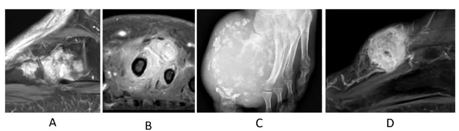
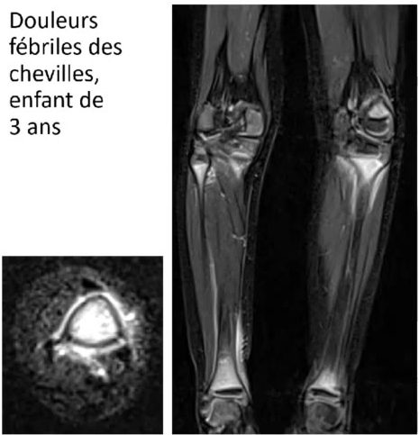
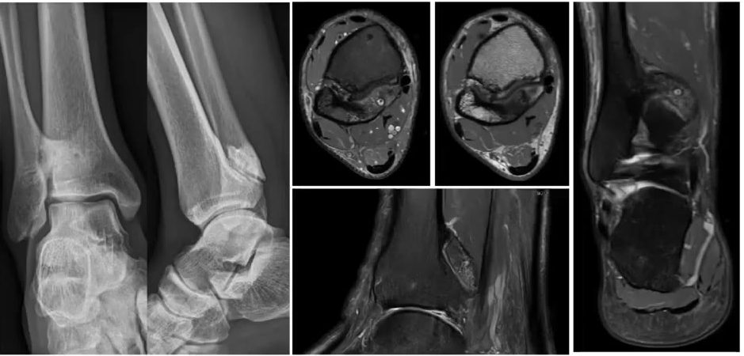

# QUIZ

> [!abstract] L'essentiel
> **Quiz « cogitolympique » d'imagerie du pied : tumeurs et pseudotumeurs, atteintes métaphysaires fébriles de l'enfant, séquelles de la syndesmose** : réponses non affichées, fiche bâtie sur les diapos.

> [!success] À retenir
> 1. Tumeurs et pseudotumeurs du pied à reconnaître : **goutte**, **Kaposi**, MOC, **tumeur mésenchymateuse sécrétant FGF23** (ostéomalacie oncogénique).
> 2. Enfant de **3 ans**, douleurs **fébriles** des chevilles, anomalies métaphysaires **bilatérales** en IRM : différentiel **OCRM**, **scorbut**, **leucémie aiguë**, ostéomyélite infectieuse, hypophosphatasie.
> 3. **Synostose tibiofibulaire distale** chez le footballeur : séquelle ossifiante d'une lésion de la syndesmose, à reconnaître en radiographie et IRM.

## Images clés
 [▶ 5:01](https://www.youtube.com/watch?v=gK3O0cIk5Oo&t=301s)
 [▶ 10:12](https://www.youtube.com/watch?v=gK3O0cIk5Oo&t=612s)
 [▶ 10:51](https://www.youtube.com/watch?v=gK3O0cIk5Oo&t=651s)

> [!NOTE]
> Pas de sous-titres disponibles : fiche établie à partir des diapositives, à compléter après visionnage (réponses du quiz).

## Liens
- Congrès : [[SIMS 2024 - Index]]
- Voir aussi : [[Cas clinique 1 - Ostéoarthropathie nerveuse diabétique révélatrice d'un diabète]], [[Cas clinique 2 - Neurofibrome plexiforme du pied dans une neurofibromatose de type 1]]
