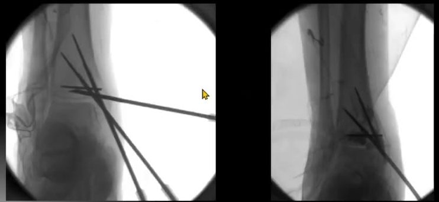
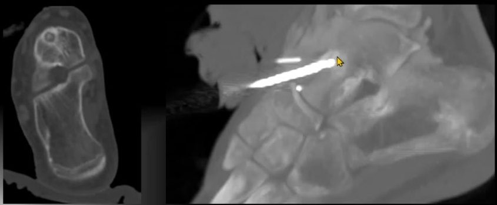
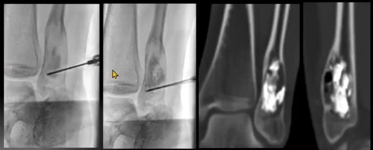

# Radiologie interventionnelle pied et cheville

> [!abstract] L'essentiel
> **Au pied, tout geste de RI est faisable si l'installation est stricte (strap, pied débordant) et les structures nobles protégées** : multi-guidage, hydrodissection, thermocapteur.

> [!success] À retenir
> 1. **Cryoablation** : AL possible, ~**30 min**, zone létale **−40/−20 °C** (glaçon à 0 °C visible), traverse la corticale ; **RF** : AG/sédation, **6-10 min**, marge nette, reste intra-osseuse (lésions lytiques).
> 2. Ostéome ostéoïde du talus : **écho + scanner + scopie**, hydrodissection, **thermocapteur intra-articulaire** (cartilage > +10 °C en cryo).
> 3. Métastase lytique : **ciment en compression + broches/vis en cisaillement** ; KOA : **sclérothérapie** percutanée ; embolisation de l'aponévropathie plantaire = technique encore évaluative.

## Images clés
 [▶ 4:01](https://www.youtube.com/watch?v=nYKu3LnX2l8&t=241s)
 [▶ 7:25](https://www.youtube.com/watch?v=nYKu3LnX2l8&t=445s)
 [▶ 11:32](https://www.youtube.com/watch?v=nYKu3LnX2l8&t=692s)

## Points clés
- **Installation** : souvent procubitus, pied débordant (aponévrose plantaire abordée par la face médiale) ou 3/4 genou fléchi exposant face médiale ou latérale ; contention par strap(s) indispensable ; fléchir le genou controlatéral pour limiter l'irradiation sous scanner.
- **Infiltrations** : sous échographie ou scopie, rarement scanner ; intra-articulaires, périnerveuses, (péri)tendineuses ; voies antéro-supérieure, latérale ou postérieure.
- **Consolidation** (femme 62 ans, métastase ostéolytique de la malléole médiale, cancer urothélial) : décubitus latéral, scanner-scopie, anesthésie locale, broches + cimentoplastie. PMMA efficace en compression ; ostéosynthèse (broches, vis) meilleure en cisaillement ; guidage CBCT ou scanner.
- **Ostéome ostéoïde du col du talus** (garçon 12 ans) : pied controlatéral fléchi, strapping, triple guidage écho-scanner-scopie (l'échographie repère les tendons à l'introduction), hydrodissection au contraste dilué, biopsie puis ablation ; en cryoablation, thermocapteur dans l'articulation talo-naviculaire pour maintenir le cartilage au-dessus de +10 °C.
- **Cryo vs radiofréquence** : cryo sous anesthésie locale, mieux tolérée mais longue (~30 min), glaçon visible (0 °C au bord, zone létale à −40 °C ou −20 °C en deux cycles), traverse la corticale, préférée pour lésions condensantes ; RF plus courte (~10 min), sédation/AG, abaque nette, reste intra-osseuse (protège peau et nerfs), efficace sur lésions lytiques.
- **Kyste osseux anévrismal de la fibula distale** (14 ans) : abord direct à l'aiguille si corticale fine ou trocart, injection de sclérosant (polidocanol possible ; Discogel à Saint-Étienne) ; la sclérothérapie s'adresse à certaines lésions osseuses bénignes (kystes anévrismaux notamment).
- **Embolisation MSK** (femme 48 ans, aponévropathie plantaire proximale réfractaire) : microcathéter 1,7 dans l'artère tibiale postérieure, blush néovasculaire, embolisation sélective des feeders par émulsion lipiodol-contraste (développée par le Pr Sapoval). Technique d'Okuno (imipénem, peu autorisé en France) ; alternatives : microsphères résorbables, particules d'alginate ; billes non résorbables déconseillées (anastomoses, risque digital). Petites séries (aponévropathie plantaire, tendinopathie calcanéenne), meilleure efficacité sur douleurs inflammatoires ; groupe d'étude avec la SFICV.

## Sémiologie et technique d'imagerie
- Infiltration de l'aponévrose : piquer médialement, le plus haut possible, en évitant la sole plantaire.

## Pièges et diagnostics différentiels
- Discussion : l'aponévropathie est souvent liée à un raccourcissement du complexe suro-achilléo-plantaire (talonnette efficace) ; le fascia est peu inflammatoire ; le nerf de Baxter passe sous l'insertion proximale → mise en garde d'un intervenant contre les corticoïdes dans aponévroses et tendons ; aucune preuve pour le PRP.

> [!WARNING] À ne pas manquer
> Thermoablation au pied : risque de brûlure/gelure cutanée, nerveuse, tendineuse et chondrale ; hydrodissection, guidage échographique et monitorage thermique du cartilage.

> [!TIP] Pour le compte rendu
> Tracer installation, guidage, protections (hydrodissection, thermocapteur), paramètres d'ablation et contrôle final ; pour l'embolisation, préciser le caractère encore évaluatif de la technique.

## Liens
- Congrès : [[SIMS 2024 - Index]]
- Voir aussi : [[Fascia plantaire]], [[Démembrement des atteintes distales du tendon calcanéen]]
