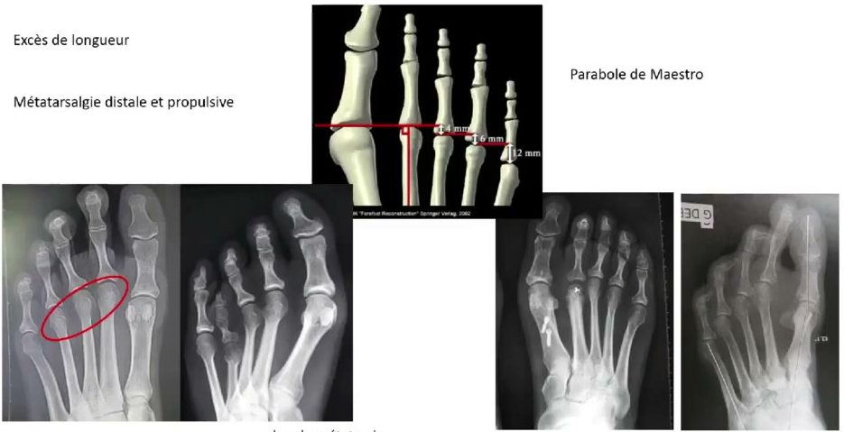
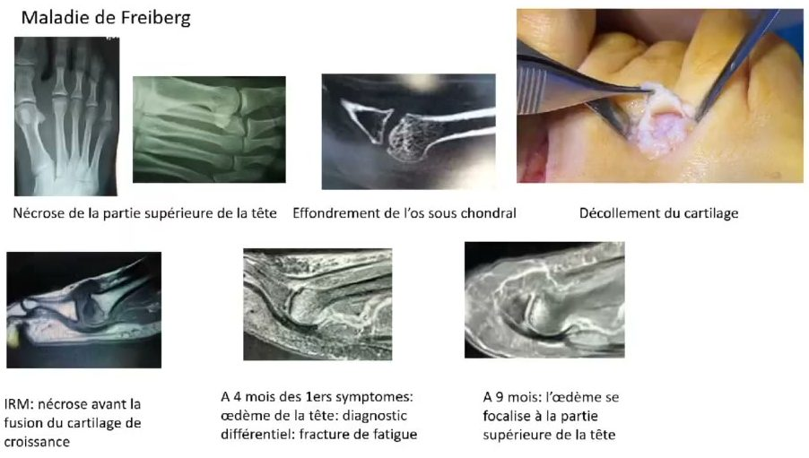

# Rayons latéraux - pathologies et traitements

> [!abstract] L'essentiel
> **Métatarsalgie des rayons latéraux = trouble mécanique à identifier (longueur, pente, équin, 1er rayon)** : on traite la cause, pas seulement la lésion (plaque plantaire, Morton).

> [!success] À retenir
> 1. **Parabole de Maestro** : M1 = M2 puis écarts **4-6-12 mm** jusqu'à M5 ; excès de longueur → lésion de **plaque plantaire** (réparation isolée = échec, corriger par recul métatarsien).
> 2. **Morton** : 3e espace ; infiltration **échoguidée, non intra-articulaire, jamais isolée, jamais au 2e espace** ; neurectomie **≥ 93 %** de bons résultats mais dysesthésies **40-70 %**.
> 3. « Névrome du **2e espace** » → chercher lésion de plaque plantaire et instabilité MTP ; **Freiberg** : œdème diffus de la tête à 4 mois (≠ fracture de fatigue), focalisé au pôle supérieur à 9 mois.

## Images clés
 [▶ 0:44](https://www.youtube.com/watch?v=5XEkU4DNTxg&t=44s)
 [▶ 9:51](https://www.youtube.com/watch?v=5XEkU4DNTxg&t=591s)

## Points clés
- **Métatarsalgies statiques** = excès d'appui ; conséquences : bursites, durillons, névromes, tendinites des fléchisseurs, lésions de plaque plantaire, déformations d'orteils.
- Causes : excès de longueur (parabole de Maestro : M1 = M2 puis progression géométrique de raison 2 jusqu'à M5, « 3-6-12 » ou « 4-6-12 » ; constitutionnel — 1er rayon court, pied grec, brachymétatarsie — ou iatrogène), excès de pente (pied creux, angle < 120°, cassure de la ligne de Méary ; ou iatrogène : tête plongeante, cal vicieux en flexion plantaire), rétraction des gastrocnémiens.
- Rétraction des gastrocnémiens : métatarsalgie propulsive distale, radiographie souvent normale, test de Silfverskiöld (équin genou tendu réductible genou fléchi) ; traitement par étirements ou section des fibres blanches du gastrocnémien médial au creux poplité.
- Ostéotomies : Weil ouverte fixée par vis (grands reculs) ; DMMO percutanée non fixée (petits reculs, toujours sur plusieurs métatarsiens). En imagerie postopératoire : ostéotomie quasi invisible au départ, puis cal ; déplacements, retards de consolidation fréquents et souvent asymptomatiques (ex. 18 mois).
- **Pathologies du 1er rayon** : décompensation d'hallux valgus (rupture de plaque plantaire, luxation MTP) ; hyperlaxité cunéo-métatarsienne (élévation de M1 sur profil en charge, surcharge de M2) traitée par arthrodèse cunéo-métatarsienne.
- **Plaque plantaire** : réparations isolées = échecs (sauf traumatiques) ; traiter la disharmonie de longueur par recul ; PRP tenté au stade précoce (Mérignac), avec strapping et semelles.
- **Morton** : neuropathie canalaire mécanique du 3e espace (jonction pied talien rigide / pied calcanéen mobile) ; clinique typique (caillou, chaussette pliée, squeeze test, signe de Mulder). Hallux limitus fonctionnel (effet ténodèse du long fléchisseur de l'hallux dans sa poulie, visible en échographie) → supination de l'avant-pied.
- Névrome du 2e espace : souvent secondaire (3e rayon long, valgus du 3e orteil, varus du 2e orteil supraductus, lésion de plaque plantaire) ; rechercher l'instabilité verticale MTP (tiroir).
- Déformations d'orteils : classification AFCP (chiffre = orteil ; trois lettres = MTP, IPP, IPD en extension, flexion ou neutre).
- **Freiberg** : nécrose de la partie supérieure de la tête avec décollement cartilagineux ; traitement par ostéotomie de Gauthier (résection + ostéotomie de flexion dorsale à charnière plantaire).
- **5e rayon** : quintus varus supraductus (souvent congénital) et bunionette (3 types : divergence M4-M5, condyle latéral saillant, M5 en lame de sabre) ; chirurgie percutanée = gold standard.

## Sémiologie et technique d'imagerie
- Radiographies en charge : parabole métatarsienne, pente, ligne de Méary, élévation de M1 sur le profil.
- Freiberg : décollement cartilagineux mal vu en IRM/échographie ; l'arthroscanner MTP pourrait aider.

## Pièges et diagnostics différentiels
- Freiberg vs fracture de fatigue distale : l'œdème initialement étendu se focalise avec le temps, savoir attendre.
- Infiltration du Morton : échoguidée, non intra-articulaire, jamais isolée ni dans le 2e espace.
- Traitement chirurgical du Morton : neurectomie (bons résultats ≥ 93 %, échecs 8 à 30 %, dysesthésies 40 à 70 %), neurolyse ouverte (bons résultats > 85 %), percutanée (section du ligament intermétatarsien ± ostéotomies) ou endoscopique.

> [!WARNING] À ne pas manquer
> Un « névrome du 2e espace » doit faire rechercher une lésion de plaque plantaire et une disharmonie de longueur métatarsienne.

> [!TIP] Pour le compte rendu
> Mentionner formule métatarsienne, état des plaques plantaires, espaces intermétatarsiens pincés, signes de rétraction/équin et, en postopératoire, consolidation des ostéotomies et déplacements.

## Liens
- Congrès : [[SIMS 2024 - Index]]
- Voir aussi : [[IRM d'une métatarsalgie centrale]], [[Faire une écho de l'avant-pied]], [[Imagerie de l'avant-pied opéré]]
