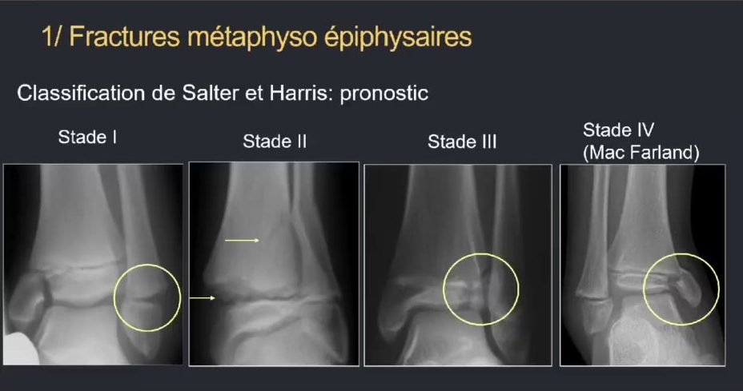
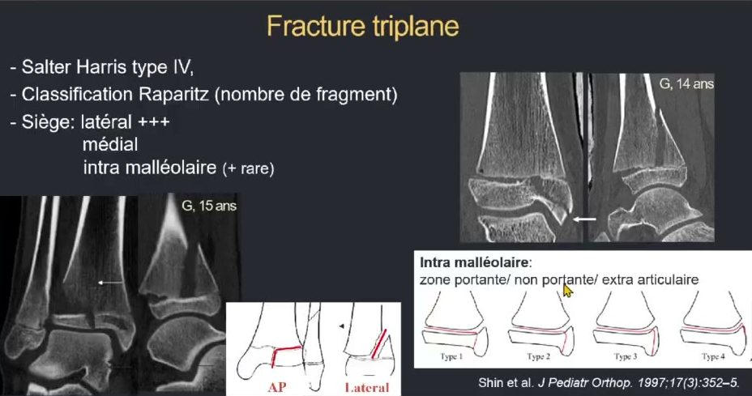
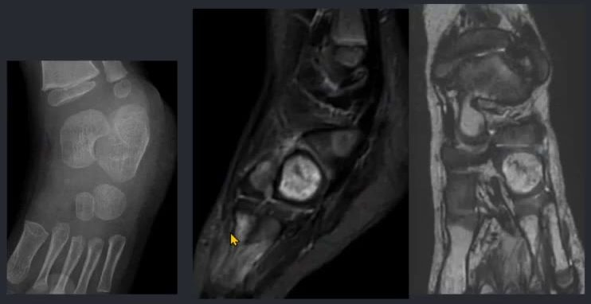

# Spécificités de la cheville et du pied traumatiques de l'enfant et de l'adolescent

> [!abstract] L'essentiel
> **Chez l'enfant, la physe est le point faible : classer en Salter-Harris, reconnaître triplane et Tillaux, et passer à l'IRM devant une boiterie** à radiographie normale.

> [!success] À retenir
> 1. **Salter-Harris** (I à IV, McFarland = IV de la malléole médiale) : les hauts grades exposent à l'**épiphysiodèse** (inégalité de longueur, déviation axiale).
> 2. Fusion physaire tibiale **centrale → médiale → latérale** : **triplane** (SH IV, compter les fragments au **scanner**) et **Tillaux** à l'adolescence ; Salter I de la malléole latérale ≈ entorse, diagnostic surtout clinique.
> 3. Jeune enfant qui boite : fracture occulte de **faible énergie** (calcanéus, **cuboïde**) → **IRM** ; ne pas prendre **noyaux accessoires** et **îlots de moelle rouge** (< 15 ans) pour du pathologique ; synostose du tarse **bilatérale 1 fois sur 2**.

## Images clés
 [▶ 3:16](https://www.youtube.com/watch?v=vE4Dkkh4Axw&t=196s)
 [▶ 4:58](https://www.youtube.com/watch?v=vE4Dkkh4Axw&t=298s)
 [▶ 6:15](https://www.youtube.com/watch?v=vE4Dkkh4Axw&t=375s)

## Points clés
- **Développement** : maquettes cartilagineuses prédominantes (résistance élastique), noyaux d'ossification primaires puis secondaires, nombreux **noyaux accessoires** (ronds/ovalaires, bords lisses corticalisés, topographie typique, sans épaississement des parties molles ; ex. base de M5 à orientation longitudinale). En cas de doute : atlas des variantes.
- **Cheville normale** : espaces physiologiquement larges (espace tibiofibulaire, espace clair médial) qui se réduisent avec la croissance ; chevauchement tibiofibulaire avant l'adolescence.
- **Fermeture asymétrique de la physe tibiale distale** : centrale, puis médiale, puis latérale → **fracture triplane** (début de fusion, torsion) et **fracture de Tillaux** (fin de croissance, persistance latérale).
- **IRM du tarse < 15 ans** : plages ponctiformes mal limitées hyper-STIR/hypo-T1 = îlots de moelle hématopoïétique résiduelle périvasculaires, à ne pas prendre pour du pathologique.
- **Traumatologie aiguë** : ~13 % des traumatismes ostéoarticulaires de l'enfant. **Critères d'Ottawa** applicables dès 5 ans, très sensibles, réduisent d'environ un tiers les radiographies.
- **Salter-Harris** (pronostique) : I décollement physaire ; II trait métaphysaire ; III trait épiphysaire (intra-articulaire) ; IV transphysaire (ex. malléole médiale, type McFarland). Risque d'**épiphysiodèse** : arrêt de croissance ou déviation axiale si le pont est latéralisé.
- **Salter I non déplacée de la malléole latérale** vs entorse : différenciation surtout clinique (point douloureux physaire). Les entorses existent chez le grand enfant, plus fréquentes qu'on ne le pensait.
- **Triplane** = Salter-Harris IV, classée selon le nombre de fragments ; variantes intramalléolaires (zone portante, non portante, extra-articulaire).
- **Pied** : fractures de faible énergie chez le jeune enfant (calcanéus après chute de toboggan, souvent extra-articulaires, meilleur pronostic que chez l'adulte ; cuboïde) ; trame hétérogène, radiographies peu contributives, diagnostic sur IRM/scanner lors d'un bilan de boiterie. Avant-pied : métatarsiens (base de M5 à trait perpendiculaire à la diaphyse ; M2-M4 souvent associés), phalanges.
- **Microtraumatique** : fractures de contrainte (métatarsiens, calcanéus) chez le jeune marcheur ou le sportif ; radiographies normales au début, puis appositions périostées ou bande de condensation ; IRM plus précoce.
- **Ostéochondroses** : apophyse calcanéenne (maladie de Sever) : fragmentation/condensation et œdème possiblement physiologiques ; l'imagerie sert surtout à éliminer un diagnostic différentiel. Épiphysaires : naviculaire, talus.
- **Lésions ostéochondrales du talus** : à partir de 10 ans, enfant sportif, dôme médial ; IRM pour la stabilité du fragment et le cartilage.
- **Synostoses du tarse** (calcanéonaviculaire, mieux vue sur le 3/4 ; talocalcanéenne) : entorses à répétition, révélation à l'adolescence, bilatérales dans 1 cas sur 2 ; IRM pour composante fibreuse ou cartilagineuse et œdème.
- **Os naviculaire accessoire** (bord médial) ; **os trigone** et syndrome du carrefour postérieur.

## Sémiologie et technique d'imagerie
- Radiographies ciblées selon Ottawa ; IRM en cas de boiterie inexpliquée, apyrétique, sans syndrome inflammatoire.

## Pièges et diagnostics différentiels
- Noyaux accessoires vs fracture ; moelle résiduelle vs lésion ; Sever d'aspect physiologique.

> [!WARNING] À ne pas manquer
> Grande fragilité du cartilage de croissance : décrire tout trait physaire, car les Salter élevés exposent à l'épiphysiodèse.

> [!TIP] Pour le compte rendu
> Classer selon Salter-Harris, signaler les fractures de transition (triplane, Tillaux) et compter les fragments ; en cas de boiterie, une IRM normale ou montrant un trait occulte oriente la suite.

## Liens
- Congrès : [[SIMS 2024 - Index]]
- Voir aussi : [[Les lésions ostéochondrales du dôme talien]], [[Cas clinique 3 - Turf toe et instabilité métatarsophalangienne du premier rayon chez un adolescent]]
