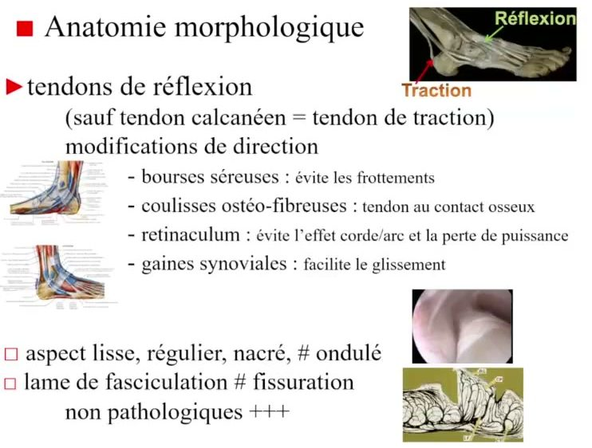
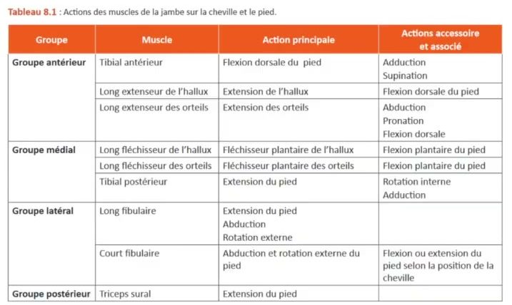

# Tendons de la cheville - à quoi ça sert, comment ça marche ?

> [!abstract] L'essentiel
> **9 tendons en 4 groupes, organisés en couples agoniste-antagoniste, assurent locomotion, statique et équilibre (« stratégie de cheville »)** : raisonner en groupe fonctionnel devant une rupture.

> [!success] À retenir
> 1. Tous sauf le **tendon calcanéen** (traction) sont des **tendons de réflexion** : bourses, coulisses, rétinaculums et gaines sont leurs points faibles.
> 2. **Lames de fasciculation** intratendineuses = aspect normal, à ne pas prendre pour une **fissuration**.
> 3. Tendon calcanéen ≈ **9 kN** (≈ **12 × le poids du corps**) mais zone physiologique limitée à **~3 %** d'étirement ; une rupture se juge aussi sur la perte des **actions accessoires**.

## Images clés
 [▶ 1:50](https://www.youtube.com/watch?v=iz0HHx2KuUU&t=110s)
 [▶ 3:11](https://www.youtube.com/watch?v=iz0HHx2KuUU&t=191s)

## Points clés
- L'unité muscle-tendon-enthèse est une unité fonctionnelle mécanique, physiologique et neurophysiologique, pas un simple relais.
- Embryologie : origine mésenchymateuse, apparition des tendons à la 6e semaine (tendons distaux à la 7e semaine) (membre supérieur avant inférieur, fléchisseurs avant extenseurs).
- Neuf tendons, quatre groupes : antérieur (tibial antérieur, long extenseur de l'hallux, long extenseur des orteils), médial (tibial postérieur, long fléchisseur de l'hallux, long fléchisseur des orteils, proches du pédicule vasculo-nerveux), latéral (long et court fibulaires), postérieur (tendon calcanéen, intégré au complexe suro-achilléo-plantaire).
- Tous sauf le tendon calcanéen sont des tendons de réflexion → structures d'adaptation : bourses, coulisses ostéofibreuses, rétinaculums, gaines synoviales.
- Actions principales en couples (flexion plantaire : triceps ; antagoniste : tibial antérieur, de force très inférieure) et actions accessoires (ex. tibial antérieur également adducteur et supinateur), révélées lors des ruptures.
- Composition : environ 30 % de collagène (surtout type I), 2 % d'élastine, 60 % d'eau ; ténocytes et ténoblastes ; vascularisation faible, augmentée à l'effort.
- Le tendon calcanéen résiste à environ 9 kN (≈ 12 fois le poids du corps) ; phase physiologique limitée à ~3 % d'étirement, au-delà apparaissent les lésions ; compliance supérieure du triceps par rapport au tibial antérieur.
- Mécanorécepteurs de Golgi (type III) à la jonction myotendineuse : régulation de la contraction et coordination ; la cheville est la seule région où neuf tendons fonctionnent en synergie permanente.
- Stratégies d'équilibre : cheville (pendule inversé, automatique, peu coûteuse en énergie ; alternance triceps / releveurs), hanche, pas, genoux (abaissement du centre de gravité).

## Sémiologie et technique d'imagerie
- Les lames de fasciculation intratendineuses peuvent donner des images de fissuration non pathologiques.

## Pièges et diagnostics différentiels
- Ne pas interpréter comme fissure un aspect fasciculé normal.
- Prudence chirurgicale au groupe médial (pédicule tibial postérieur), surtout dans les grandes déformations neuro-motrices.

> [!WARNING] À ne pas manquer
> Au-delà d'environ 3 % d'étirement, le tendon sort de sa zone physiologique : la marge de sécurité mécanique est faible malgré une résistance élevée.

> [!TIP] Pour le compte rendu
> Raisonner en groupe fonctionnel et en couple agoniste-antagoniste pour expliquer le retentissement clinique d'une rupture (perte des actions accessoires).

## Liens
- Congrès : [[SIMS 2024 - Index]]
- Voir aussi : [[Tendons fibulaires et leurs retinacula]], [[Le tibial postérieur]], [[Démembrement des atteintes distales du tendon calcanéen]]
