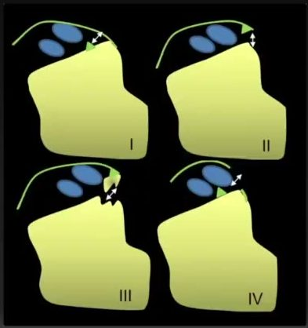
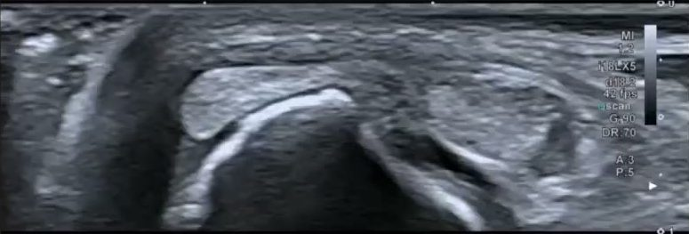
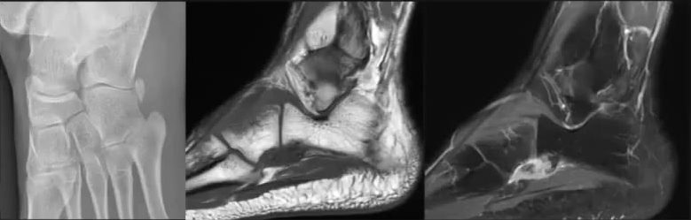

# Tendons fibulaires et leurs retinacula

> [!abstract] L'essentiel
> **Derrière une « entorse latérale », penser fibulaires** : radio (arrachement malléolaire, os peroneum) puis **échographie statique et dynamique**, examen roi.

> [!success] À retenir
> 1. **Luxation des fibulaires** = lésion du **rétinaculum supérieur** (classification d'**Oden I-IV** ; III = arrachement osseux visible en radio) → traitement **chirurgical**.
> 2. **Écho dynamique** en éversion contrariée : (sub)luxation, **twist** intra-gaine (jeune fille), fissure longitudinale du court fibulaire (sujet âgé, Sobel).
> 3. **POPS** : fracture/diastasis de l'os peroneum ; **migration proximale de l'os peroneum = rupture du long fibulaire** ; IRM en 2e intention.

## Images clés
 [▶ 5:36](https://www.youtube.com/watch?v=hvrskyFoXpY&t=336s)
 [▶ 6:23](https://www.youtube.com/watch?v=hvrskyFoXpY&t=383s)
 [▶ 8:43](https://www.youtube.com/watch?v=hvrskyFoXpY&t=523s)

## Points clés
- Anatomie : court fibulaire → base de M5 ; long fibulaire → tunnel sous-cuboïdien, face inférieure du cunéiforme médial et base de M1 ; os peroneum dans le long fibulaire distal. Gaine commune puis gaines propres à hauteur du calcanéus.
- Rétinaculum supérieur des fibulaires (malléole latérale → tubérosité calcanéenne postérieure et tendon calcanéen) ; rétinaculum inférieur (sinus du tarse → face latérale du calcanéus).
- Repères : petit triangle fibrocartilagineux à l'insertion malléolaire du rétinaculum supérieur ; court fibulaire aplati distalement ; tubercule des fibulaires séparant les gaines propres.
- Variantes : peroneus quartus (véritable « 3e fibulaire », sur l'éminence rétro-trochléaire), « troisième fibulaire » (en fait extenseur, base de M5), jonction myotendineuse basse du court fibulaire.
- **Ténopathies / ténosynovites** : douleur postéro-latérale à l'effort (course, danse) ; favorisées par un tubercule fibulaire proéminent, un muscle court fibulaire bas ; traitement médical ± infiltrations échoguidées.
- **Subluxations / luxations** : lésion du rétinaculum supérieur (dorsiflexion forcée, arrière-pied en inversion) ; classification d'Oden en 4 grades selon la désinsertion du rétinaculum (avec le triangle fibrocartilagineux), sa rupture ou l'arrachement osseux malléolaire ; traitement en règle chirurgical (réparation, creusement malléolaire, lambeau périosté, transfert).
- **Twist** (plutôt jeune fille) : interversion des deux tendons dans la gaine avec rétinaculum intact ; type A intra-gaine, type B avec fissure du court fibulaire.
- **Fissures / ruptures** : aiguës chez le jeune, chroniques chez le sujet âgé (laxité rétinaculaire ou compression du court fibulaire entre malléole et long fibulaire) ; classification de Sobel ; PRP non validé.
- **POPS** (painful os peroneum syndrome) : fracture aiguë/chronique ou diastasis d'un os peroneum multipartite, rupture du long fibulaire, hypertrophie du tubercule fibulaire.

## Sémiologie et technique d'imagerie
- Radiographie indispensable : arrachement osseux malléolaire (lésion du rétinaculum), pied en charge (os peroneum, pied cavo-varus) ; migration proximale de l'os peroneum = rupture du long fibulaire.
- Échographie statique, dynamique (éversion contrariée), comparative ; rétinaculum normal fin et hypoéchogène ; Doppler pour l'hyperhémie de la gaine.
- Scanner peu utilisé (reliefs osseux) ; IRM en 2e intention (œdème osseux, lésions complexes, nerf sural déformé dans un rétinaculum épaissi).

## Pièges et diagnostics différentiels
- Schwannome du nerf sural comprimant les fibulaires ; désinsertion myotendineuse distale du long fibulaire (rare).
- Un 3e « fibulaire » extenseur ne doit pas être pris pour une fissure.

> [!WARNING] À ne pas manquer
> Un « simple » diagnostic d'entorse latérale peut masquer une luxation des fibulaires, dont la prise en charge est chirurgicale.

> [!TIP] Pour le compte rendu
> Préciser état du rétinaculum supérieur (épaississement, désinsertion, arrachement), instabilité dynamique, fissure (grade), variantes favorisantes et os peroneum.

## Liens
- Congrès : [[SIMS 2024 - Index]]
- Voir aussi : [[Entorses latérales de cheville - traitement médical et chirurgical]], [[Tendons de la cheville - à quoi ça sert, comment ça marche]], [[Rayons latéraux - pathologies et traitements]]
